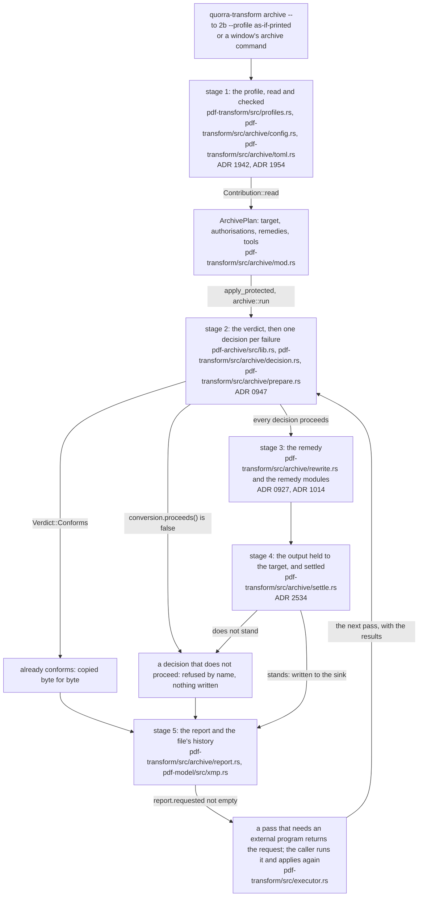
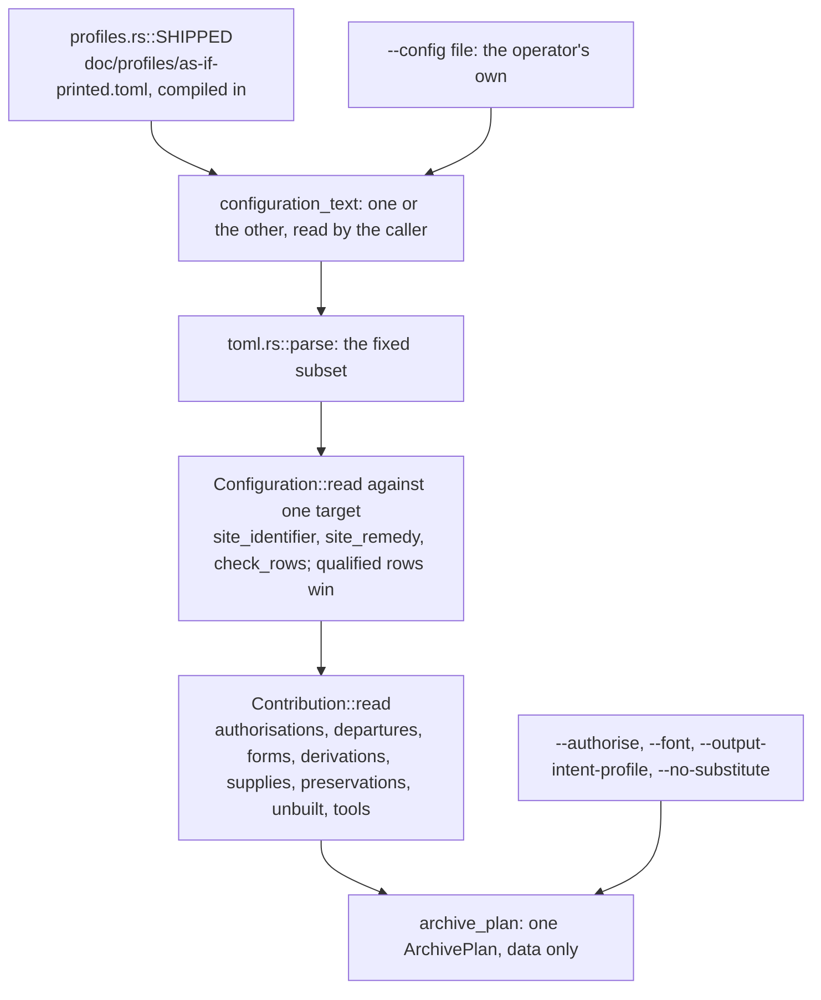
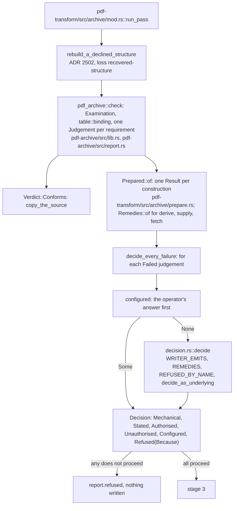
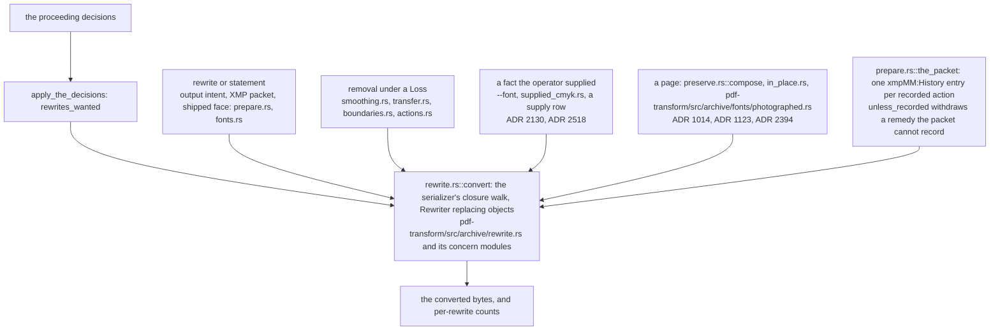
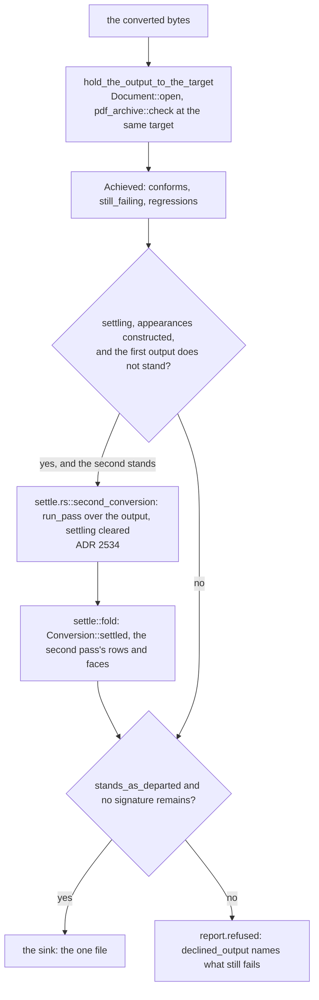
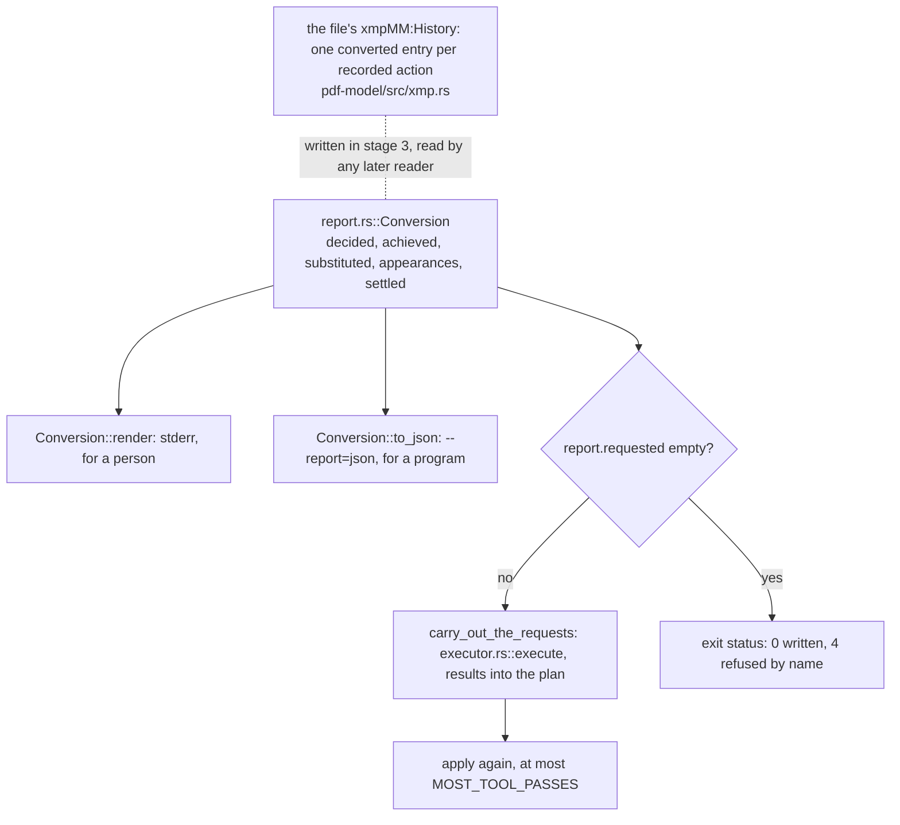

# How a document becomes PDF/A

Status: **standing** — a walk, not a reference. Read by: a student, or a new contributor, who has
followed [how a page lands on the screen](how-a-page-lands-on-the-screen.md) and now wants to follow
what the program does when a person asks for a document *archived*: the profile that answers its
refusals in advance, the validator's verdict, the decision taken at each requirement the document
fails, the remedy that carries the decision out, the second look at the output, and the report that
says what was done. `doc/crate-map.md` says what each crate is responsible for; this says what
happens **in order**.

**It describes the converter as of commit 0c34fee4** — the code `pdf-transform` and `pdf-archive`
held when this walk was drawn. What comes next is RFC 0014,
`doc/rfc/0014-a-profile-answers-each-site-in-order-and-states-what-it-could-not-keep.md`:
an ordered `try` list per site, a page appended to state what a loss took, `derive` widened to an
external program's conversion, and the operator's own profile beside the shipped ones. When those
land, stage 1 and stage 3 below are the sections to redraw (see
[Keeping this document true](#keeping-this-document-true)).

**This document is checked and it is also allowed to be wrong, and those two facts are the reason
for its last section.** `tools/conformance/tests/teaching.rs` holds every path and every
`file::name` pair it writes to a file that exists and a name the file contains, and every ADR it
cites to a record. It cannot hold a *sentence* true: when a round moves a stage, the sentence about
the stage is the round's to redraw. Each diagram below ends with a **Maintenance note** that says
which files and records it depends on, so the round that changes one knows which diagram it has
made stale.

**One rule about quotation runs through all of it.** ISO 19005-2 and ISO 19005-4 are licensed to a
single reader, so nothing in this tree quotes them — not the code, not the profiles, not this walk.
A requirement is named by the identifier `pdf-archive` gives it (`fonts/font-programs-embedded`)
and cited by section; `doc/pdfa/` is where a reader opens the text. ISO 32000-2 is cited the usual
way, with a `§`.

## The running example

A one-page invoice, the least a document needs to exercise every stage: a filled rectangle and a
line of text in `DeviceRGB`, the text set in `Helvetica` with no font program embedded, a 2×1 image
with `/Interpolate true`, and a free-text annotation saying *Paid in full* whose producer wrote its
default appearance string (Table 177 makes `/DA` required) but no appearance stream. There is no
output intent and no XMP packet.

```text
1 0 obj  << /Type /Catalog /Pages 2 0 R >>
3 0 obj  << /Type /Page /Parent 2 0 R /MediaBox [0 0 612 792] /Contents 4 0 R /Annots [7 0 R]
            /Resources << /Font << /F1 5 0 R >> /XObject << /Im1 6 0 R >> >> >>
4 0 obj  stream
           q 0.8 0 0 0.2 rg 72 640 200 30 re f Q
           BT /F1 18 Tf 0 0 1 rg 72 700 Td (Invoice 2026-10) Tj ET
           q 40 0 0 40 300 640 cm /Im1 Do Q
5 0 obj  << /Type /Font /Subtype /Type1 /BaseFont /Helvetica /Encoding /WinAnsiEncoding >>
6 0 obj  << /Type /XObject /Subtype /Image /Width 2 /Height 1 /ColorSpace /DeviceRGB
            /BitsPerComponent 8 /Interpolate true … >>
7 0 obj  << /Type /Annot /Subtype /FreeText /Rect [72 560 300 600] /F 4
            /Contents (Paid in full) /DA (/Helv 12 Tf 0 g) >>
```

The request is one command line, and the walk follows it:

```text
quorra-transform archive invoice.pdf --to 2b --profile as-if-printed -o invoice-2b.pdf
```

Every string quoted from the report below was read off that run; the output it wrote, held to
PDF/A-2b by veraPDF as well as by this tree's own validator, passes. The same file converted with no
profile is **refused**, with exit status 4 and the line

```text
refused: graphics/image-interpolation-is-off (ISO 19005-2 section 6.2.8.1): not done, because it
loses something nobody authorised: … --authorise image-smoothing allows it
```

— which is the whole design in one sentence: the converter knew the remedy, the remedy loses
something, and nobody had said that loss was acceptable.

## The whole walk

Five stages. The first is *asking*: a profile is a refusal answered in advance, read by the caller
and handed in as data. The second is *judging*: the validator holds the document to the target, and
every requirement it fails gets one decision. The third is *doing*: the decisions become rewrites of
the document's objects, a removal, a fact the operator supplied, or a page appended. The fourth is
*checking*: the output is validated again, and where the conversion built content no earlier pass
saw it is converted once more. The fifth is *telling*: the report, for a person and for a program,
and the file's own history.



**Maintenance note.** Depends on: `crates/pdf-transform/src/profiles.rs`,
`crates/pdf-transform/src/archive/config.rs`, `crates/pdf-transform/src/archive/mod.rs`,
`crates/pdf-archive/src/lib.rs`, `crates/pdf-transform/src/archive/decision.rs`,
`crates/pdf-transform/src/archive/prepare.rs`, `crates/pdf-transform/src/archive/rewrite.rs`,
`crates/pdf-transform/src/archive/settle.rs`, `crates/pdf-transform/src/archive/report.rs`,
`crates/pdf-transform/src/bin/quorra-transform.rs` and ADR 0947. Redraw it when a stage is added
or two merge — RFC 0014's ordered answer is the first candidate — when an output is written without
being validated again, or when `apply` starts a process of its own. The rule it draws — **nothing is
changed that no failed requirement asked for, and no file is written that does not conform** — is
ADR 0947's, and it is the one to keep true above all.

## Stage 1 — the profile, read and checked (`pdf-transform`)

**Question answered:** how does a person say, before the run, what the conversion may lose — and
who reads what they said?

A conversion runs unattended — in a batch, in a window that should not stop to ask — and a refusal
would mean somebody has to come back. RFC 0007's reframe is that **a refusal is a question the
converter asks, so its answer can be written down in advance**, in a file. That file is a *profile*.

1. **Where the text comes from.** `as-if-printed` is one of the profiles this program ships:
   `crates/pdf-transform/src/profiles.rs::SHIPPED` holds each one's name and its text, compiled in
   from `doc/profiles/` by `include_str!`, so a profile named by its name works wherever the program
   is installed, and the command line and a window offer the same list (ADR 1954;
   `crates/viewer-host/src/archiving.rs` is the window's side). `--config <file>` names the
   operator's own instead; `crates/pdf-transform/src/bin/quorra-transform.rs::configuration_text`
   reads one or the other and refuses both at once. **The file is read by the caller**, never by
   the library: `apply` opens no path, reads no clock and starts no process, so the configuration
   reaches it as data, exactly as the document's own restrictions' `Policy` does.
2. **The text becomes rows.** `crates/pdf-transform/src/archive/toml.rs::parse` reads the small
   fixed subset of TOML a configuration is written in, and
   `crates/pdf-transform/src/archive/config.rs::Configuration` is what `Configuration::read` makes
   of it, against the one target the run asks for. A `[profile]` table names the profile and its
   one sentence, and its `default` may only be `stop` — a default of anything else would authorise
   a loss at every site at once. Each `[site."<requirement>"]` table is one row:
   `site_identifier` holds the name to a requirement `pdf_archive`'s tables define, `site_remedy`
   to the five words of `crates/pdf-transform/src/archive/config.rs::Kind` (`stop`, `discard`,
   `preserve`, `derive`, `supply`), and `check_rows` to the keys and tools the remedy needs. A row
   qualified `.target."4f"` wins its site over the unqualified one whatever order the file wrote
   them in. A site the target does not bind is not an error — the refusal never arises there —
   which is why one profile serves all six targets.
3. **The rows become the plan's inputs.**
   `crates/pdf-transform/src/profiles.rs::Contribution` splits the configuration into what a
   conversion consumes: `authorisations` (a `discard` at a site the decision table answers with a
   loss *is* `--authorise <that loss>`, read off the same table by `loss_sites`), the departures,
   the form answers, the `derive`, `supply` and `preserve` rows, the tools they declare, and
   `unbuilt` — the sites the profile answers with a remedy this version does not carry out, which
   the command line names on its error stream so an operator sees the intent was read.
   `crates/pdf-transform/src/bin/quorra-transform.rs::archive_plan` folds them, and each
   `--authorise` flag, into one `crates/pdf-transform/src/archive/mod.rs::ArchivePlan`.

The example's profile answers two of the invoice's sites. Both are `discard`:

```toml
[site."graphics/image-interpolation-is-off"]
remedy = "discard"

[site."fonts/font-programs-embedded"]
remedy = "discard"
```

The first authorises `image-smoothing`. The second authorises the losses the font row can incur —
a face this program ships in place of one nobody embedded, and the photographed page of ADR 2516
where no face can carry the text — and the invoice will need only the first of those. **A profile
is a lower bound on what a conversion may lose, never an instruction to lose it** (ADR 1942): a
`discard` at a site the document meets does nothing.



**Maintenance note.** Depends on: `crates/pdf-transform/src/profiles.rs`,
`crates/pdf-transform/src/archive/config.rs`, `crates/pdf-transform/src/archive/toml.rs`,
`crates/pdf-transform/src/bin/quorra-transform.rs`, `crates/viewer-host/src/archiving.rs`,
`doc/profiles/`, ADR 1942 and ADR 1954. Redraw it when RFC 0014's `try` list replaces the single
`remedy` word, when a profile can state a `default` other than `stop`, when a sixth remedy word
joins `Kind`, or when the library starts reading the file itself.

## Stage 2 — the verdict, and one decision per failure (`pdf-archive`, `pdf-transform`)

**Question answered:** which requirements does the document fail, and what does the converter do
about each one?

`crates/pdf-transform/src/lib.rs::apply_protected` sends the plan to
`crates/pdf-transform/src/archive/mod.rs::run`, which is `run_pass` with settling allowed. Before
anything is judged, `rebuild_a_declined_structure` asks whether the source states its catalog and
page tree at all; one that does not is refused unless the profile authorised `recovered-structure`,
and then the conversion goes on over the structure this reader recovered (ADR 2502).

1. **The validator is the reading.** `crates/pdf-archive/src/lib.rs::check` holds the document to
   the target: one `crates/pdf-archive/src/examination.rs::Examination` walks the content once for
   every requirement that needs it, and every requirement `table::binding` yields for the target
   becomes a `crates/pdf-archive/src/report.rs::Judgement` whose `Outcome` is `Met`, `Failed` (with
   its places), or one of three ways of *not* being checked — and those are named in the verdict,
   never dropped. **Nothing in the converter re-reads ISO 19005**; a requirement the validator
   cannot see is one the converter cannot answer. The invoice fails eight of the requirements
   PDF/A-2b binds and meets 125.
2. **A source that already conforms is copied, not rewritten.** `copy_the_source` writes its bytes
   unchanged: a rewrite of a file that needs nothing can only lose, and the first thing it would
   lose is the byte range a signature covers.
3. **What every decision needs is worked out once.**
   `crates/pdf-transform/src/archive/prepare.rs::Prepared` holds one `Result<_, Because>` per
   construction the decisions may call for — the output intent and which shipped profile it embeds
   (`shipped_for`), the XMP packet, the substitute faces, the appearance streams, the pages
   preserved — so that **a decision that cannot be carried out is a refusal rather than a plan**.
   `crates/pdf-transform/src/archive/remedies.rs::Remedies` does the same for the `derive`,
   `supply` and fetched `preserve` rows, and a row whose program has not run yet is a request
   returned to the caller rather than a process started here.
4. **One decision per failed requirement.** `decide_every_failure` walks the failures and asks
   `configured` first — the operator's answer to a requirement the table would refuse — and
   otherwise `crates/pdf-transform/src/archive/decision.rs::decide`. That function is a pure
   function from a requirement's identifier to an answer: a requirement the serializer meets by
   construction (`WRITER_EMITS`) is a whole-file rewrite; one with a row in `REMEDIES` takes that
   row's `Answer`; one in `REFUSED_BY_NAME` is refused with its own sentence; anything else is
   refused as not built yet. A compound requirement takes the most constraining of its parts'
   answers (`decide_as_underlying`).

The answer is a `crates/pdf-transform/src/archive/decision.rs::Decision`, and its six variants are
six different things rather than six degrees of one:

| variant | what it means | the invoice |
|---|---|---|
| `Mechanical` | a rewrite that loses nothing | the file identifier, the identification schema in a new XMP packet |
| `Stated` | a rewrite that writes down an interpretation the standard defines, with the sentence a person is owed | the sRGB output intent; Liberation Sans for `Helvetica`; the free text's appearance stream |
| `Authorised` | a rewrite that loses a named `Loss`, authorised before the run | `/Interpolate false`, the loss `image-smoothing` |
| `Unauthorised` | the same, with a loss nobody authorised — the conversion stops | the same row, with no profile |
| `Configured` | the operator's `derive`, `supply` or `preserve` carried out | — |
| `Refused` | no file; the `Because` says which kind of *no* | — |

`Because` keeps the kinds of *no* apart, because a person told each has somewhere different to go:
`TheFence` (the fix would edit a producer's content stream or invent a mark, ADR 0816 — final),
`NotBuiltYet` (the converter owes it), `NotThisTarget` (no conforming file exists for this target),
`Declined` (the caller asked for the refusal, as `--no-substitute` does) and `AwaitingTool` (this
pass is waiting for a program's result). A `Loss` is one of the named things a conversion can throw
away, each with the word `--authorise` and a profile's `discard` take; `Authorisations` is the set
the plan carries.

If any decision does not proceed (`Conversion::proceeds`), every refused requirement goes into the
report's `refused` list with `describe_decision`'s sentence and nothing is written.



**Maintenance note.** Depends on: `crates/pdf-transform/src/archive/mod.rs`,
`crates/pdf-transform/src/archive/decision.rs`, `crates/pdf-transform/src/archive/prepare.rs`,
`crates/pdf-transform/src/archive/remedies.rs`, `crates/pdf-transform/src/archive/recovered.rs`,
`crates/pdf-archive/src/lib.rs`, `crates/pdf-archive/src/report.rs`,
`crates/pdf-archive/src/examination.rs`, ADR 0947, ADR 0816 and ADR 2502. Redraw it when the
decision table stops being one answer per requirement, when a sixth kind of *no* joins `Because`,
when the configured answer stops coming before the table's, or when a conforming source is
rewritten.

## Stage 3 — the remedy (`pdf-transform`)

**Question answered:** how does a decision change the file, and what may it change?

`apply_the_decisions` collects every rewrite the proceeding decisions name (`rewrites_wanted`), and
`crates/pdf-transform/src/archive/rewrite.rs::convert` walks the document through `pdf_syntax`'s
serializer with one `Rewriter` deciding, object by object, what is replaced: the same closure walk
`optimize` uses, except that a changed object is *replaced* so every reference lands on the new one.
Each `Rewrite` variant reaches every place its requirement is about and nothing else, and its count
of places done becomes the `changed` the report prints as *(1 done)*. Nothing in `rewrite.rs`
decides anything; the objects it inserts were built in stage 2.

The remedies come in four shapes, and they differ by what happens to the document's content:

1. **A rewrite that loses nothing, or states what the standard defines.** The invoice's output
   intent embeds the sRGB profile this program ships, because its device colours are RGB
   (`crates/pdf-transform/src/archive/prepare.rs::shipped_for`); the identification schema goes into
   a new XMP packet; `Helvetica`, embedded nowhere, gains Liberation Sans Regular under
   `crates/pdf-transform/src/archive/fonts.rs`, with the widths the dictionary states left
   untouched so no glyph moves. The `Stated` ones carry ADR 0927's condition: what was written is
   reported.
2. **A removal**, authorised as a `Loss`. The image's `/Interpolate` is written false
   (`crates/pdf-transform/src/archive/smoothing.rs` records it); transfer functions, page
   boundaries, actions and annotations a target forbids leave by the same route, each in its own
   module (`crates/pdf-transform/src/archive/transfer.rs`,
   `crates/pdf-transform/src/archive/boundaries.rs`, `crates/pdf-transform/src/archive/actions.rs`).
3. **A fact supplied** — by the operator, never guessed: a font program named with `--font`, a press
   profile (`crates/pdf-transform/src/archive/supplied_cmyk.rs`, ADR 2130; with none supplied at
   part 4, `as-if-printed` takes the shipped press under the loss `press-assumed`, ADR 2518), a CJK
   pack, an attachment's media type through a `supply` row.
4. **A page.** `preserve` with `placement = "append"` lays the document's own content on a page
   appended to it — the one content stream this program writes that no clause specifies, and so the
   one that needed an amendment to the authoring exclusion (ADR 1014): nothing may be on it that did
   not come from the file. `crates/pdf-transform/src/archive/preserve.rs::compose` builds it. Three
   relatives: a producer's appearance put back on its own page where §12.5.5 draws it
   (`crates/pdf-transform/src/archive/preserve.rs`, `crates/pdf-transform/src/archive/rewrite/annotations.rs`,
   ADR 1123), an annotation kept where it is with the flags the target asks for
   (`crates/pdf-transform/src/archive/in_place.rs`, ADR 1285), and a page *photographed*
   as the window draws it where no face can carry its text
   (`crates/pdf-transform/src/archive/fonts/photographed.rs::photograph`, ADR 2394, ADR 2516).

The invoice's free-text annotation is the case that needs the next stage. ISO 19005-2 section 6.3.3
asks for an appearance dictionary, and the conversion constructs one: `pdf_model::appearance` builds
a form XObject from the annotation's own `/DA`, as Table 177 says the text is formatted (by
§12.7.4.3's variable text rules). That stream names `/Helv` — a face nothing in the file embeds —
and **no pass over the source saw it**, because it did not exist when stage 2 surveyed the fonts.

**Every remedy that writes something is conditional on the file saying so.**
`crates/pdf-transform/src/archive/prepare.rs::the_packet` composes the XMP packet with one
`xmpMM:History` entry per action the conversion records, from a `Recording` that names each — the
faces substituted, the images unsmoothed, the default colour spaces written, the pages preserved,
the facts supplied — at the instant the plan's `Clock` gives (ADR 2306). Where the packet will not
take the entry, `unless_recorded` turns the remedy back into a refusal: the permission and its
condition are one thing.



**Maintenance note.** Depends on: `crates/pdf-transform/src/archive/mod.rs`,
`crates/pdf-transform/src/archive/rewrite.rs`, `crates/pdf-transform/src/archive/rewrite/`,
`crates/pdf-transform/src/archive/prepare.rs`, `crates/pdf-transform/src/archive/fonts.rs`,
`crates/pdf-transform/src/archive/fonts/photographed.rs`,
`crates/pdf-transform/src/archive/preserve.rs`, `crates/pdf-transform/src/archive/in_place.rs`,
`crates/pdf-transform/src/archive/smoothing.rs`, `crates/pdf-transform/src/archive/supplied_cmyk.rs`,
ADR 0927, ADR 1014, ADR 1123, ADR 2130, ADR 2306, ADR 2394, ADR 2516 and ADR 2518. Redraw it when
RFC 0014's `append-statement` puts a page stating a loss beside the four shapes, when a remedy is
carried out without an `xmpMM:History` entry, or when `rewrite.rs` starts deciding.

## Stage 4 — the output held to the target, and settled (`pdf-transform`, `pdf-archive`)

**Question answered:** how does the converter know the file it is about to write conforms?

It does not trust stage 3. `crates/pdf-transform/src/archive/mod.rs::hold_the_output_to_the_target`
re-opens the converted bytes as a document and runs `pdf_archive::check` over them at the same
target. Its `Achieved` says whether the output conforms, which requirements it `still_failing`,
and which of those are `regressions` — requirements the *source* met. That second verdict is what
makes the report's claim about the output a measurement rather than a promise, and it catches what
the decision table cannot see.

The invoice's first output fails it: the constructed appearance names an unembedded `/Helv`, so
`fonts/font-programs-embedded` fails again, at a font the first pass never surveyed. ADR 2534's
answer is the converter's own: **the output is converted once more, as a source of its own, under
the same plan.** `crates/pdf-transform/src/archive/settle.rs::second_conversion` opens the first
output and runs `run_pass` over it with settling cleared — one extra pass and no more, so no input
can deepen it — writing to memory sinks only; the constructed stream is now ordinary content, and
the font pass embeds Liberation Sans for `Helv` without a second implementation. The second output
is taken only where all four hold: settling is allowed, the conversion constructed appearances, the
first output does not stand, and the second does. `settle::fold` adds what the second pass decided
to the first pass's report, and `Conversion::settled` names each requirement it answered.

Then the last two checks. `stands_as_departed` is `conforms`, narrowed only by a departure the
operator named — a departed file is written when the departed requirements, and the identification
the departure omits, are all it still fails. `a_signature_remains` refuses an output that would
still carry a signature value the conversion invalidated. Only then is the file opened on the sink
and written.



**Maintenance note.** Depends on: `crates/pdf-transform/src/archive/mod.rs`,
`crates/pdf-transform/src/archive/settle.rs`, `crates/pdf-transform/src/archive/report.rs`,
`crates/pdf-archive/src/lib.rs`, ADR 0947 and ADR 2534. Redraw it when a second pass may run for a
reason other than constructed appearances, when settling may nest, or when a file can be written
whose output verdict was not taken.

## Stage 5 — the report, and the file's own history (`pdf-transform`, `pdf-model`)

**Question answered:** what does a person, a program and a later reader of the archive each learn
about what was done?

Three readers, three forms, one source. `crates/pdf-transform/src/archive/report.rs::Conversion` is
what one conversion did — what conformed already, each requirement decided under its clause with
its places and what changed, what was refused and why, what was lost with authorisation, every
appearance constructed, every face substituted, and the output's own verdict — and it reaches the
caller through `crate::Report::archive` whether or not a file was written.

- **For a person**, `Conversion::render` on the error stream. The invoice's opens
  *PDF/A-2b: 125 of the requirements this file was held to were already met*, gives each decided
  requirement two lines — `graphics/image-interpolation-is-off (ISO 19005-2 section 6.2.8.1) — 1
  place(s)` and *changed with your authorisation: an image's /Interpolate is set false …* — says
  *settled by a second conversion over this one's own output, because the appearances it
  constructed brought what the source did not have: fonts/font-programs-embedded*, names both
  substituted fonts, and ends *the output was held to PDF/A-2b again and conforms, over 133
  requirements* and the seventeen requirements **not checked**, a list that is never omitted so a
  reader can see it is empty rather than absent.
- **For a program**, `Conversion::to_json` under `--report=json`: the same report as RFC 0002
  section 4.5's JSON, one key per field — `decided` with each row's `decision` word and `rewrite`,
  `achieved`, `substituted_fonts`, `constructed_appearances`, `recorded_in_xmp_history`, `settled`.
- **For the archive's later reader**, the file itself: the `xmpMM:History` entries stage 3 composed
  (`pdf-model/src/xmp.rs` writes them into the packet). The invoice's output carries three, each an
  action `converted` with its parameters — the font substituted for `F1` by the first pass, the
  image unsmoothed, and the font substituted for `Helv` by the second.

**The caller's loop closes the walk.** `crates/pdf-transform/src/bin/quorra-transform.rs::convert`
applies the plan, and where `report.requested` names an external program a `derive` row declared,
`carry_out_the_requests` runs each through `crates/pdf-transform/src/executor.rs::execute` — the one
shared executor, also the window's — puts the results in the plan and applies again, at most
`MOST_TOOL_PASSES` times. So `apply` never starts a process, and a pass handed a full set of
recorded results is a pure function of its inputs. `--or-else-to` is the same caller asking for a
second target only where the first refused. The binary itself runs the program confined, in
`crates/pdf-transform/src/bin/quorra-transform-worker.rs`, with the plan crossing as its command
line (ADR 2140).



**Maintenance note.** Depends on: `crates/pdf-transform/src/archive/report.rs`,
`crates/pdf-transform/src/archive/prepare.rs`, `crates/pdf-model/src/xmp.rs`,
`crates/pdf-transform/src/bin/quorra-transform.rs`, `crates/pdf-transform/src/executor.rs`,
`crates/pdf-transform/src/bin/quorra-transform-worker.rs`, ADR 0927 and ADR 2140. Redraw it when a
field joins the report without joining both its forms, when RFC 0014's statement page becomes a
fourth reader, or when the tool loop leaves the caller.

## What the walk leaves out

The walk follows one small document through one target and one shipped profile. It does not
follow: the other five targets and what each adds — level U's `/ToUnicode` maps, level A's
structure, part 4's embedded files (`crates/pdf-transform/src/archive/to_unicode.rs`,
`crates/pdf-transform/src/archive/tagged.rs`, `crates/pdf-transform/src/archive/attach.rs`); a
signed source, whose signatures lose their values under the loss `signature-assertion` and are each
named with what verifying them found (`crates/pdf-transform/src/archive/signatures.rs`); a
departure from the standard, which only `--config` with `--depart-from-the-standard` can make
(`doc/profiles/factur-x.toml` is the one written); a stream whose data is outside the file, fetched
by the caller under ADR 1199; the window's archive command (`crates/viewer-host/src/archiving.rs`,
ADR 1966); and the validator's own reading of each requirement, which is `pdf-archive`'s tables
under `crates/pdf-archive/src/table/`. `doc/pdfa-remedies.md` joins every problem the converter
knows to every remedy for it (ADR 2514), `doc/pdf-a-conversion-limits.md` is the converter's
specification of behaviour, and `doc/pdf-a-mitigations.md` argues each remedy; they are the next
documents to open.

## Keeping this document true

Written for the round that changes the code, not for the one that reads this.

1. **The test is the floor.** `tools/conformance/tests/teaching.rs` reads this file and holds every
   `crates/…`, `raster/…`, `doc/…` and `tools/…` path to a file or directory that exists, every
   `path::name` pair to a file that contains `name`, every `ADR NNNN` to a record in `doc/adr/`,
   every diagram to its **Maintenance note**, and `doc/HANDOVER.md` and `doc/crate-map.md` to a
   pointer to this file. Run it with `cargo test -p conformance --test teaching`.
2. **The test cannot read a sentence.** A round that moves a remedy between modules, adds a remedy
   word, changes the order in which an operator's answer and the table's are asked, or lets a file
   leave without its second verdict reads the Maintenance notes above for the files it touched,
   redraws the diagram and rewrites the sentence beside it **in the present tense, as what is** (ADR
   1023), not as what changed. RFC 0014's build is the first such round: stage 1's row becomes an
   ordered list and stage 3 gains the statement page.
3. **The running example's strings were read off the tree.** A round that changes stage 2, 3 or 5
   writes the objects of [The running example](#the-running-example) out as a file, runs the
   command line above with `--report=json` and without, holds the output to PDF/A-2b with veraPDF,
   and corrects every string above that moved — the requirement counts, the report's lines, the
   history's three entries. A string reasoned out rather than read off is the kind of sentence this
   section exists to catch.
4. **A new stage is a new section** with a diagram and a Maintenance note, in the order the walk
   takes it, and the count in `WALKS` rises with it.
5. **A claim that stops being true is deleted or corrected, not annotated.** The record of why is
   `doc/adr/` and `doc/history/`.
6. **A bug found while drawing a diagram is reported, not fixed in the same change**: the diagram
   says what the code does, and a bug is a gap between that and what the standard says.
