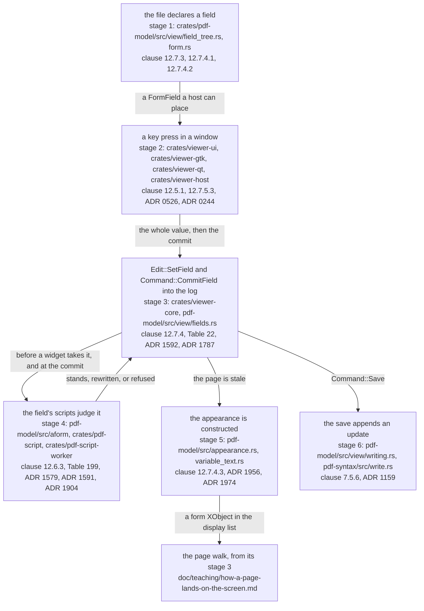
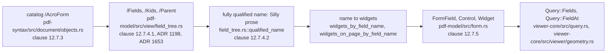
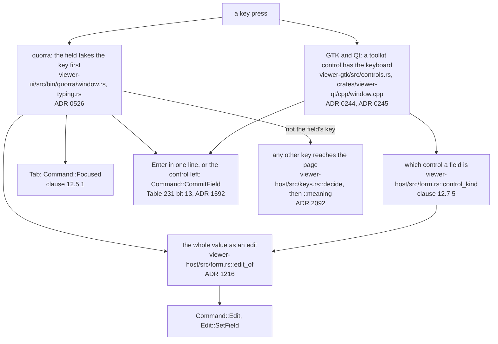
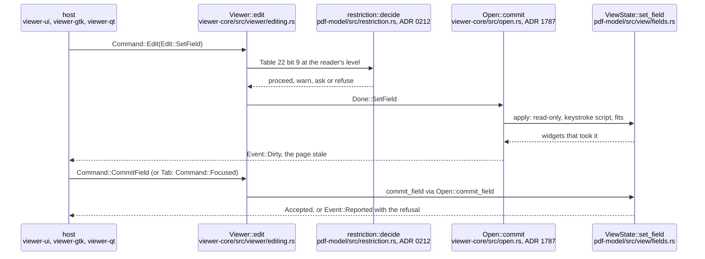
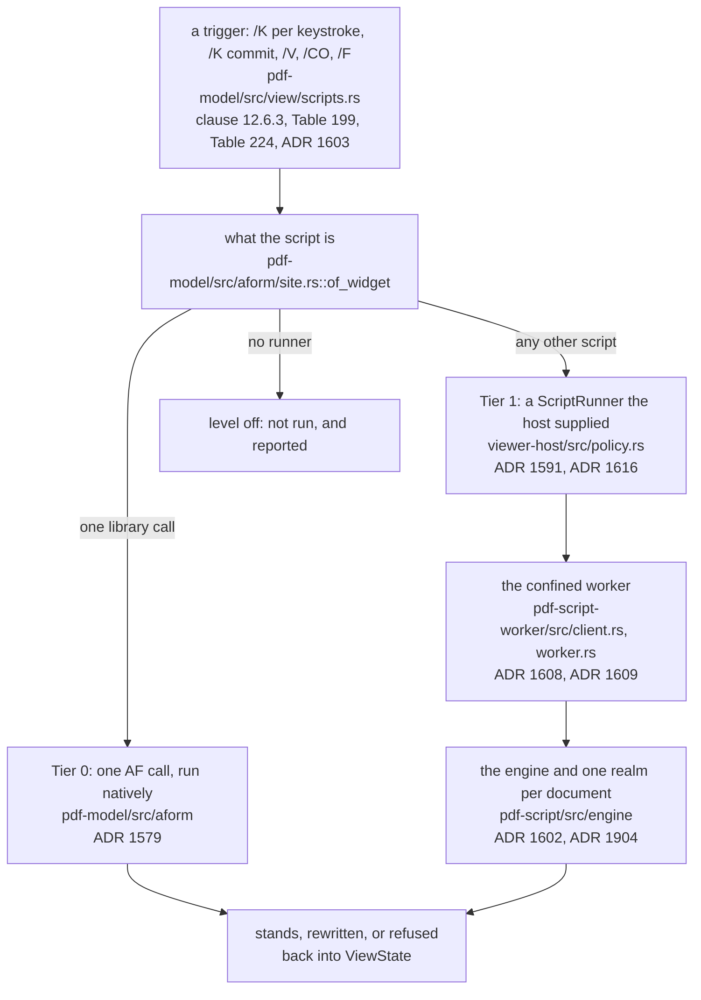
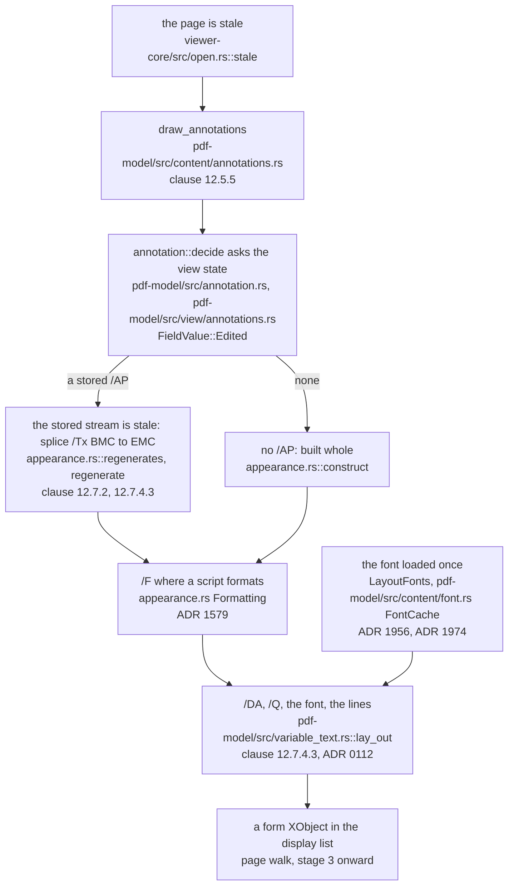
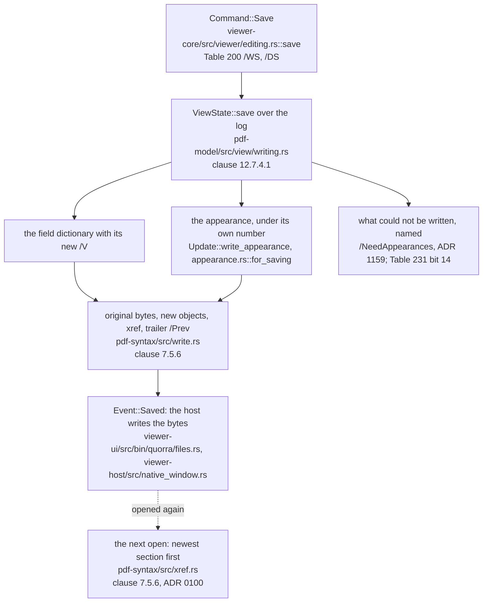

# How a form field is filled

Status: **standing** — a walk, not a reference. Read by: a student, or a new contributor, who has
followed [how a page lands on the screen](how-a-page-lands-on-the-screen.md) and now wants to follow
the other direction — a person's keystroke going *into* a document — from the `/AcroForm` entry
that declares a text field, through a window's keyboard, to the bytes a save appends to the file.
`doc/crate-map.md` says what each crate is responsible for; this says what happens **in order**.

**This document is checked and it is also allowed to be wrong, and those two facts are the reason
for its last section.** `tools/conformance/tests/teaching.rs` holds every path and every
`file::name` pair it writes to a file that exists and a name the file contains, and every ADR it
cites to a record. It cannot hold a *sentence* true: when a round moves a stage, the sentence about
the stage is the round's to redraw. Each diagram below ends with a **Maintenance note** that says
which files and records it depends on, so the round that changes one knows which diagram it has
made stale. The rules for that are in [Keeping this document true](#keeping-this-document-true).

## The running example

ISO 32000-2 §12.7.5.3 ends with an EXAMPLE, "the object definitions for a typical text field", and
the walk follows it. Around it are the three objects a file needs for the field to be reachable: the
catalog's `/AcroForm` entry (§12.7.3), the page whose `/Annots` lists the widget (§12.5.2), and the
resource dictionary the field's `/DA` names a font in.

```text
1 0 obj  << /Type /Catalog /Pages 2 0 R /AcroForm << /Fields [6 0 R] /DR 21 0 R >> >>
3 0 obj  << /Type /Page /Parent 2 0 R /MediaBox [0 0 612 792] /Annots [6 0 R] >>
6 0 obj  << /Type /Annot /Subtype /Widget /Rect [100 100 400 220] /P 3 0 R
            /FT /Tx /Ff 4096 /T (Silly prose) /DA (0 0 1 rg /Ti 12 Tf)
            /V (The quick brown fox ate the lazy mouse) /AP << /N 5 0 R >> >>
5 0 obj  << /Type /XObject /Subtype /Form /BBox [0 0 300 120] /Resources 21 0 R >>
stream
/Tx BMC q BT 0 0 1 rg /Ti 12 Tf 1 0 0 1 100 100 Tm 0 0 Td (The quick brown fox) Tj
0 -13 Td (ate the lazy mouse.) Tj ET Q EMC
endstream
21 0 obj << /Font << /Ti 22 0 R >> >>
```

Read aloud: *the document has an interactive form whose one root field is object 6; object 6 is at
once a field and the widget annotation that shows it on page 3; it is a text field (`/FT /Tx`) with
Table 231's bit 13, Multiline, set (`/Ff 4096`); its name is `Silly prose`; its text is drawn in
blue, 12-point, in the font the resources call `/Ti`; it currently says "The quick brown fox ate
the lazy mouse"; and the picture of that, stream 5, has the text inside a `/Tx BMC` … `EMC` pair.*

A person clicks into the field, types " today", presses Tab to leave it, and saves. Everything below
follows those three acts.

Two sentences of the standard frame the whole walk. §12.7.4.3, on why this program has to write a
content stream of its own here when everywhere else it only reads them:

> In such cases, the PDF document cannot provide a statically defined appearance stream for
> displaying the field. Instead, the PDF processor shall construct an appearance stream dynamically
> at rendering time.

and §7.5.6, on how what the person did gets back into the file:

> The contents of a PDF file can be updated incrementally without rewriting the entire file. When
> updating a PDF file incrementally, changes shall be appended to the end of the file, leaving its
> original contents intact.

Between the two sits the rule that shapes every stage: **`pdf_syntax::Document` is never changed.**
What the person typed is a log beside the document (ADR 0065), the page is a pure function of the
bytes, the view state and that log, and only the save turns the log into bytes — appended, never
rewritten (`CLAUDE.md`, the authoring exclusion).

## The whole walk

Six stages. The first is *reading* — what the file declares. The next three are *the edit* — a key
in a window, the value it becomes in the log, and the scripts that may judge it. The fifth is
*drawing* the value, and it joins the page walk at its stage 3. The sixth is *writing* it.



**Maintenance note.** Depends on: `crates/pdf-model/src/view/field_tree.rs`,
`crates/pdf-model/src/form.rs`, `crates/viewer-core/src/command.rs`,
`crates/viewer-core/src/open.rs`, `crates/pdf-model/src/view/fields.rs`,
`crates/pdf-model/src/view/scripts.rs`, `crates/pdf-model/src/appearance.rs`,
`crates/pdf-model/src/variable_text.rs`, `crates/pdf-model/src/view/writing.rs`,
`crates/pdf-syntax/src/write.rs` and `doc/crate-map.md`. Redraw it when a stage moves to another
crate, when scripts stop running between the keystroke and the log, or when the save stops being an
incremental update. The rule it draws — every arrow into the document goes through the log, and only
the save writes bytes — is the one to keep true above all.

## Stage 1 — from the catalog to a field (`pdf-model`)

**Question answered:** which fields does this document have, what are they called, and where on
which page is each one?

The catalog's `/AcroForm` is §12.7.3's interactive form dictionary, and its `/Fields` is "[a]n array
of references to the document's root fields (those with no ancestors in the field hierarchy)". A
field may have `/Kids` — more fields, or widget annotations — and the tree is walked by
`crates/pdf-model/src/view/field_tree.rs::field_table`, which every question about fields asks.

1. **The name is built, not read.** §12.7.4.2:

   > For a field that is the child of another field, the fully qualified name shall be formed by
   > appending the child field's partial name to the parent's fully qualified name, separated by a
   > PERIOD (2Eh)

   so `field_tree.rs::qualified_name` joins `/T` up the tree. Object 6 has no parent, so its fully
   qualified name is its partial name, `Silly prose`. That name, and never an object number, is what
   every later stage addresses the field by, because §12.7.4.1 makes the value the *field's*: one
   field may own several widgets and they all show the same value.
2. **A field and its widget may be one dictionary.** §12.7.2 says that when a field has a single
   widget, the two "may be merged into a single dictionary containing entries that pertain to both a
   field and an annotation", which is what object 6 is. `field_tree.rs` treats a leaf with no
   `/Kids` as its own widget.
3. **The walk is bounded and recovers what the array forgot.** `/Kids` may point back up the tree, so
   every walk stops at `MAX_FIELD_DEPTH` (ADR 1198); a widget a page lists whose root `/Fields`
   omits is recovered from the page (ADR 1653).
4. **The table is asked for at most the page in view.** `field_tree.rs::widgets_by_field_name` walks
   every page and is for what a person asked of the whole document — a typed value, a save;
   `field_tree.rs::widgets_on_page_by_field_name` is what a page being shown asks
   (`CLAUDE.md` principle 2, nothing eager).
5. **A host is handed a description, not a picture.** `crates/pdf-model/src/form.rs::fields` turns
   one page's widgets into `FormField`s — the control a field is (`Control`), its flags, its value
   and each widget's rectangle — so that a toolkit can place a real text entry there.
   `viewer_core::Query::Fields` answers with them (`crates/viewer-core/src/viewer/geometry.rs::form_fields`),
   and `crates/pdf-model/src/view/fields.rs::field_at` is what a click asks (`Query::FieldAt`).



**Maintenance note.** Depends on: `crates/pdf-model/src/view/field_tree.rs`,
`crates/pdf-model/src/view.rs` (`MAX_FIELD_DEPTH`), `crates/pdf-model/src/form.rs`,
`crates/pdf-model/src/view/fields.rs`, `crates/viewer-core/src/query.rs`,
`crates/viewer-core/src/viewer/geometry.rs`, ADR 1198 and ADR 1653. Redraw it when the field table
is cached rather than walked, when a host is handed something other than `FormField`, or when a field
comes to be addressed by anything but its fully qualified name.

## Stage 2 — a key press in a window

**Question answered:** who has the keyboard, and what does a keystroke send?

The standard says almost nothing here. It names a key once for this job — §12.5.1:

> Interactive PDF processors may permit the user to navigate through the annotations on a page by
> using the keyboard (in particular, the tab key).

— and Table 231's bit 13 decides what Enter is: in a field restricted "to a single line" it enters
no character, so it commits. Everything else about a keyboard is a host's documented choice
(`crates/viewer-host/src/keys.rs`, ADR 0526), and that module's own rule is the one that matters
here: **a field being typed into takes the keyboard before the page does**, and
`crates/viewer-host/src/keys.rs::meaning` is asked only for a key that reached the page.

There are two shapes of window, and the difference is who draws the field.

- **The toolkit hosts place a real control.** `viewer-gtk` builds a `GtkEntry` or, for object 6's
  Multiline flag, a `GtkTextView` (`crates/viewer-gtk/src/controls.rs`); `viewer-qt` a `QLineEdit`
  or a `QPlainTextEdit` (`crates/viewer-qt/cpp/window.cpp`). Which control a field is, is decided
  once for every host by `crates/viewer-host/src/form.rs::control_kind`. The page is then drawn
  **without** the widget's appearance underneath, or the person would see the field twice:
  `Command::Delegate` asks for that page (`crates/viewer-host/src/native_window.rs`, ADR 0244 and
  ADR 0245). The toolkit owns the caret and the selection.
- **`quorra` draws the field itself.** It places no toolkit control: a click aims the keyboard at
  the field (`crates/viewer-ui/src/bin/quorra/typing.rs::aim_at_field`, through `Query::FieldAt`),
  and the caret and the selection are asked of the core (`Query::Caret`, `Query::FieldSelection`)
  so that they sit on the glyphs stage 5 lays out. `crates/viewer-ui/src/bin/quorra/window.rs`'s
  `pressed` offers every key to the field first, then to
  `crates/viewer-host/src/keys.rs::decide`, which asks the page's push-button and then the key table
  for all four hosts (ADR 2092). The confined window does the same over its boundary
  (`crates/viewer-ui/src/bin/quorra-confined/typing.rs`, ADR 0713).

**In every window a keystroke sends the whole value, not the key.** The six characters " today"
are six `Edit::SetField` commands, each carrying everything the field now says
(`typing.rs::spliced` in `quorra`; each toolkit's changed signal in the others), because the core
decides how much of a value a widget accepts (stage 3) and a key would leave that to the host.
`crates/viewer-host/src/form.rs::edit_of` is the one place that tells a file-select field's
pathname from ordinary text (ADR 1216). **The end of the typing is its own message**,
`Command::CommitField`: Enter in a single-line field, a toolkit control losing the keyboard, and —
for object 6, whose Enter is a line break — the Tab that moves §12.5.1's focus on (ADR 1592).



**Maintenance note.** Depends on: `crates/viewer-host/src/keys.rs`, `crates/viewer-host/src/form.rs`,
`crates/viewer-host/src/native_window.rs`, `crates/viewer-ui/src/bin/quorra/typing.rs`,
`crates/viewer-ui/src/bin/quorra/window.rs`, `crates/viewer-ui/src/bin/quorra-confined/typing.rs`,
`crates/viewer-gtk/src/controls.rs`, `crates/viewer-gtk/src/host/forms.rs`,
`crates/viewer-qt/src/host/forms.rs`, `crates/viewer-qt/cpp/window.cpp`, ADR 0244, ADR 0245,
ADR 0526, ADR 1216 and ADR 1592. Redraw it when a host stops sending whole values, when `quorra`
places a toolkit control, when a new host joins — the .NET host of
`doc/rfc/0010-a-windows-native-host-in-dotnet-on-the-c-abi.md` will — or when the commit stops
being a message of its own.

## Stage 3 — the value into the log (`viewer-core`, `pdf-model`)

**Question answered:** may the person change this field, how much of what they typed does it take,
and where is it kept?

`viewer_core::Viewer::handle` receives `Command::Edit(Edit::SetField { field, value })`
(`crates/viewer-core/src/command.rs`) and hands it to
`crates/viewer-core/src/viewer/editing.rs::edit`, which does three things in order.

1. **It asks the reader's policy, once.** A document can restrict filling in a form — Table 22's
   bit 9, "[f]ill in existing interactive form fields (including signature fields), even if bit 6 is
   clear" — and `CLAUDE.md` makes how much of that is obeyed the *reader's* choice, at four levels.
   So the question is asked in one place a host can reach, `editing.rs::standing`, through
   `crates/pdf-model/src/restriction.rs::decide`, and its answer is to proceed, to refuse with a
   sentence, to warn, or to ask (ADR 0212). It is never a refusal hard-coded at the field.
2. **It resolves the edit and logs it.** `crates/viewer-core/src/open.rs::Done` is what was *done*,
   as opposed to what was asked; `Open::commit` applies the entry to the view state and pushes it, so
   that an undo and a redo replay the log (ADR 1787), and marks the page stale.
3. **The view state takes the value.** `crates/pdf-model/src/view/fields.rs::set_field` finds every
   widget of the field by name (stage 1), drops the ones Table 227's bit 1 makes read-only, asks the
   keystroke script (stage 4), encodes the text once as §7.9.2.2's text string, and stores it in the
   view state as an `Entry` beside the document. Where Table 231's bit 24, DoNotScroll, is set, the
   value a widget takes is the longest prefix that fits its rectangle (ADR 0197) — the place where
   §12.7.5.3's "no further text shall be accepted" binds, which is why a host sends whole values.

The view state, `crates/pdf-model/src/view.rs::ViewState`, holds four statements about a value — the
file's `/V`, a reset's `/DV`, an import's value and a person's edit — and the latest wins
(`FieldValue`). That is what lets the document stay immutable: drawing asks the view state which of
the four holds for a widget.

**The commit is a second command.** `Command::CommitField { field }` reaches
`editing.rs::commit_typed`, then `Open::commit_field`, then
`crates/pdf-model/src/view/scripts.rs::commit_field`, which runs the commit's scripts (stage 4) and
answers `Committed::Accepted`, `Committed::Refused` with a sentence the host shows, or
`Committed::Nothing` where nobody was typing. A Tab reaches the same commit without the message: it
is `Command::Focused`, which raises Table 197's `/Bl` on the widget it leaves, and the field is
committed first (`crates/viewer-core/src/viewer/pointer.rs::raise`, ADR 1592). The host hears
`Event::Dirty` and, where a script refused, `Event::Reported`.



**Maintenance note.** Depends on: `crates/viewer-core/src/command.rs`, `crates/viewer-core/src/viewer.rs`,
`crates/viewer-core/src/viewer/editing.rs`, `crates/viewer-core/src/viewer/pointer.rs`,
`crates/viewer-core/src/open.rs`, `crates/pdf-model/src/restriction.rs`,
`crates/pdf-model/src/view.rs`, `crates/pdf-model/src/view/fields.rs`, ADR 0065, ADR 0197, ADR 0212,
ADR 1592 and ADR 1787. Redraw it when `Edit::SetField` gains or loses a field, when the restriction
question moves, when the log stops being replayed by an undo, or when the commit stops being an entry
of its own.

## Stage 4 — the field's scripts (`pdf-model`, `pdf-script`, `pdf-script-worker`)

**Question answered:** may the document's own scripts accept, rewrite or refuse what was typed?

A field may carry an additional-actions dictionary, `/AA`, whose entries are §12.6.3's Table 199
triggers. Object 6 has none, so for it this stage is a lookup that finds nothing. Had it one, the
keystroke trigger is the one that runs first — Table 199's `/K`:

> (Optional; PDF 1.3) An ECMAScript action that shall be performed when the user modifies a
> character in a text field or combo box or modifies the selection in a scrollable list box. This
> action may check the added text for validity and reject or modify it.

**When each trigger runs is two sources, and the module says which.** The standard names the
triggers; Adobe's *JavaScript for Acrobat API Reference* ("Form event processing") orders them, and
this tree follows it as evidence, not as the specification: each keystroke runs `/K` in its typing
form, inside `set_field`, *before* any widget takes the value; the commit runs `/K` in its commit
form, then `/V` (validate), then Table 224's `/CO` calculation order, then `/F` (format) wherever a
runner formats (`crates/pdf-model/src/view/scripts.rs`, ADR 1579 and ADR 1603). A refusal leaves the
field as it was before the typing began, and the sentence reaches the person.

**Two tiers, and only one of them is an engine** (RFC 0008, accepted by the owner).

- **Tier 0** is no engine at all. Nearly every field script in the world is one call of Adobe's
  `AF*` library — `AFNumber_Format(2, 0, 0, 0, "$", true)` — and
  `crates/pdf-model/src/aform/site.rs::of_widget` recognises a script that is textually one such call
  with literal arguments and runs it natively from `crates/pdf-model/src/aform` (ADR 1579).
- **Tier 1** is every other script, handed as data — a `ScriptEvent` out, a `ScriptResult` back — to
  a `ScriptRunner` a host supplies (ADR 1591). The host's runner is
  `crates/pdf-script-worker/src/client.rs::ScriptWorker`, which starts a confined process on the
  first trigger and never at open (ADR 1608 and ADR 1609); in it `crates/pdf-script` evaluates the
  script with the Boa engine under a budget, and one realm per document keeps what the document's
  scripts defined (ADR 1602). A script's `app.alert` comes back as a question, held in the worker,
  which `quorra` puts on its card and the toolkits in a dialogue (ADR 1627).

**And the level is the reader's.** No runner is supplied at the level `off`, which is the default:
then Tier 0 still runs and every other script is reported as not run, never silently skipped.
`crates/viewer-host/src/policy.rs` makes the runner at the levels that run scripts, and the confined
window is pinned `off` because its viewer runs where no runner can be handed (ADR 1616). What a
script may reach is this document and this viewer and nothing beyond (ADR 1904).



**Maintenance note.** Depends on: `crates/pdf-model/src/view/scripts.rs`,
`crates/pdf-model/src/aform/site.rs`, `crates/pdf-model/src/aform/mod.rs`,
`crates/pdf-script/src/lib.rs`, `crates/pdf-script/src/engine/mod.rs`,
`crates/pdf-script-worker/src/client.rs`, `crates/pdf-script-worker/src/worker.rs`,
`crates/viewer-host/src/policy.rs`, `doc/rfc/0008-a-script-is-a-document-acting-on-its-reader.md`,
ADR 1579, ADR 1591, ADR 1602, ADR 1603, ADR 1608, ADR 1609, ADR 1616, ADR 1627 and ADR 1904.
Redraw it when the order of the commit's triggers changes, when a third tier appears, when the
worker stops being a process of its own, or when the default level changes.

## Stage 5 — the appearance is constructed (`pdf-model`)

**Question answered:** what does the field look like now that it says something its stored stream
does not?

The edit made the page stale, so the next frame interprets it again, and the page walk's stage 3
draws the page's annotations after its content
(`crates/pdf-model/src/content/annotations.rs::draw_annotations`, §12.5.5). For object 6,
`crates/pdf-model/src/annotation.rs::decide` asks the view state about the widget
(`ViewState::annotation`, an `AnnotationView` whose `value` is now `FieldValue::Edited`) and finds a
stored appearance, stream 5, that shows the *old* value. §12.7.2 forbids drawing it:

> If such an object defines an appearance stream, the appearance shall be consistent with the
> object's current value as a field.

So `crates/pdf-model/src/appearance.rs::regenerates` answers yes — a value this program replaced
makes the stored stream stale whatever `/NeedAppearances` says — and `appearance.rs::regenerate`
does what §12.7.4.3 states for an existing stream: it copies the needed resources from `/DR` in,
and replaces what lies between `/Tx BMC` and its `EMC`, so the producer's own background and border
survive. A widget with no `/AP` at all is built whole by `appearance.rs::construct`.

The text inside the pair is `crates/pdf-model/src/variable_text.rs::lay_out`, reached through
`appearance.rs`'s `field_text`:

1. **The `/DA` string is read** (`variable_text.rs::DefaultAppearance`): `0 0 1 rg` is the colour,
   and `/Ti 12 Tf` the font and size, where the name "shall match a resource name in the Font
   entry of the default resource dictionary". A size of zero would be auto-sized.
2. **The font is loaded once**, not once per field. `variable_text.rs::LayoutFonts` holds what one
   interpretation loaded (ADR 1956), and `LayoutFonts::sharing` asks the open document's
   `crates/pdf-model/src/content/font.rs::FontCache` first, so the appearance's own `Tf` later finds
   the same font (ADR 1974). A `/DA` font `/DR` does not define gets a stand-in and a report
   (ADR 0112).
3. **The value is formatted**, where the field has a `/F` script: `appearance.rs`'s `Formatting`
   runs a Tier 0 call, or shows what a runner displayed — except for the value a person is still
   typing, which shows as typed until it is committed (ADR 1579).
4. **The text is laid out**: Table 228's `/Q` places it, Multiline wraps it at the rectangle, and
   where a baseline sits and how far apart two lines are is a documented choice, because §12.7.4.3
   leaves "positioning values it determines to be appropriate" to the processor.

The result is a form XObject in the display list like any other appearance, and from there the page
walk's stages 4 to 7 draw it. **In the toolkit hosts this picture is not drawn** — the page was
delegated (stage 2) — and the control shows the value instead, the field's formatted text once it is
committed (ADR 1604).



**Maintenance note.** Depends on: `crates/pdf-model/src/content/annotations.rs`,
`crates/pdf-model/src/annotation.rs`, `crates/pdf-model/src/view/annotations.rs`,
`crates/pdf-model/src/appearance.rs`, `crates/pdf-model/src/variable_text.rs`,
`crates/pdf-model/src/content/font.rs`, `crates/viewer-core/src/open.rs`, ADR 0112, ADR 1579,
ADR 1604, ADR 1956 and ADR 1974. Redraw it when an edited value stops making the stored stream stale,
when the splice gives way to a whole reconstruction, when the layout's font cache moves, or when a
toolkit host starts drawing the widget's appearance under its control.

## Stage 6 — the save appends an update (`pdf-model`, `pdf-syntax`)

**Question answered:** how does the edit leave the program without touching a byte the producer
wrote?

`Command::Save` reaches `crates/viewer-core/src/viewer/editing.rs::save`, which runs Table 200's
`/WS` document script first, so that whatever it writes into a field is in the update, then
`crates/pdf-model/src/view/writing.rs::save`, then `/DS` after a save that was written.

1. **One replacement object per field typed into.** `ViewState::save` walks the log's edits and, for
   object 6, writes a copy of the field dictionary with the new `/V`. §12.7.4.1's `/V` is
   inheritable, so the value goes on the dictionary that already holds one — here the widget itself,
   since field and widget are merged.
2. **The appearance goes with it**: `writing.rs`'s `Update::write_appearance` asks
   `crates/pdf-model/src/appearance.rs::for_saving` for the bytes this program would draw (stage 5)
   and writes them under stream 5's own object number, so the saved file shows what the viewer
   showed and no object is orphaned.
3. **What could not be written is said.** A widget whose appearance could not be laid out is named
   and Table 224's `/NeedAppearances` is set for exactly that case (ADR 1159); a Table 231 bit 14
   password field's value is not written at all, and the person is told (`Written::withheld`).
4. **The bytes are §7.5.6's.** `crates/pdf-syntax/src/write.rs::incremental_update_freeing` returns
   the whole file: the original bytes untouched, then the new objects, a cross-reference section for
   them, and a trailer whose `/Prev` points at the old one. The host writes them somewhere —
   `quorra` beside the original (`crates/viewer-ui/src/bin/quorra/files.rs::write_saved`), the
   toolkits where a person chose (`crates/viewer-host/src/native_window.rs`) — on `Event::Saved`.

**And the loop closes when the file is opened again.** §7.5.6 binds the reader too: "it shall build
its cross-reference information in such a way that the most recent copy of each object shall be the
one accessed from the PDF file." `crates/pdf-syntax/src/xref.rs` reads sections newest first and the
first writer of an object wins (ADR 0100), so the next open reads object 6's new `/V` and stream 5's
new appearance, and the field says what the person typed — with the producer's bytes still in the
file beneath it.



**Maintenance note.** Depends on: `crates/viewer-core/src/viewer/editing.rs`,
`crates/pdf-model/src/view/writing.rs`, `crates/pdf-model/src/appearance.rs`,
`crates/pdf-syntax/src/write.rs`, `crates/pdf-syntax/src/xref.rs`,
`crates/viewer-ui/src/bin/quorra/files.rs`, `crates/viewer-host/src/native_window.rs`, ADR 0100 and
ADR 1159. Redraw it when a save stops being an incremental update, when the appearance stops being
written beside the value, when the document scripts around a save move, or when a host's writing of
`Event::Saved` changes.

## What the walk leaves out

The walk follows one text field. It does not follow: check boxes and radio buttons, whose value is
an appearance-state name (§12.7.5.2.3; `crates/viewer-host/src/form.rs::toggling`); choice fields,
whose value is chosen from `/Opt` (§12.7.5.4); rich text, which regenerates the whole appearance
(Table 231 bit 26, ADR 1635); a file-select field, whose contents a host reads (ADR 1216); importing
and submitting form data (§12.7.8, §12.7.6.2; `crates/pdf-model/src/forms_data.rs`,
`crates/pdf-model/src/submission.rs`); a reset (§12.7.6.3); signature fields (§12.8); free text
annotations, which share stage 5's variable text (§12.5.6.6); and deriving a new file rather than
updating one (`crates/pdf-syntax/src/serialize.rs`). Each has a row in `doc/crate-map.md`, which is
the next document to open.

## Keeping this document true

Written for the round that changes the code, not for the one that reads this.

1. **The test is the floor.** `tools/conformance/tests/teaching.rs` reads this file and holds every
   `crates/…`, `raster/…`, `doc/…` and `tools/…` path to a file or directory that exists, every
   `path::name` pair to a file that contains `name`, every `ADR NNNN` to a record in `doc/adr/`,
   every diagram to its **Maintenance note**, and `doc/HANDOVER.md` and `doc/crate-map.md` to a
   pointer to this file. Run it with `cargo test -p conformance --test teaching`.
2. **The test cannot read a sentence.** A round that moves a function between modules, splits a
   file, changes which tier runs a script or which host draws a field reads the Maintenance notes
   above for the files it touched, redraws the diagram and rewrites the sentence beside it **in the
   present tense, as what is** (ADR 1023), not as what changed.
3. **A new stage or a new host shape is a new section** with a diagram and a Maintenance note, in
   the order the walk takes it.
4. **A claim that stops being true is deleted or corrected, not annotated.** The record of why is
   `doc/adr/` and `doc/history/`.
5. **A bug found while drawing a diagram is reported, not fixed in the same change**: the diagram
   says what the code does, and a bug is a gap between that and what the standard says.
