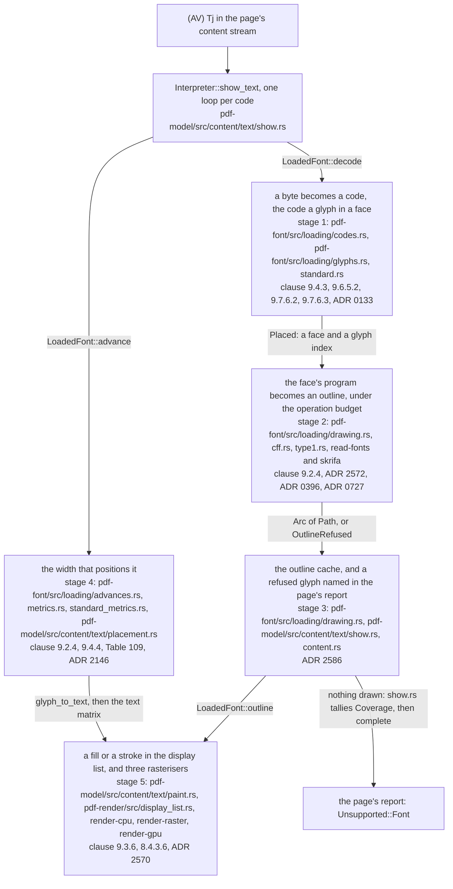
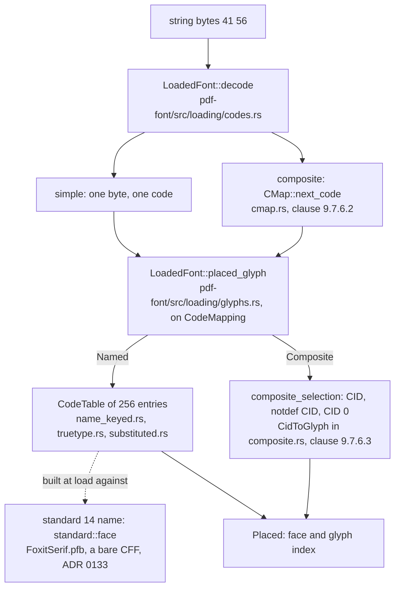
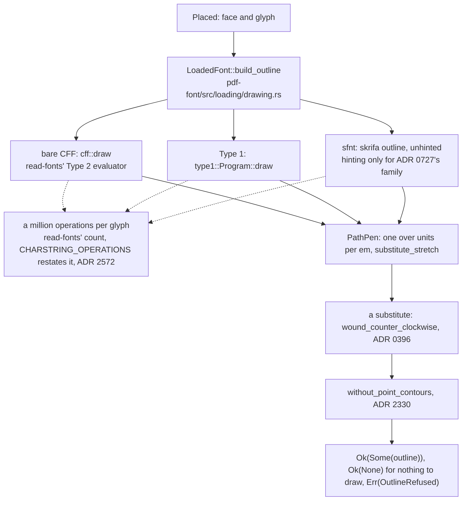
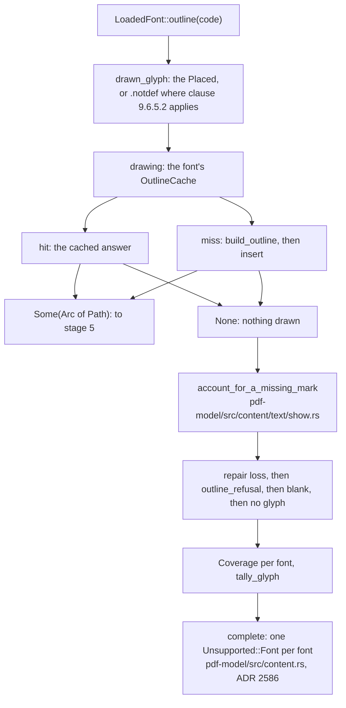
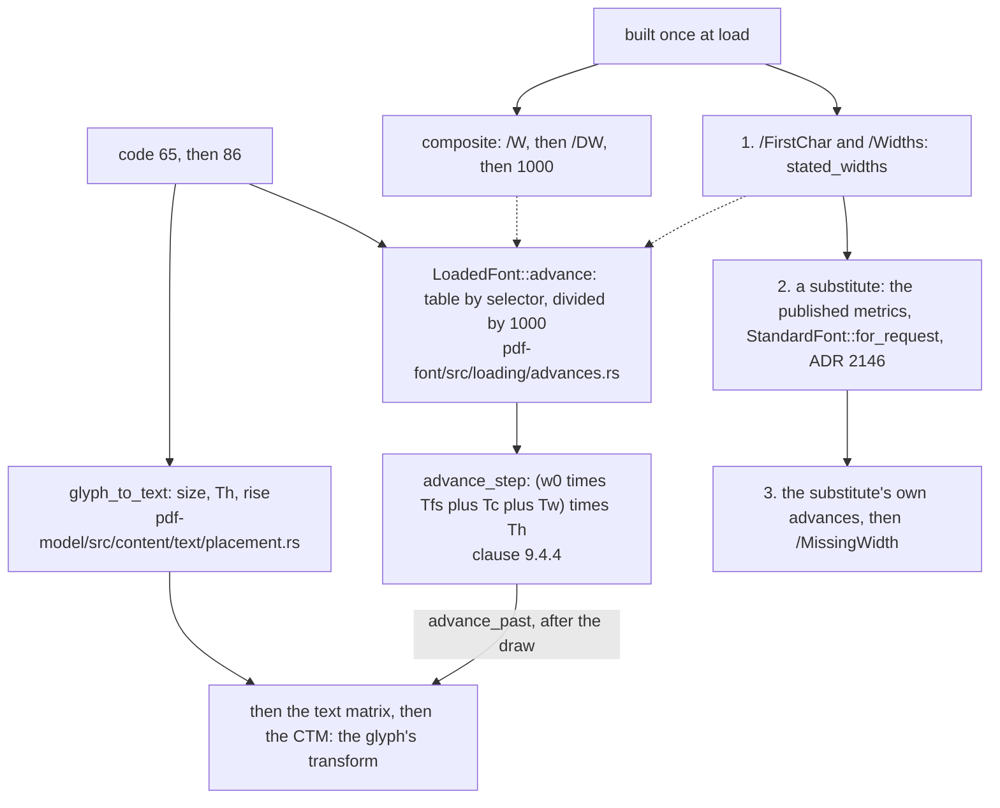
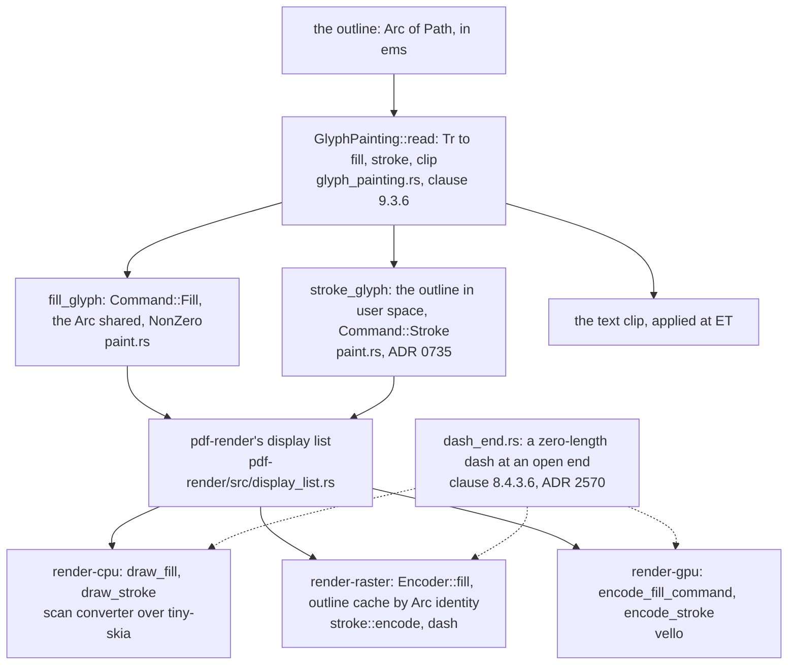

# How a glyph reaches the screen

Status: **standing** — a walk, not a reference. Read by: a student, or a new contributor, who has
followed [how a page lands on the screen](how-a-page-lands-on-the-screen.md), seen its stage 3 hand a
`Tj` to `pdf-font` in one sentence, and wants to follow what happens inside that sentence. This
walk starts at one byte of a string operand and ends at the pixels three rasterisers colour for
it. `doc/crate-map.md` says what each crate is responsible for; this says what happens **in order**.
It describes the tree at commit `c53ad5e0`.

**This document is checked and it is also allowed to be wrong, and those two facts are the reason
for its last section.** `tools/conformance/tests/teaching.rs` holds every path and every
`file::name` pair it writes to a file that exists and a name the file contains, and every ADR it
cites to a record. It cannot hold a *sentence* true: when a round moves a stage, the sentence about
the stage is the round's to redraw. Each diagram below ends with a **Maintenance note** that says
which files and records it depends on, so the round that changes one knows which diagram it has
made stale. The rules for that are in [Keeping this document true](#keeping-this-document-true).

## The running example

One page, one font, two lines:

```text
3 0 obj  << /Type /Page /Parent 2 0 R /MediaBox [0 0 200 760]
            /Resources << /Font << /F1 5 0 R >> >> /Contents 4 0 R >>
4 0 obj  << /Length 79 >>
stream
BT /F1 24 Tf 72 700 Td (AV) Tj ET
BT /F1 24 Tf 1 Tr 0.5 w 72 660 Td (AV) Tj ET
endstream
5 0 obj  << /Type /Font /Subtype /Type1 /BaseFont /Times-Roman /Encoding /WinAnsiEncoding >>
```

Read aloud: *in a text object, select font `F1` at 24 units, move to 72 across and 700 up, and show
the string `AV`; then do the same 40 units lower with the text rendering mode set to 1, stroke,
and a line width of half a unit.* The font is `Times-Roman` stated by name alone — no `/Widths`, no
`/FontDescriptor`, no program — which Table 109 permits for the standard 14 ("optional in PDF
1.0-1.7 for the standard 14 fonts"). That is the case this walk follows because it touches every
stage: the code table, a program this tree carries itself, the published metrics for the width,
and both a fill and a stroke at the end. Where a composite font (`Type0`) or an embedded program
would leave the route, the stage says where.

The figures below were read off the tree, not reasoned out: the objects above written out as a
file, drawn at scale 2 with `crates/pdf-model/examples/render_at.rs` from a `dev` build, and read
back with `crates/pdf-model/examples/readback.rs`. The drawing is 400 by 1520 pixels, the first
`AV` filled and the second drawn as an outline; the readback prints

```text
AV
AV
--- 4 glyph(s) marked the page; 0 code(s) §9.10.2 could not name
```

so all four codes reached a glyph and every glyph drew something. The pen's positions follow from
Times-Roman's published widths, 722 for both `A` and `V`: each glyph moves the pen 0.722 × 24 =
17.328 units, so `V` starts at 89.328 and the string ends at 106.656 on both lines.

The standard's own sentence about what the `Tj` must do with the two glyphs, §9.2.4:

> In either case, the Tj operator shall position the consecutive glyphs of a string according to their widths.

and, a paragraph later, where those widths live:

> The width information for each glyph shall be stored both in the font dictionary and in the font program itself.

The running example stores them in neither, which is the reason stage 4 has three sources rather
than one.

## The whole walk

Five stages. The first is *selection* — a byte becomes a code and the code a glyph in a face. The
second is *shape* — the face's program is evaluated into an outline, under a budget. The third is
*memory and honesty* — the outline is kept, and a glyph the program could not describe is said
out loud. The fourth is *place* — the width that moves the pen, and the matrix that puts the
outline where the pen is. The fifth is *pixels* — the outline becomes a fill or a stroke in the
display list, and three rasterisers draw it.



**Maintenance note.** Depends on: `crates/pdf-model/src/content/text/show.rs`,
`crates/pdf-font/src/loading/codes.rs`, `crates/pdf-font/src/loading/glyphs.rs`,
`crates/pdf-font/src/loading/drawing.rs`, `crates/pdf-font/src/loading/advances.rs`,
`crates/pdf-model/src/content/text/placement.rs`, `crates/pdf-model/src/content/text/paint.rs`,
`crates/pdf-model/src/content.rs`, `crates/pdf-render/src/display_list.rs` and the three backend
crates. Redraw it when a glyph stops being drawn from an outline the font hands out per code, when
the width stops being a per-code table lookup, or when the display list grows a glyph item of its
own. The rule it draws — **the font answers three questions per code, `decode`, `outline` and
`advance`, and nothing downstream of `pdf-font` knows what kind of program the font is** — is the
one to keep true above all.

## Stage 1 — a byte becomes a code, and the code a glyph (`pdf-font`)

`Tj` reaches `crates/pdf-model/src/content/text/show.rs::show_text` (`TJ`, `'` and `"` reach the
same function), which hands the string to `LoadedFont::decode`. Everything that knows what a font
*is* lives in `pdf-font`; `pdf-model` holds a loaded font behind
`crates/pdf-model/src/content/font.rs` and asks it about codes, never about programs.

**The bytes become codes** in `crates/pdf-font/src/loading/codes.rs::decode`. A simple font takes
one byte per code. A composite font asks its CMap, `crates/pdf-font/src/cmap.rs::next_code`, which
does what §9.7.6.2 says:

> The codespace ranges in the CMap (delimited by begincodespacerange and endcodespacerange ) specify how many bytes are extracted from the string for each successive character code.

trying one byte, then two, up to four, against the ranges. It always consumes at least one byte, so
a string of *n* bytes yields at most *n* codes whatever the CMap says — the bound principle 3 asks
for, held by construction rather than by a counter. The running example yields two codes, 65 and 86.

**A code becomes a glyph** in `crates/pdf-font/src/loading/glyphs.rs::placed_glyph`, whose answer
is a `Placed` — a face and a glyph index in it, the key of everything that follows. It matches on
`CodeMapping` (`crates/pdf-font/src/loading.rs`), decided once when the font loads
(`crates/pdf-font/src/loading/opening.rs::load_simple`, `load_composite`), so nothing per code
re-reads a dictionary:

- **A simple font's codes are a table**, `CodeTable` in `crates/pdf-font/src/loading.rs`: 256
  entries of an optional glyph index. For an embedded Type 1 or bare CFF program it is built by
  `crates/pdf-font/src/name_keyed.rs::simple_code_table`, through §9.6.5.2's glyph names; for a
  TrueType program by `crates/pdf-font/src/truetype.rs::truetype_code_table`, through §9.6.5.4's
  choice of `cmap` subtable and the tiers past it that ADR 1943 states as this tree's own. A code
  the table does not answer reaches no glyph — the code is never used as a glyph index by default.
- **For the running example there is no program**, and the table is built against a face this tree
  carries: `crates/pdf-font/src/substituted.rs::substitute_code_table` turns each name of
  `/WinAnsiEncoding` (`crates/pdf-font/src/glyph_names.rs::encoding_names`) into the glyph of the
  same name in the substitute. Which substitute is decided in
  `crates/pdf-font/src/substitute.rs::find_styled`: a standard 14 name is answered by
  `crates/pdf-font/src/standard.rs::face` and never by the machine's installed fonts (ADR 0133),
  so the page is a property of the document. `Times-Roman` is `data/standard-fonts/FoxitSerif.pfb`,
  compiled into the binary — and, despite its extension, a bare CFF program; its first four bytes
  are a CFF header (`01 00 04 02`).
- **A composite font's codes go through a CID.** `crates/pdf-font/src/loading/glyphs.rs::composite_selection`
  takes the CMap's CID for the code, then its notdef mapping, then CID 0, which is §9.7.6.3's order
  ("If no glyph exists for that CID, the glyph for CID 0 (which shall be present) shall be
  substituted."); the CID becomes a glyph index through `CidToGlyph`
  (`crates/pdf-font/src/composite.rs::cid_to_glyph`): a CID-keyed CFF's charset, a `/CIDToGIDMap`
  stream bounded at two bytes for each of 65 536 CIDs, or the identity.

One sentence of the standard is deliberately *not* applied here. §9.6.5.2:

> If an encoding maps to a character name that does not exist in the Type 1 font program, the .notdef glyph shall be substituted.

The substitution happens at the drawing step (stage 2's `drawn_glyph`), not in the table, because
three instruments read the table to count codes that reached nothing (ADR 0152); writing `.notdef`
into it would obey the `shall` by blinding them. The doc comment on
`crates/pdf-font/src/loading/drawing.rs::outline` argues it at length.



**Maintenance note.** Depends on: `crates/pdf-font/src/loading/codes.rs`,
`crates/pdf-font/src/cmap.rs`, `crates/pdf-font/src/loading/glyphs.rs`,
`crates/pdf-font/src/loading.rs`, `crates/pdf-font/src/loading/opening.rs`,
`crates/pdf-font/src/name_keyed.rs`, `crates/pdf-font/src/truetype.rs`,
`crates/pdf-font/src/substituted.rs`, `crates/pdf-font/src/substitute.rs`,
`crates/pdf-font/src/standard.rs`, `crates/pdf-font/src/composite.rs` and ADRs 0133, 0152 and 1943.
Redraw it when the code-to-glyph decision stops being taken once at load, or when a standard 14
name starts being answered from the machine.

## Stage 2 — the face's program becomes an outline, under the operation budget (`pdf-font`)

`crates/pdf-font/src/loading/drawing.rs` holds the one place a glyph's program is run,
`build_outline`, and it dispatches on the kind of program the face holds:

- **A bare CFF** — the running example's face, and an embedded `/FontFile3` — goes to
  `crates/pdf-font/src/cff.rs::draw`, which resolves the sub-font a CID-keyed program keeps for
  the glyph and runs `read-fonts`' Type 2 charstring evaluator into a pen.
- **A Type 1 program** goes to `crates/pdf-font/src/type1.rs::draw`, over the program parsed once
  when the font loaded.
- **An `sfnt`** — TrueType's `glyf` or OpenType's `CFF ` table — goes to `skrifa`'s outline
  collection, drawn unhinted at the em; ADR 0727's hint-reliant family alone is drawn through a
  hinting instance (`hinting`, a `OnceLock`, built only for such a face), and a hinted draw that
  fails is drawn again unhinted.

**The pen does the scaling**: `PathPen` (`crates/pdf-font/src/loading.rs`) multiplies every point
by one over the program's units per em — a bare CFF's taken from its `FontMatrix` — so the outline
leaves in ems, the unit stage 4's matrix expects. A substitute drawn for a document whose
`/Widths` say the original was narrower is also compressed horizontally,
`crates/pdf-font/src/metrics.rs::substitute_stretch`, never below half.

**The substitute is wound one way.** A substitute's path goes through
`crates/pdf-font/src/substituted.rs::wound_counter_clockwise`, which measures each contour's signed
area rather than trusting the format's convention, because a face this tree chose must not draw
differently from the same face under another fill rule (ADR 0396); an embedded program's winding is
the producer's and is left as drawn. Then `without_point_contours` drops contours of a single point
(ADR 2330), and an outline left empty is `Ok(None)`: nothing to draw, which is not an error.

**The budget is the evaluator's own.** A charstring can call subroutines that call subroutines, ten
deep by Adobe's limit, so a few hundred bytes can ask for billions of operations. `read-fonts`
counts every operand and operator a glyph's evaluation reads, inside its subroutines, and stops the
glyph at a million (ADR 2572). This crate's own walks over charstrings spend the same number,
`crates/pdf-font/src/cff.rs::CHARSTRING_OPERATIONS`: `calls_local_subr` (the repair's question)
and `crates/pdf-font/src/embed/reach.rs::walk` (the subset writer's), each of which answers on its
own safe side when the budget runs out — the repair counts the glyph as calling a local
subroutine, the writer keeps every subroutine. A Type 1 program's charstrings reach the same evaluator
through `crates/pdf-font/src/type1.rs::draw`, and that file's tests hold the same pair as the CFF
ones in `crates/pdf-font/src/cff_budget_tests.rs`: a fan-out past the budget is refused, a modest
one is evaluated to its answer. No static pre-scan exists: it would be a second
charstring interpreter in a crate that reads them through `read-fonts` precisely to have one.



**Maintenance note.** Depends on: `crates/pdf-font/src/loading/drawing.rs`,
`crates/pdf-font/src/cff.rs`, `crates/pdf-font/src/type1.rs`, `crates/pdf-font/src/embed/reach.rs`,
`crates/pdf-font/src/loading.rs`, `crates/pdf-font/src/metrics.rs`,
`crates/pdf-font/src/substituted.rs`, the `read-fonts` and `skrifa` versions in `Cargo.toml`, and
ADRs 0396, 0727, 2330 and 2572. Redraw it when a program kind gains an evaluator of this tree's
own, when the budget stops being the evaluator's, or when a substitute stops being re-wound.

## Stage 3 — the outline is kept, and a refused glyph is said out loud (`pdf-font`, `pdf-model`)

**One cache per loaded font.** `OutlineCache` (`crates/pdf-font/src/loading.rs`) maps a `Placed`
to `Result<Option<Arc<Path>>, OutlineRefused>`, behind a mutex in the font. `drawing` in
`crates/pdf-font/src/loading/drawing.rs` reads it first and runs `build_outline` only on a miss, so
a program is evaluated once per distinct glyph of a loaded font, whatever it answered. The bound is
the glyph count of each face the font holds — its own program and, for a CIDFont whose `/FD` names
class faces (§9.8.3.3), each of those — a `u16` apiece: the cache is never evicted because it
cannot grow past that.
The `Arc` is the point of the shape — the second `A` on a page, and the thousandth, is a reference
count, and stage 5's `render-raster` uploads one outline once however many fills name it.

**The cache keeps the refusal, not only the outline.** `outline` answers `None` both for a glyph
with nothing to draw and for one whose program the evaluator stopped on, because nothing is drawn
for either; `outline_refusal` reads the *same* entry and tells them apart (ADR 2586). Principle 1
is why the refusal is kept: before it was, a glyph stopped by stage 2's budget was counted with
the glyphs a program describes as empty, and the page said something untrue about the file.

**The report is asked in `pdf-model`**, by
`crates/pdf-model/src/content/text/show.rs::account_for_a_missing_mark`, only for a code that drew
nothing and does not read back as a space. Its questions run narrowest first: was the glyph lost
to a repair of the program (`glyph_lost_to_repair`, ADR 0808); did the evaluator refuse it
(`outline_refusal`); is it a glyph the program holds and describes as blank; else the code reached
no glyph at all. The answers are tallied per font into `Coverage`
(`crates/pdf-model/src/content/text.rs`), once per string by `tally_glyph`, and when the page is
complete `crates/pdf-model/src/content.rs::complete` turns each font's tally into one
`Unsupported::Font` sentence — for a refusal, "the evaluator refuses the outline of glyph …", with
the evaluator's own reason and the number of codes that reached it. A font every one of whose
empty codes was lost or refused does not also get the sentence that the program has no outline.



**Maintenance note.** Depends on: `crates/pdf-font/src/loading.rs`,
`crates/pdf-font/src/loading/drawing.rs`, `crates/pdf-model/src/content/text/show.rs`,
`crates/pdf-model/src/content/text.rs`, `crates/pdf-model/src/content.rs` and ADRs 0808 and 2586.
Redraw it when the cache gains an eviction or a second home, when a refusal stops being cached,
or when the report's order of questions changes.

## Stage 4 — the width that positions it (`pdf-font`, `pdf-model`)

**The advance is one lookup.** `crates/pdf-font/src/loading/advances.rs::advance` reads a table by
the code's selector — the code for a simple font, the CID for a composite one — and divides by a
thousand, Table 109's unit:

> The glyph widths shall be measured in units in which 1000 units correspond to 1 unit in text space.

The table is built once at load, so the per-character path neither allocates nor consults a
program. **What goes into it**, in descending authority, for a simple font
(`crates/pdf-font/src/metrics.rs::simple_widths`), the first two chosen per font and not per
code:

1. **`/FirstChar` and `/Widths`**, read by `stated_widths`: the document's own statement. When the
   font states any width at all, that is the whole table, and the two sources below are not
   consulted for the codes it leaves out.
2. **Only for a substitute whose dictionary states no widths** — which only the standard 14 are
   allowed to do — **the published metrics of the face it stands for**:
   `crates/pdf-font/src/standard_metrics.rs::for_request` and its `width` by glyph name, so the
   running example's line is laid out by Times-Roman's metrics and not by the Foxit face's, and the
   layout is a property of the document rather than of the face this tree happened to carry. The
   same widths are what `pdf-transform` writes into the dictionary when it embeds that face for an
   archive (ADR 2146), so the converted file lays out exactly as the viewer showed it.
3. **In that same case, a code the published metrics do not name falls to the substitute's own
   advances**, `program_widths` — in practice a glyph outside the standard character set.

A code the finished table does not hold, from whichever source it was built, takes
`/MissingWidth`, `missing_width`, zero when absent.

A composite font's table is `/W`, `composite_widths`, with `/DW` behind it and 1000 behind that
(§9.7.4.3). The program's own advance, `program_advance`, is never a layout fallback; it exists for
the archive's check that the dictionary and the program agree (§9.2.4's "These widths shall be
consistent with the actual widths given in the font program.").

**The pen moves, and the glyph is placed, in `pdf-model`.** §9.4.4 gives the displacement; for
horizontal writing `crates/pdf-model/src/content/text/placement.rs::advance_step` computes it as
the advance times the font size, plus `Tc`, plus `Tw` where the code is the single-byte 32, all
times `Th`, and `advance_past` in `show.rs` applies it to the text matrix after the glyph is drawn.
Before it is drawn, `glyph_to_text` builds the matrix that takes the em-sized outline into text
space — the size times the horizontal scale across, the size up, the rise — and the glyph's
transform is that, then the text matrix, then the current transformation matrix. A font this tree
refused outright still runs this stage (`advance_through_a_refused_font`): a refused font loses its
marks, never the position of everything after it.



**Maintenance note.** Depends on: `crates/pdf-font/src/loading/advances.rs`,
`crates/pdf-font/src/metrics.rs`, `crates/pdf-font/src/standard_metrics.rs`,
`crates/pdf-model/src/content/text/placement.rs`, `crates/pdf-model/src/content/text/show.rs` and
ADR 2146. Redraw it when the advance stops being a table built at load, when the order of the width
sources changes, or when a program's advance becomes a layout fallback.

## Stage 5 — a fill or a stroke in the display list, and three rasterisers (`pdf-model`, `pdf-render`, the backends)

**The rendering mode is read once per string.** `GlyphPainting`
(`crates/pdf-model/src/content/text/glyph_painting.rs`) turns §9.3.6's `Tr` into three independent
answers — fill (modes 0, 2, 4, 6), stroke (1, 2, 5, 6), clip (4 to 7) — and
`crates/pdf-model/src/content/text/paint.rs::show_program_glyph` does them in that order. There is
no glyph item in the display list; a glyph is a path like any other:

- **Fill**: `fill_glyph` emits `Command::Fill` (`crates/pdf-render/src/display_list.rs`) with the
  outline's `Arc` itself, the glyph's transform from stage 4, and the non-zero winding rule. The
  outline is shared with stage 3's cache, not copied.
- **Stroke**: `stroke_glyph` copies the outline into user space first and emits `Command::Stroke`
  with the current transformation matrix alone, because a line width and a dash are user-space
  lengths (ADR 0735) — the running example's second line pays that copy, the first does not.
- **Clip**: the outline joins the text object's clip, which
  `crates/pdf-model/src/content/text/end_object.rs` makes the clipping path at `ET`.

**Three rasterisers draw the list**, and the page walk's stage 5 says why there are three; here is
what each does with a glyph:

- **`render-cpu`, the oracle**, fills through `crates/render-cpu/src/fill.rs::draw_fill`: its own
  area-coverage scan converter over `tiny-skia`, the fill rule as given, no glyph cache — each fill
  is converted again. It strokes in `crates/render-cpu/src/stroke.rs::draw_stroke`, with
  `tiny-skia`'s stroker and dasher.
- **`render-raster`, quorra's rasteriser on `wgpu`**, the default lane, encodes a fill in
  `crates/render-raster/src/scene/fills.rs::fill`, which uploads the path through
  `crates/render-raster/src/scene/outlines.rs::outline`, a cache keyed by the `Arc`'s identity: one
  glyph outline, any number of fills, one upload. Its stroke is
  `crates/render-raster/src/stroke.rs::encode`: it cuts a dash pattern with `kurbo`'s dasher in
  `dash`, then hands the path to quorra's rasteriser, which widens it and draws its caps and joins
  itself from one device width — except where the placement is anisotropic and one width cannot
  say it, where `expanded` outlines the stroke with `kurbo`'s stroker first and the rasteriser
  fills the result.
- **`render-gpu`, `vello` on `wgpu`**, the cross-backend comparison, encodes in
  `crates/render-gpu/src/scene.rs::encode_fill_command` and `encode_stroke`; `fill_rule` maps the
  rule to `peniko`'s.

**Where the three must agree on a stroke's end**, the rule is in the crate they share. A dash
pattern whose zero-length dash falls exactly on an open subpath's end paints a dot there with its
cap, by §8.4.3.6 and §8.5.3.2; `tiny-skia`'s dasher would stop short of it and `kurbo`'s would
not, so `crates/pdf-render/src/dash_end.rs::extended_to_a_zero_dash_at_the_end` extends the path
by a straight step for all three, and each backend's zero-length-dash route calls it
(`zero_length_dashes` in `render-cpu` and `render-gpu`, `dash` in `render-raster`), ADR 2570. The
running example's stroke is solid, so the function answers `None` and the path goes to each
stroker untouched.



**Maintenance note.** Depends on: `crates/pdf-model/src/content/text/glyph_painting.rs`,
`crates/pdf-model/src/content/text/paint.rs`, `crates/pdf-render/src/display_list.rs`,
`crates/pdf-render/src/dash_end.rs`, `crates/render-cpu/src/fill.rs`,
`crates/render-cpu/src/stroke.rs`, `crates/render-raster/src/scene/fills.rs`,
`crates/render-raster/src/scene/outlines.rs`, `crates/render-raster/src/stroke.rs`,
`crates/render-gpu/src/scene.rs` and ADRs 0735 and 2570. Redraw it when the display list grows a
glyph item or a glyph atlas, when a backend gains or loses an outline cache, or when the
zero-length-dash rule moves out of `pdf-render`.

## What the walk leaves out

The walk follows two glyphs of one simple font. It does not follow: a Type 3 font, whose glyphs are
content streams run by the interpreter itself (`crates/pdf-model/src/content/text/type3.rs`,
§9.6.4) rather than outlines; the text a glyph reads back as, which is
[how text is selected and copied](how-text-is-selected-and-copied.md)'s first stage; vertical
writing, whose displacement and position vector come from §9.7.4.3's `/W2` and `/DW2`,
resolved by `crates/pdf-font/src/loading/advances.rs::vertical_metrics`, rather than from the
horizontal table stage 4 follows; a font that
cannot be loaded at all, whose codes still advance the pen; the repair of a damaged CFF program and
the subset writer that `crates/pdf-font/src/embed/reach.rs` serves, which belong to the archive
([how a document becomes PDF/A](how-a-document-becomes-pdfa.md)); and a glyph drawn for the
viewer's own interface text, which reaches the same cache through `cached_outline` without a code.
Each has a row in `doc/crate-map.md`, which is the next document to open.

## Keeping this document true

Written for the round that changes the code, not for the one that reads this.

1. **The test is the floor.** `tools/conformance/tests/teaching.rs` reads this file and holds every
   `crates/…`, `raster/…`, `doc/…` and `tools/…` path to a file or directory that exists, every
   `path::name` pair to a file that contains `name`, every `ADR NNNN` to a record in `doc/adr/`,
   every diagram to its **Maintenance note**, and `doc/HANDOVER.md` and `doc/crate-map.md` to a
   pointer to this file. Run it with `cargo test -p conformance --test teaching`.
2. **The test cannot read a sentence.** A round that moves a function between modules, splits a
   file, adds a program kind, changes the budget, the cache's shape or the order of the width
   sources reads the Maintenance notes above for the files it touched, redraws the diagram and
   rewrites the sentence beside it **in the present tense, as what is** (ADR 1023), not as what
   changed.
3. **The running example's results were read off a build.** A round that changes stage 1, 2 or 4
   writes the objects of [The running example](#the-running-example) out as a file, renders it with
   `crates/pdf-model/examples/render_at.rs` and reads its text with
   `crates/pdf-model/examples/readback.rs`, and corrects every figure above that moved.
4. **A new stage is a new section** with a diagram and a Maintenance note, in the order the walk
   takes it.
5. **A claim that stops being true is deleted or corrected, not annotated.** The record of why is
   `doc/adr/` and `doc/history/`.
6. **A bug found while drawing a diagram is reported, not fixed in the same change**: the diagram
   says what the code does, and a bug is a gap between that and what the standard says.
