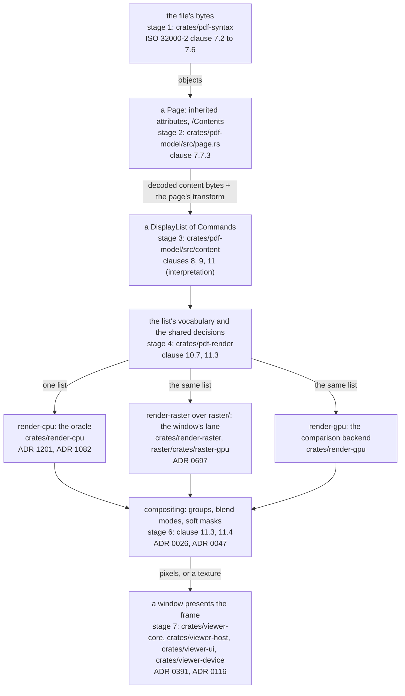
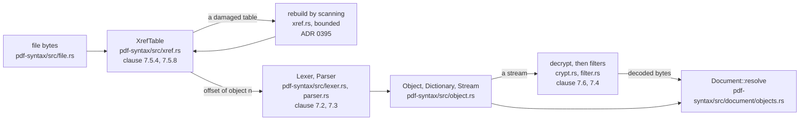
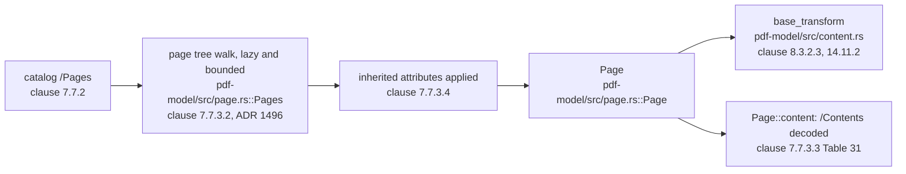
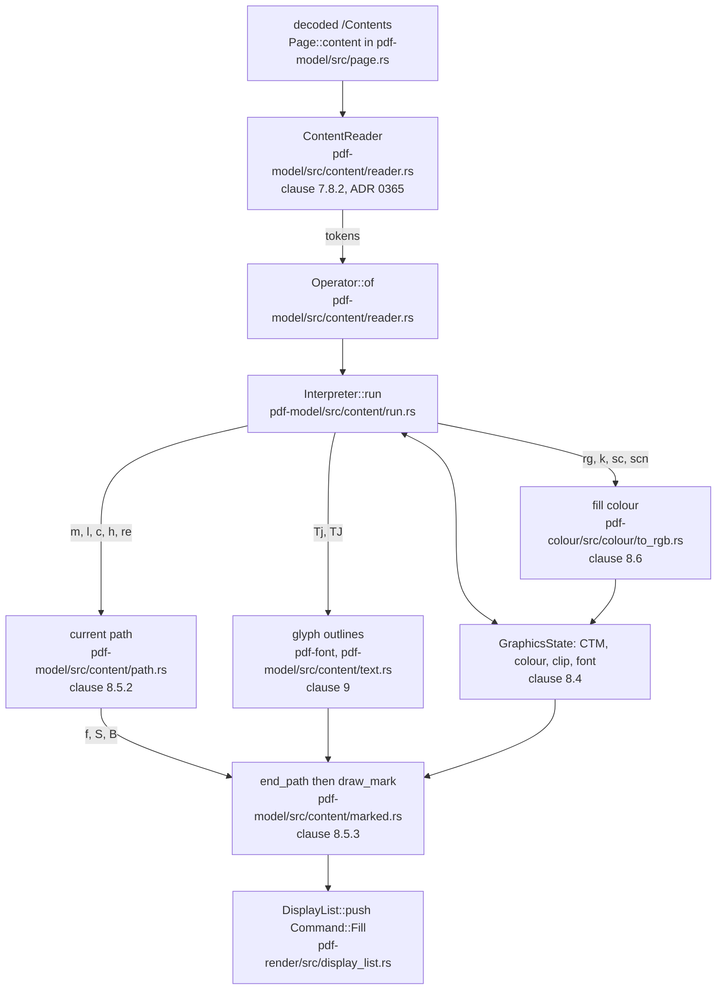
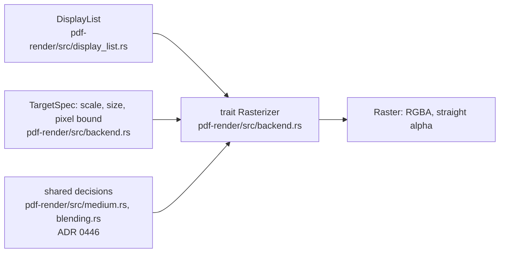
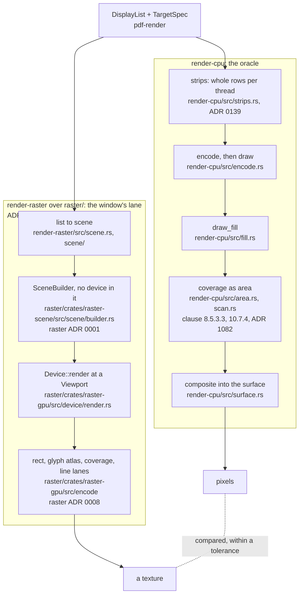
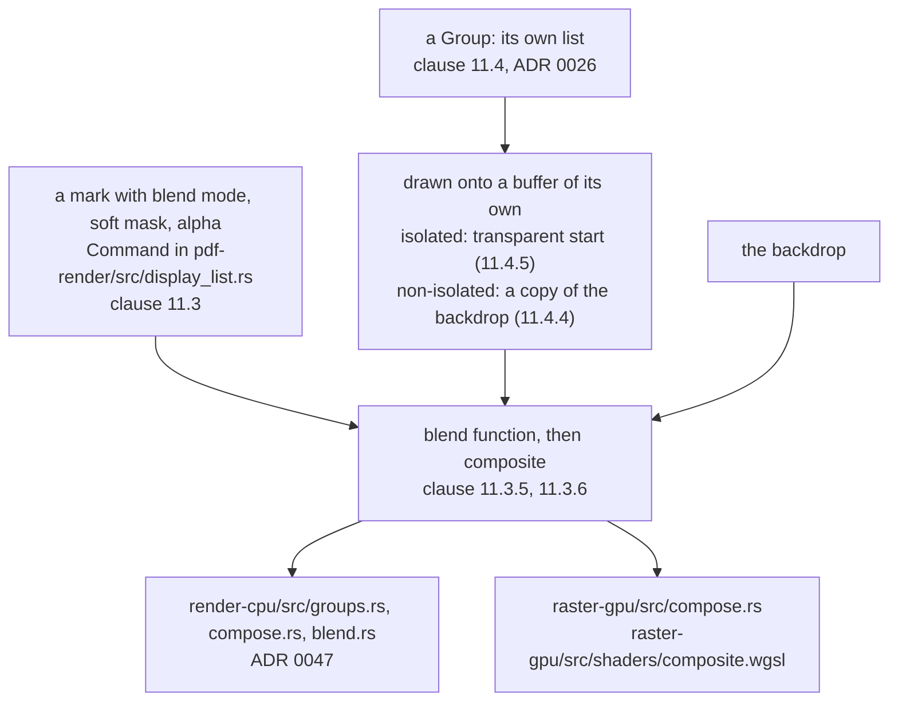
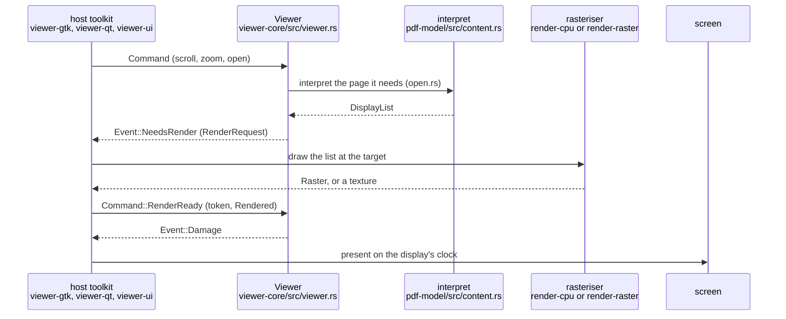

# How a page lands on the screen

Status: **standing** — a walk, not a reference. Read by: a student, or a new contributor, who wants
to follow one instruction of a PDF page from the bytes of the file to a pixel in a window, and to
know which crate, which module and which decision stands at each step.
`doc/crate-map.md` says what each crate is responsible for; this says what happens **in order**.

**This document is checked and it is also allowed to be wrong, and those two facts are the
reason for its last section.** `tools/conformance/tests/teaching.rs` holds every path and every
`file::name` pair it writes to a file that exists and a name the file contains. It cannot hold a
*sentence* true: when a round moves a stage, the sentence about the stage is the round's to redraw.
Each diagram below ends with a **Maintenance note** that says which files and records it depends on,
so the round that changes one knows which diagram it has made stale. The rules for that are in
[Keeping this document true](#keeping-this-document-true).

## The running example

One fragment of a content stream, four operators (ISO 32000-2 §8.5.2.1's `re`, §8.5.3.1's `f`,
§8.6's `rg`, §8.4.2's `q` and `Q`):

```text
q
0.2 0.4 0.8 rg
72 600 200 100 re
f
Q
```

Read aloud: *save the graphics state; make the fill colour a blue; add a rectangle whose lower-left
corner is 72 points across and 600 up and which is 200 wide and 100 high; fill what the path
encloses; restore the state.* Everything below follows the `re` and the `f` from the file's bytes to
the pixels they colour, and says where a text operator (`Tj`), an image (`Do`) and a transparency
group would leave the path.

The standard's own sentence about what such a stream is, §7.8.2:

> A content stream is a PDF stream object whose data consists of a sequence of instructions
> describing the graphical elements to be painted on a page.

and about the order it is read in:

> the objects in the content stream shall be interpreted and acted upon sequentially.

That second sentence is the reason the interpreter in stage 3 is a loop over a bytecode and not a
tree walk.

## The whole walk

Seven stages. The first four are *meaning* — what the file says; they are the same whichever
rasteriser draws, and they are pure functions of the bytes and the view. The last three are
*drawing*, and there are three implementations of the middle one.



**Maintenance note.** Depends on: `crates/pdf-syntax/src/lib.rs`, `crates/pdf-model/src/page.rs`,
`crates/pdf-model/src/content.rs`, `crates/pdf-render/src/lib.rs`, `crates/render-cpu/src/lib.rs`,
`crates/render-raster/src/lib.rs`, `crates/render-gpu/src/lib.rs`, `crates/viewer-core/src/lib.rs`
and `doc/crate-map.md`. Redraw it when a crate is added to or removed from this path, when a fourth
rasteriser appears, or when the order of two stages changes. The cross-backend rule it draws — one
list, many rasterisers — is stated in `crates/pdf-render/src/backend.rs` and is the thing to keep
true above all.

## Stage 1 — from bytes to objects (`pdf-syntax`)

**Question answered:** given a byte slice, what is the object numbered *n*?

`pdf-syntax` is the crate that touches untrusted bytes first, and it is `#![forbid(unsafe_code)]`
(`CLAUDE.md` principle 3). It turns bytes into an object graph and nothing more: a page tree is a
dictionary here, not a page. Meaning belongs to the next stage.

The steps for an object, in the order a reader takes them:

1. **Read the file.** `crates/pdf-syntax/src/file.rs::read_file` returns `FileBytes`; the document
   is then a slice and every later stage borrows from it.
2. **Find the cross-reference table.** `crates/pdf-syntax/src/xref.rs::read` follows the trailer's
   `startxref` to the newest section and then its `/Prev` chain, and produces an `XrefTable` that
   answers `location(n)`. §7.5.4 says what the table is for:

   > The cross-reference table contains information that permits random access to indirect objects
   > within the PDF file so that the entire PDF file need not be read to locate any particular
   > object.

   Real files are damaged, so when the table does not work `xref.rs::rebuild` scans the whole file
   for `N G obj` headers (`xref.rs::scan_for_objects`). **Both paths are bounded**, because
   unbounded recovery is a denial of service dressed as robustness. ADR 0395 is the recovery that
   reads an object stream's own header.
3. **Lex and parse the object at that offset.** `crates/pdf-syntax/src/lexer.rs::Lexer` makes
   tokens (§7.2), `crates/pdf-syntax/src/parser.rs::Parser` makes objects and indirect objects
   (§7.3, `Parser::parse_indirect_object`). `parser.rs::Limits` is what bounds nesting and
   container size.
4. **Decrypt and decode.** A stream's bytes pass `crates/pdf-syntax/src/crypt.rs` (§7.6) and then
   its filter chain, `crates/pdf-syntax/src/filter.rs` (§7.4), in `Document::decoded_stream_data`.
   The three image filters that carry the most attack surface run in a confined process
   (`crates/pdf-sandbox`, `CLAUDE.md` principle 3).
5. **Resolve.** `crates/pdf-syntax/src/document.rs::Document` ties the above together;
   `Document::resolve` (`crates/pdf-syntax/src/document/objects.rs`) turns a reference into the
   object it names, and compressed objects (§7.5.7) are read through their object stream
   (`crates/pdf-syntax/src/document/object_streams.rs`).

The document is immutable once opened. An edit is a log beside it, never a change to it
(`CLAUDE.md`, the authoring exclusion), which is what lets stages 2 to 4 be pure functions.



**Maintenance note.** Depends on: `crates/pdf-syntax/src/xref.rs`, `crates/pdf-syntax/src/lexer.rs`,
`crates/pdf-syntax/src/parser.rs`, `crates/pdf-syntax/src/crypt.rs`,
`crates/pdf-syntax/src/filter.rs`, `crates/pdf-syntax/src/document.rs` with `document/`, and ADR 0395. Redraw it when
the open path changes order (a lazy phase moves, ADR 0890 and ADR 1543 are the two that moved work
off the launch path), when a recovery stops being bounded, or when decryption moves relative to
decoding. `CLAUDE.md` principle 2's "incremental parsing" rule is the constraint a change here has
to respect.

## Stage 2 — from objects to a page (`pdf-model`)

**Question answered:** which dictionary is page *n*, and what does it inherit?

`crates/pdf-model/src/page.rs` is the page tree. The catalog's `/Pages` is a tree whose leaves are
pages, and §7.7.3.4 lets `/Resources`, `/MediaBox`, `/CropBox` and `/Rotate` be set on any ancestor.
`Pages::get` finds a page **lazily** — it walks the tree on demand rather than building a list at
open time, because time-to-first-page is what a person perceives (`CLAUDE.md` principle 2). The walk
is bounded in depth and in nodes visited, and a node met again beneath itself stands for no pages
(ADR 1496). A `Page` carries the inherited values already applied, and
`Page::content(&Document)` is the concatenation of its `/Contents` streams, decoded.

The page also says where it sits. `crates/pdf-model/src/content.rs::base_transform` maps the page's
default user space (§8.3.2.3, with the `/CropBox`, `/Rotate` and `/UserUnit` of §14.11.2 and
Table 31) to the **display list's own coordinates**. The interpreter in stage 3 starts with that as
its current transformation matrix. The scale of a window, a zoom or a thumbnail is *not* applied
there: it is the rasteriser's, supplied separately as a `TargetSpec` (stage 4), which is how one
list serves every magnification.



**Maintenance note.** Depends on: `crates/pdf-model/src/page.rs`, `crates/pdf-model/src/content.rs`,
ADR 1496, ADR 0890 and ADR 1543. Redraw it when the tree walk stops being lazy, when an attribute is
inherited somewhere else, or when the page's own transform moves out of `content.rs`.

## Stage 3 — from a content stream to a display list (`pdf-model`, `pdf-colour`, `pdf-font`)

**Question answered:** what marks does this page make, in what order, under what state?

This is where PDF's *meaning* lives. In `crates/pdf-model/src/content/`:

| step | where | clause |
|---|---|---|
| the bytes arrive a window at a time, parts of `/Contents` chained | `crates/pdf-model/src/content/reader.rs::ContentReader` (`for_page`) | §7.8.2, Table 31 |
| a keyword becomes an operator | `crates/pdf-model/src/content/reader.rs::Operator` (`Operator::of`) | Annex A |
| the operator loop, one flat dispatch | `crates/pdf-model/src/content/run.rs` (`Interpreter::run`) | Annex A |
| path construction and painting | `crates/pdf-model/src/content/path.rs` (`begin_subpath`, `end_path`) | §8.5 |
| colour operators | `crates/pdf-model/src/content/colour.rs` | §8.6 |
| text | `crates/pdf-model/src/content/text.rs`, `crates/pdf-model/src/content/font.rs` | clause 9 |
| images and forms | `crates/pdf-model/src/content/image.rs`, `crates/pdf-model/src/content/xobject.rs` | §8.9, §8.10 |
| transparency and overprint | `crates/pdf-model/src/content/transparency.rs` (its group entry points, with a module per concern beside it in `transparency/`, ADR 2080), `crates/pdf-model/src/content/overprint.rs` | clause 11 |
| patterns | `crates/pdf-model/src/content/pattern.rs` (the `scn` and the paints, with a module per concern beside it in `pattern/`, ADR 2081) | §8.7 |

Following the example:

- `0.2 0.4 0.8 rg` sets the non-stroking colour space to `DeviceRGB` and its components. The
  conversion of a colour to the device is not decided here but in `crates/pdf-colour`
  (`crates/pdf-colour/src/colour.rs::ColourSpace`, whose `to_rgb` (`crates/pdf-colour/src/colour/to_rgb.rs`) is the answer
  to §8.6's one question for every space). The split is deliberate: the interpreter is a question about *marks*,
  `pdf-colour` a question about *colour* (see its crate documentation).
- `72 600 200 100 re` is, by Table 58, `x y m` and three `l`s and an `h`. The `Operator::Rectangle`
  arm of `run.rs` builds exactly those path commands into the current path in user space; nothing is
  drawn.
- `f` is where a path becomes a mark. `Interpreter::end_path` (`path.rs`) drops a trailing `m`
  (§8.5.3.3.1), asks `fill_paint` (`crates/pdf-model/src/content/pattern.rs::fill_paint`) for the
  `Paint`, and hands a `Command::Fill` to `draw_mark`
  (`crates/pdf-model/src/content/marked.rs::draw_mark`), which pushes it onto the `DisplayList`.
  The command carries the path, the CTM at that moment, the fill rule, the paint, the clip, the soft
  mask and the blend mode, and nothing else: it is a complete statement of one mark.
- `Q` restores the graphics state from the stack (§8.4.2). Nothing reaches the list: state is the
  interpreter's, marks are the list's.

A **text** operator takes a different road to the same place. `Tj` asks `crates/pdf-font` for the
outline of each glyph (via `skrifa`, §9.6, §9.7) and emits a `Command::Fill` whose path is the
glyph's outline, shared by `Arc` among every occurrence of the letter — the reason `Fill` holds an
`Arc<Path>`. A text page is therefore mostly fills, and a rasteriser needs no notion of a font.

**The interpreter has budgets, because the standard describes valid files and the world has others.**
A decompression bomb is turned into time rather than memory by the window the stream is read
through (ADR 0365), and a display list is bounded in bytes while `interpret` takes no clock
(ADR 1507). The entry points are `crates/pdf-model/src/content.rs::interpret` and its variants
(`interpret_with`, `interpret_replaceable`); each is a pure function of a document, a page and the
view state.



**Maintenance note.** Depends on: `crates/pdf-model/src/content/reader.rs`,
`crates/pdf-model/src/content/run.rs`, `crates/pdf-model/src/content/path.rs`,
`crates/pdf-model/src/content/marked.rs`, `crates/pdf-model/src/content/text.rs`,
`crates/pdf-colour/src/colour.rs` with `colour/`, `crates/pdf-render/src/display_list.rs`, ADR 1507 and ADR 0365.
Redraw it when an operator family moves to another module, when `draw_mark` stops being the single
way a mark reaches the list, or when a stage between the lexer and the loop appears. The table above
is the part most likely to go stale first: `ls crates/pdf-model/src/content/` is its check.

## Stage 4 — what the list is, and what every rasteriser must agree on (`pdf-render`)

**Question answered:** what is the vocabulary the interpreter and the rasterisers share?

`crates/pdf-render` has no PDF semantics and no rasteriser. It holds:

- **`DisplayList` and `Command`** (`crates/pdf-render/src/display_list.rs`): `Fill`, `Stroke`,
  `Image`, a shading, a group, a clip, a soft mask. A command is a statement of a mark in the list's
  own coordinate space; a clip is referenced by `ClipId` and a soft mask by `SoftMaskId`, resolved
  the same way, because §11.5.1's NOTE 2 calls a soft mask a *soft clip*.
- **The `Rasterizer` trait and `TargetSpec`** (`crates/pdf-render/src/backend.rs`): `rasterize(&mut
  self, list: &DisplayList, target: TargetSpec) -> Result<Raster, _>`. The whole list goes in at
  once, never one command at a time, so a GPU backend can batch. The scale is in the `TargetSpec`,
  so one list is drawn at many magnifications without re-interpreting the content stream, which is
  "the expensive part" in that file's words.
- **The device decisions that must not differ between backends** — for example the medium the page
  is imposed on (`crates/pdf-render/src/medium.rs`, ADR 0446) and the blending-space and transfer
  helpers — so that the rasterisers cannot disagree about them by construction rather than by test.

**Unsupported input is an error, never a skipped command.** A backend that silently omitted a draw
would hand the comparison a plausible-looking wrong image instead of a failure.



**Maintenance note.** Depends on: `crates/pdf-render/src/display_list.rs`,
`crates/pdf-render/src/backend.rs`, `crates/pdf-render/src/medium.rs`,
`crates/pdf-render/src/blending.rs` and ADR 0446. Redraw it when the trait's signature changes, when
a command kind is added (every backend must then draw it or refuse it out loud), or when a decision
moves into or out of this crate.

## Stage 5 — three rasterisers behind one list

**Question answered:** how does `Command::Fill` become coverage on a grid of pixels, and why are
there three ways to do it?

The three, and what each is *for*, as ADR 1201 states it:

| rasteriser | crate | job |
|---|---|---|
| the processor's | `crates/render-cpu` (over `tiny-skia`, with its own exact coverage) | **the oracle**; also draws a frame the graphics device refuses |
| quorra's | `crates/render-raster`, over `raster/crates/raster-gpu` | **what a person's frames go through**: the window draws with it |
| Vello's | `crates/render-gpu` | a comparison backend; not on the shipped path |

**Why the processor's is the oracle.** All three consume one `DisplayList`, so any difference
between their pictures is a backend defect and not a difference in how the document was
interpreted — a far tighter test than comparing against another PDF viewer (that crate's own
documentation). Coverage in `render-cpu` is computed as **area**: the integral of §8.5.3.3's winding
number over §10.7.4's half-open pixel square, in `crates/render-cpu/src/area.rs` (ADR 1082), with
nothing between the geometry and the level. The window's lane must agree with it within a stated
tolerance, and the CPU is correct before it is fast (ADR 0002). Where the specification is silent —
§10.7 leaves scan conversion to the device — the choice made is written down as a choice.

### The processor's road for our rectangle

`CpuRasterizer::rasterize` (`crates/render-cpu/src/lib.rs`) cuts the target into strips of whole
rows (`crates/render-cpu/src/strips.rs`, ADR 0139), each drawn on its own thread from its own replay
of the list, and together the strips are the page drawn in one piece, byte for byte. Inside a strip
`crates/render-cpu/src/encode.rs` walks the commands, clipped to the rows their clip admits, and
`CpuRasterizer::draw` dispatches `Command::Fill` to `crates/render-cpu/src/fill.rs::draw_fill`.
That asks `crates/render-cpu/src/scan.rs` for coverage — a rectangle aligned to the pixel grid takes
the exact rectangle route (`fill.rs::rectangular_mark`), a general path `area.rs::region` — and
composites the colour into the surface by coverage (`crates/render-cpu/src/surface.rs`).

### The window's road for the same rectangle

`QuorraRasterizer` and `QuorraWindowRenderer` (`crates/render-raster/src/lib.rs`,
`crates/render-raster/src/present.rs`) translate the list into a **scene**
(`crates/render-raster/src/scene.rs`, one walk over the commands, `Encoder::commands`;
`Encoder::fill` for our mark, in `crates/render-raster/src/scene/fills.rs`) that carries no device, no resolution and no viewport
(`raster/crates/raster-scene`, `SceneBuilder::fill`). The device half
(`raster/crates/raster-gpu`, `Device::render`) then decides *at a viewport* how the scene is drawn:
a rectangle on the pixel grid takes the analytic rectangle lane
(`raster/crates/raster-gpu/src/shaders/rect.wgsl`), a glyph takes the atlas, a general outline takes a coverage lane. Coverage
for the glyph and path lanes is produced on the CPU so that its bytes are identical on every
adapter (`raster/crates/raster-gpu/src/raster.rs`, `raster/doc/adr/0008-cpu-coverage-rasterisation.md`);
the final blend is the one place an adapter's arithmetic enters, and the oracle comparison bounds it.
Splitting the scene from the device is the library's whole design
(`raster/doc/adr/0001-three-crates-and-a-scene-that-cannot-see-a-device.md`), and is why zoom,
scroll and resize are the same scene at another viewport.

A frame the device cannot or should not draw — a refusal, or a page predicted faster on the
processor — is drawn by `render-cpu` instead and **said out loud** (`CLAUDE.md` principle 2,
ADR 1831, `crates/viewer-device/src/renderer/lanes.rs`).



**Maintenance note.** Depends on: `crates/render-cpu/src/lib.rs`, `crates/render-cpu/src/strips.rs`,
`crates/render-cpu/src/encode.rs`, `crates/render-cpu/src/fill.rs`, `crates/render-cpu/src/area.rs`,
`crates/render-cpu/src/scan.rs`, `crates/render-cpu/src/surface.rs`,
`crates/render-raster/src/scene.rs`, `crates/render-raster/src/scene/fills.rs`,
`crates/render-raster/src/present.rs`,
`raster/crates/raster-scene/src/scene/builder.rs`, `raster/crates/raster-gpu/src/device/render.rs`,
`raster/crates/raster-gpu/src/raster.rs`, ADR 1201, ADR 1082, ADR 0139, ADR 0697, ADR 1831 and
`doc/oracle-and-corpus.md`. Redraw it when a rasteriser is added or retired, when the oracle
changes, when the window's lane changes the order of scene, viewport and device, or when
ADR 1201 is superseded (it supersedes the *record* of ADR 0002 and is the current account of
which rasteriser does what).

## Stage 6 — compositing

**Question answered:** how does a mark combine with what is already under it?

For an opaque mark with the Normal blend mode the answer is "replace by coverage", and the
rectangle above takes it. Everything else is clause 11's: a blend mode (§11.3.5), alpha (§11.3.6),
and the **transparency group** (§11.4): a set of elements drawn onto a buffer of their own and
composited onto the page once, isolated or not, knockout or not. The page itself is a group
(§11.4.7, ADR 0026).

The interpreter does not composite; it records the group as a `Command` holding its own list,
together with the blend mode, the soft mask and the colour space it composites in. Each rasteriser
runs the same arithmetic in its own way:

- `render-cpu`: `crates/render-cpu/src/groups.rs` draws a group onto a buffer of its own;
  `crates/render-cpu/src/compose.rs` chooses over, knockout or the two-stage shaped form; the four
  non-separable modes of §11.3.5.3 are `crates/render-cpu/src/blend.rs`, **written here rather than
  borrowed from `tiny-skia`** and written again in the GPU lane on purpose (ADR 0047). A soft mask
  is `crates/render-cpu/src/soft_mask.rs`.
- `raster`: each layer renders bottom-up into its own premultiplied texture and a child is
  composited onto its parent by a shader, `raster/crates/raster-gpu/src/compose.rs` and
  `raster/crates/raster-gpu/src/shaders/composite.wgsl`; a soft mask is reduced to one channel by
  `raster/crates/raster-gpu/src/shaders/reduce.wgsl`.

Overprint (§8.6.7, §11.7.4) is a blend mode the interpreter stages
(`crates/pdf-model/src/content/overprint.rs`) and the rasterisers draw.



**Maintenance note.** Depends on: `crates/render-cpu/src/groups.rs`,
`crates/render-cpu/src/compose.rs`, `crates/render-cpu/src/blend.rs`,
`crates/render-cpu/src/soft_mask.rs`, `raster/crates/raster-gpu/src/compose.rs`,
`raster/crates/raster-gpu/src/shaders/composite.wgsl`,
`crates/pdf-model/src/content/overprint.rs`, ADR 0026 and ADR 0047. Redraw it when a group kind
changes who owns its buffer, when a third implementation of the blend functions appears, or when the
page group's handling (§11.4.7) moves.

## Stage 7 — from a frame to a window

**Question answered:** what asks for the page, who draws it, and what puts it on the glass?

Interpretation and drawing are not called by the window directly. They sit behind a boundary that is
a **vocabulary and not a trait** (ADR 0116, `doc/ui-boundary.md`): a host sends the viewer a
`Command`, and the viewer answers with `Event`s.

1. A person scrolls or zooms; the host sends `Command::…` to
   `crates/viewer-core/src/viewer.rs::handle` (a method of `Viewer`). Layout (Table 29's `/PageLayout`) decides
   which pages are on screen (`crates/viewer-core/src/layout.rs`).
2. The viewer interprets the page it needs (`crates/viewer-core/src/open.rs::interpret`, which calls
   `pdf_model::content::interpret_replaceable`, stage 3) and emits `Event::NeedsRender` carrying a
   `RenderRequest`: the display list, the target and a token.
3. The host owes a `Command::RenderReady { token, rendered }`. `viewer_core::Rendered` states how:
   `Raster` (pixels the viewer keeps), `Presented` (the host drew on its own surface),
   `Listed` (the host took the list and holds the page itself, per page) or `Failed`, which is
   reported and never swallowed.
4. **The windows answer differently.** The GTK and Qt hosts draw with the processor on a thread of
   their own (`crates/viewer-host/src/drawing.rs`, `CpuRasterizer`) and answer `Rendered::Raster`.
   `quorra` (`crates/viewer-ui/src/bin/quorra.rs`) keeps the list and draws it with
   `QuorraWindowRenderer` onto its swapchain, on a render thread that owns the device, while the
   event thread owns the surface and presents on the display's clock. That device renderer is a
   library of its own, `crates/viewer-device`, so that a toolkit window can draw through the same
   chooser (`crates/viewer-device/src/renderer.rs`, ADR 0391, ADR 0461 and ADR 2049). The render
   thread never sees a `Document` or a `Viewer`, which keeps `interpret` a pure function.
5. In the confined build, the document, the interpreter and the rasteriser run in a process that has
   no filesystem and no network (`crates/viewer-confined`, ADR 0218). A page then crosses to the
   host as the smaller of pixels and marks (ADR 0607), and a page past the bound as the window it
   shows (ADR 1944, ADR 1986).
6. The frame is presented: the page and the window's chrome are two textures, the medium (the
   window's background, never page white) goes under them, and a stale stand-in is drawn while the
   exact frame is being made (`crates/render-raster/src/present.rs`, ADR 0378, ADR 0443).



**Maintenance note.** Depends on: `crates/viewer-core/src/viewer.rs`,
`crates/viewer-core/src/command.rs`, `crates/viewer-core/src/event.rs`,
`crates/viewer-core/src/open.rs`, `crates/viewer-host/src/drawing.rs`,
`crates/viewer-device/src/renderer.rs`, `crates/viewer-ui/src/bin/quorra/dispatch.rs`,
`crates/viewer-confined/src/lib.rs`, `doc/ui-boundary.md`, ADR 0116, ADR 0391, ADR 0461, ADR 0607 and
ADR 1986. Redraw it when a host stops answering a `Rendered` it answered, when the render thread's
duties move, or when `Command` or `Event` gain a variant on the path from `NeedsRender` to a
present. This is the stage that changed most often, and the one to check first.

## What the walk leaves out

The walk follows a path fill. It does not follow: annotations and form-field appearances
(`crates/pdf-model/src/annotation.rs`, `crates/pdf-model/src/appearance.rs`; §12.5.5 places an
appearance stream by the annotation's `/Rect`), which re-enter at stage 3 as another content
stream; optional content (§8.11), which is decided in stage 3 before a mark is made; shadings and
patterns, which are paints and not colours; the sandbox's seccomp and Landlock layers; the writer
(`crates/pdf-syntax/src/serialize.rs`); signatures; and scripts. Each has a row in
`doc/crate-map.md`, which is the next document to open.

## Keeping this document true

Written for the round that changes the code, not for the one that reads this.

1. **The test is the floor.** `tools/conformance/tests/teaching.rs` reads this file and holds
   every `crates/…`, `raster/…`, `doc/…` and `tools/…` path to a file or directory that exists, every
   `path::name` pair to a file that contains `name`, every `ADR NNNN` to a record in `doc/adr/`,
   every diagram to its **Maintenance note**, and `doc/HANDOVER.md` and `doc/crate-map.md` to a pointer
   to this file. Run it with `cargo test -p conformance --test teaching`.
2. **The test cannot read a sentence.** A round that moves a function between modules, splits a file
   or changes which rasteriser a window uses reads the Maintenance notes above for the files it
   touched, redraws the diagram and rewrites the sentence beside it **in the present tense, as what
   is** (ADR 1023), not as what changed.
3. **A new stage or a new rasteriser is a new section** with a diagram and a Maintenance note, in
   the order the walk takes it.
4. **A claim that stops being true is deleted or corrected, not annotated.** The record of why is
   `doc/adr/` and `doc/history/`.
5. **A bug found while drawing a diagram is reported, not fixed in the same change** (the owner's
   rule for the round that wrote this): the diagram says what the code does, and a bug is a gap
   between that and what the standard says.
