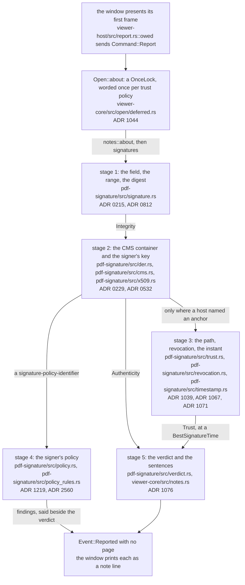
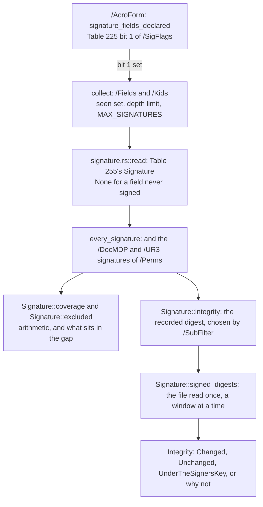
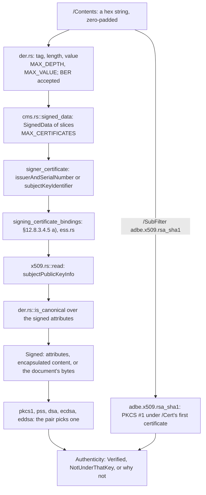
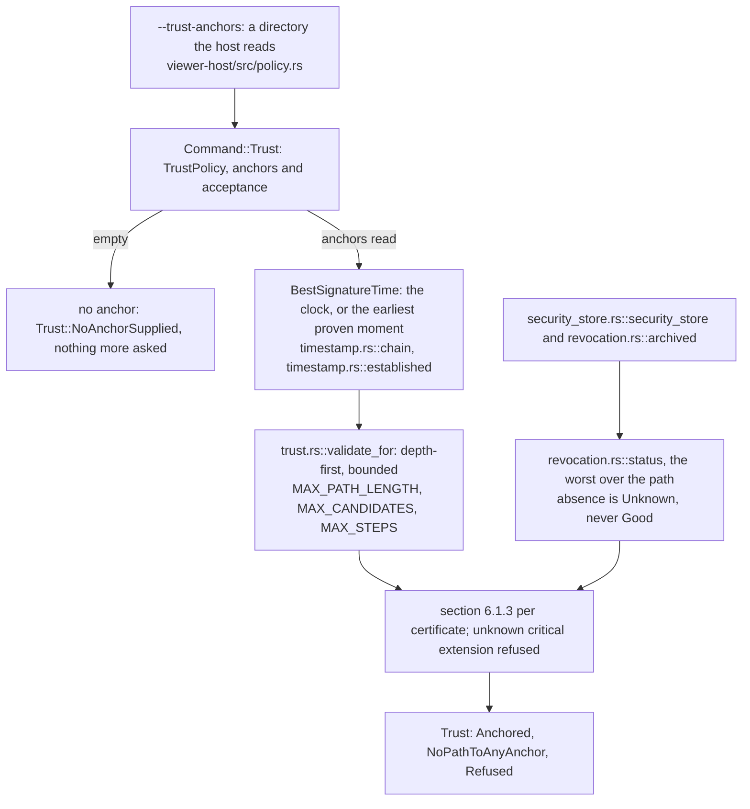
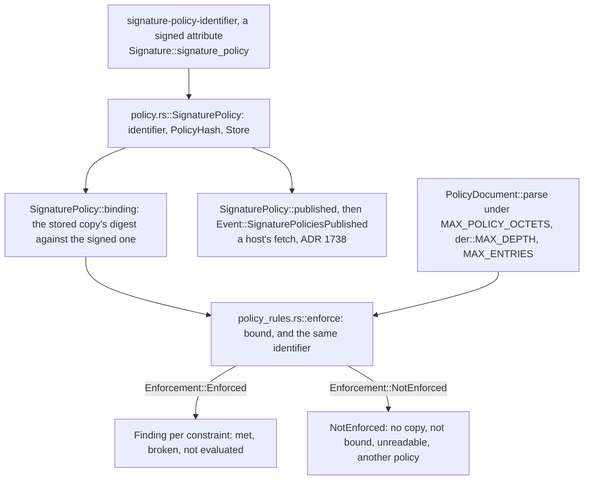
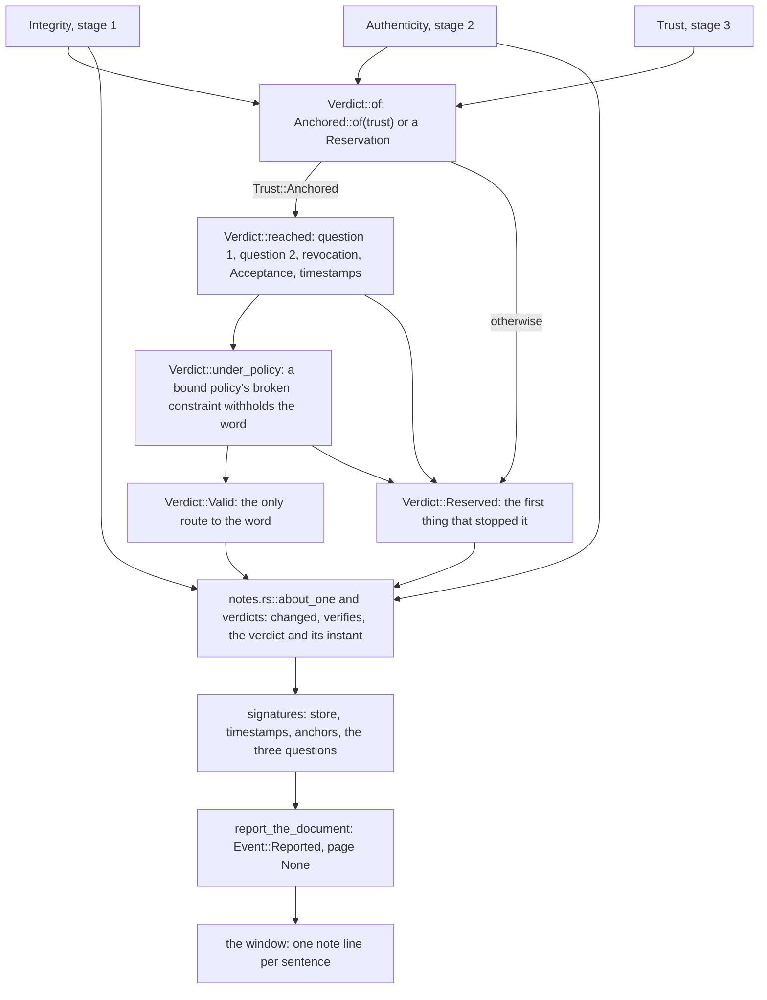

# How a signature is verified

Status: **standing** — a walk, not a reference. Read by: a student, or a new contributor, who has
followed [how a page lands on the screen](how-a-page-lands-on-the-screen.md) and now wants to follow
what the program does with a document somebody *signed*: the field that holds the signature, the
bytes it names and the digest recomputed over them, the CMS container and the key it is checked
under, the certification path and what the file says about revocation, the signer's policy, and
the sentences a reader is finally shown. `doc/crate-map.md` says what each crate is responsible
for; this says what happens **in order**.

**It describes the signature stack as of commit 2d54febf, with round 1863's
`crates/pdf-signature/src/policy_rules.rs` (ADR 2560) on it** — the code `pdf-signature` and
`viewer-core`'s `crates/viewer-core/src/notes.rs` held when this walk was drawn. Two things stay
owed and change stage 4 when they land: the rules of the second ASN.1 syntax ETSI TS 119 172-3
defines, which `policy_rules.rs` tells apart and refuses by name today, and the XML syntax of ETSI
TS 119 172-2 (see [Keeping this document true](#keeping-this-document-true)).

**This document is checked and it is also allowed to be wrong, and those two facts are the reason
for its last section.** `tools/conformance/tests/teaching.rs` holds every path and every
`file::name` pair it writes to a file that exists and a name the file contains, and every ADR it
cites to a record. It cannot hold a *sentence* true: when a round moves a stage, the sentence about
the stage is the round's to redraw. Each diagram below ends with a **Maintenance note** that says
which files and records it depends on, so the round that changes one knows which diagram it has
made stale.

**One rule about quotation runs through all of it.** ETSI's texts — EN 319 122-1, EN 319 102-1,
TR 102 272 and the TS 119 172 parts — permit no reproduction, so nothing in this tree quotes them:
they are cited by clause and paraphrased (ADR 1085). ISO 32000-2 is quoted the usual way, with a
`§`, and so are the RFCs, which are free to quote.

**And one word runs through all of it: *valid*.** Every stage below answers a question and says
less than that word. A digest that matches, a signature that verifies, a path that reaches an
anchor — each is a fact, and only the last stage may join them into the word, through a type that
cannot be made any other way. Watching where the word is *not* said is most of what this walk
teaches.

## The running example

`bug854315.pdf`, a one-page document from pdf.js's test corpus (a submodule this tree links rather than holds,
so it is named here by its file name alone) and the witness `crates/viewer-core/src/notes.rs` names for one branch of stage 2. It
has one signature field whose value is an `adbe.pkcs7.detached` signature — the most common
`/SubFilter` there is — and its `SignerInfo` carries **no signed attributes**. That one fact
decides more of the walk than anything else in the file, which is why it is the example.

The request is the window opening the file, and nothing else:

```text
quorra bug854315.pdf
```

No trust anchors are named (no `--trust-anchors`), which is every host's default. What the window
prints on its terminal, once the first page is on the screen, was read off a `dev` build of `quorra`
from an export of that commit with round 1863's files, under Xvfb — one sentence a line:

```text
note: this document is signed by an unnamed signer, reason: Scopo della firma: Genehmigt, at 2011-01-17T23:52:39+01:00
note: and that signature verifies under the 2048-bit RSA (PKCS #1 v1.5) key in a certificate the file itself carries, directly over the bytes its /ByteRange names — so those bytes are the ones that were signed and nothing has changed since
note: that signature carries a timestamp of its own (§12.8.3.3.1's unsigned signature timestamp attribute, RFC 3161 Appendix A), stating genTime 20110117225318.526Z. The imprint inside it is the digest of this signature's own bytes. Whether the authority that issued it is one to believe is the same unanswered question as above
note: of the three questions a signature asks, this program answers two: whether the document changed since it was signed (§12.8.1's digest, recomputed above) and whether the signature verifies under the public key in the certificate the file itself carries (§12.8.3.3.1). It does not answer the third — it has no certificate store and makes no network request, so it does not know whether that certificate belongs to anyone you have reason to believe. It can now say whether a certificate was revoked, but only from the material the file itself carries and only once somebody names a certification authority to end the chain at, which nothing here does. A signature that verifies here was made by whoever holds the key in a certificate that arrived with the document, which is not the same as a valid signature. Nothing here says valid
```

Four lines. The first and the last are stage 5's wording; the second is stage 2's answer, which here
settles stage 1's too; the third is the signature's own RFC 3161 timestamp, read and checked against
the signature's bytes, whose authority nobody has vouched for — stage 3's question, unasked. No line
says what the range leaves out (it leaves out nothing), no line is a verdict (no anchor was named),
and no line is about a policy (the signature states none).

## The whole walk

Five stages. The first two answer the two questions a file can answer about itself: *has the
document changed since it was signed* (stage 1, the byte range and its digest) and *does the
signature verify under the key in the certificate the file carries* (stage 2, the CMS container).
The third answers the question a file cannot answer about itself — *is that key anybody's* — and
only when a host has said whom to believe (stage 3, the certification path and the document's own
revocation material). The fourth reads what the signer committed to beyond the bytes (stage 4, the
signature policy). The fifth joins the answers into a verdict and words every answer for a person
(stage 5).

The first three are §12.8.1's own division. The standard writes them as one paragraph: the
signer's certificate is to be determined and verified, and "[t]he digest shall be recomputed and
compared with the one stored in the document". ADR 0215 is the decision to answer them separately,
because questions 1 and 2 need no trust store and the whole clause used to be refused on question
3's infrastructure.



**Maintenance note.** Depends on: `crates/viewer-host/src/report.rs`,
`crates/viewer-core/src/viewer/navigation.rs`, `crates/viewer-core/src/open/deferred.rs`,
`crates/viewer-core/src/notes.rs`, `crates/pdf-signature/src/signature.rs`,
`crates/pdf-signature/src/verdict.rs`, ADR 0215 and ADR 1044. Redraw it when the report moves onto
the open path, when a stage is added or two merge, or when the policy's findings start to decide
the verdict rather than standing beside it. The rule it draws — **only stage 5 may say *valid*, and
only after stage 3 reached an anchor a host supplied** — is ADR 1076's, and it is the one to keep
true above all.

## Stage 1 — the field, the byte range and the digest (`pdf-signature`)

**Question answered:** which signatures does this file hold, what bytes did each one sign, and do
those bytes still hash to what the signature recorded?

1. **The form says whether to look.** `crates/pdf-signature/src/signature.rs::signatures` reads the
   catalog's `/AcroForm` and asks `signature_fields_declared` first: Table 225's bit 1 of
   `/SigFlags`, `SignaturesExist`, whose default is 0, so an absent entry is the form stating it has
   no signature field. That was counted against the corpus before it was trusted (the comment
   carries the count), and it keeps a form with dozens of fields and no signature from walking them.
2. **The walk is bounded before it starts.** `collect` descends `/Fields` and `/Kids` with a set of
   the objects already seen, a depth limit, and `MAX_SIGNATURES`, so a field tree that loops or
   nests without end costs a bounded amount. A field whose `/FT` is `/Sig` and whose `/V` is a
   dictionary is handed to `crates/pdf-signature/src/signature.rs::read`, which makes Table 255's
   `Signature` — and answers `None` for a dictionary with neither `/ByteRange` nor `/Contents`,
   which is a field prepared for a signature and never signed. `notes.rs`'s `every_signature` adds
   the two signatures §12.8.6's `/Perms` names (the `/DocMDP` and `/UR3` ones), which may be
   reachable from nowhere else.
3. **What the range covers needs no cryptography.** `Signature::coverage` is arithmetic over the
   pairs against the file's length: `Coverage::WholeFile`, `Coverage::Unsigned` with the number of
   bytes after the range — an incremental update appended after signing, which §12.8.1's NOTE 1
   makes the ordinary way a signed document goes on being used — or `Coverage::Malformed`.
   `Signature::must_cover_whole_file` is the one case where the tail is a broken `shall` rather than
   a fact: Table 255 requires the whole file for `ETSI.CAdES.detached` and `ETSI.RFC3161`.
   `Signature::excluded` asks the question arithmetic cannot — *what sits in the gap* — because
   §12.8.1 says the only thing left out is the signature value itself, and bytes in the gap that are
   not `/Contents` are the classic forgery.
4. **The recorded digest is found by the `/SubFilter`, never by trying.** `Signature::integrity`
   reads the value through `crates/pdf-signature/src/cms.rs::signed_data` (stage 2 says how) and
   takes the digest from the one place the format puts it: a document timestamp's `TSTInfo`
   imprint, `adbe.pkcs7.sha1`'s encapsulated SHA-1, or every other CMS format's `message-digest`
   signed attribute. Guessing from the encoding would compare the wrong two values for
   `adbe.pkcs7.sha1` and report a modified document that is not.
5. **The file is read once, a window at a time.** `Signature::signed_digests` digests every range
   off `pdf_syntax::FileBytes` without holding the signed bytes in memory — on a signed document
   that is nearly the whole file, and none of it draws a page (ADR 0812).

The answer is `crates/pdf-signature/src/signature.rs::Integrity`, and its variants are the point:
`Changed` and `Unchanged` name the digest; `UnderTheSignersKey` says nothing records the digest in
the open; `RangeNotInThisFile`, `RangeNotReadable`, `UnknownDigest`, `NoSignatureValue` and
`Unreadable` each say why the question was not answered rather than answering it wrongly. **A
matching digest proves less than a mismatching one**: the recorded digest sits beside the
signature, so whoever edits the document can edit it too. A difference proves the bytes moved; an
agreement proves only that nothing changed carelessly, until stage 2 shows the digest is under the
signer's key.

In the example, the range covers the whole file, so no tail line is printed; and the `SignerInfo`
has no signed attributes, so there is no `message-digest` to compare and the answer is
`UnderTheSignersKey` — which stage 5 does not print, because stage 2's answer settles it.



**Maintenance note.** Depends on: `crates/pdf-signature/src/signature.rs` (`signatures`,
`collect`, `read`, `coverage`, `excluded`, `integrity`, `signed_digests`),
`crates/viewer-core/src/notes.rs` (`every_signature`, `range_notes`), ADR 0215 and ADR 0812.
Redraw it when a new `/SubFilter` places its digest somewhere else, when the walk stops trusting
`/SigFlags`, or when the signed bytes start being held in memory. A test of this stage's
behaviour over real files is `crates/pdf-signature/tests/signatures.rs`.

## Stage 2 — the CMS container and the signer's key (`pdf-signature`)

**Question answered:** what is inside the signature value, which certificate signed it, and does the
signature verify under that certificate's key?

§12.8.3.3.1 says what the value is: "When CMS signatures are used, the value of Contents shall be a
DER-encoded CMS binary data object containing the signature." Reading one is reading a stranger's
ASN.1, so this stage is mostly about bounds.

1. **One ASN.1 reader, in the tree, bounded.** `crates/pdf-signature/src/der.rs` is X.690's
   tag-length-value reader and the tree's only ASN.1. It allocates nothing — every accessor hands
   back a sub-slice of the caller's buffer — and every loop is bounded by something that is not the
   file's own arithmetic: `MAX_DEPTH` for nesting, `MAX_VALUE` for the whole input, four octets for
   a length. ADR 0215 argues an in-tree reader over a dependency for input this hostile, and ADR
   0229 weighs a general ASN.1 package against it when the certificates had to be read too.
2. **BER where RFC 5652 writes BER, DER where it writes DER.** Producers write indefinite lengths,
   which DER forbids — Adobe's own handler opens its `ContentInfo` with `30 80` — so the reader
   accepts them. But RFC 5652 section 2 names the one region that must be DER, the signed
   attributes, and `crates/pdf-signature/src/der.rs::is_canonical` is what a caller about to digest
   that region asks first. The tolerance has the RFC's boundary, not the reader's.
3. **The container, read for what the questions need.** `crates/pdf-signature/src/cms.rs::signed_data`
   makes a `SignedData` of slices: the encapsulated content and its type, the certificates (at most
   `MAX_CERTIFICATES`), the one `SignerInfo`'s digest and signature algorithms, its signed and
   unsigned attributes, its signature value, and the `message-digest` stage 1 compared. Nothing
   here is a trust decision.
4. **The verification, in the order the clause states it.** `Signature::authenticity` sends
   §12.8.3.2's `adbe.x509.rsa_sha1` — a PKCS #1 value with the certificate in `/Cert` and no CMS
   object at all — down its own path, and every CMS format to
   `crates/pdf-signature/src/signature.rs::authenticity_of`, which takes these steps and returns at
   the first that does not hold:
   - the signature algorithm is one this program knows, and the signer's certificate is among the
     certificates the value carries, found by RFC 5652's `issuerAndSerialNumber` or
     `subjectKeyIdentifier` (`signer_certificate`);
   - **§12.8.3.4.5 a)'s first sentence before its second**: where the signer signed a hash of the
     certificate it meant (RFC 5035's signing-certificate attribute, read by
     `crates/pdf-signature/src/ess.rs`), `signing_certificate_bindings` compares it — so a
     `Verified` never exists, even for a moment, over a certificate the signer did not name;
   - the certificate is read by `crates/pdf-signature/src/x509.rs::read` for its key, and a key or
     curve this program does not compute is named by its identifier;
   - the signed attributes, if any, are held to DER;
   - **what is signed** is settled by RFC 5652 section 5.4: the signed attributes if there are any,
     the encapsulated content if there is one, and otherwise the document's bytes themselves
     (`Signed`);
   - the pair — the `SignerInfo`'s algorithm and the certificate's key — picks one family:
     RFC 8017's two RSA paddings (`crates/pdf-signature/src/pkcs1.rs::verify`,
     `crates/pdf-signature/src/pss.rs::verify`), DSA (`crates/pdf-signature/src/dsa.rs::verify`),
     ECDSA (`crates/pdf-signature/src/ecdsa.rs::verify`) or `EdDSA`
     (`crates/pdf-signature/src/eddsa.rs::verify`). A pair that contradicts itself — DSA named over
     an RSA key — is refused, because choosing which claim to believe would be this program
     inventing a fact.

The answer is `Authenticity`, and its strongest variant is `Authenticity::Verified`, which means
exactly this: the signature was made with the key in a certificate **that arrived in the same file**.
A forger who edits the document cannot produce that, so it is a real check, but it is not a
statement that the signer is anybody (ADR 0229). The arithmetic is reviewed code behind
`crates/pdf-signature/src/bigint.rs`, a seam that keeps the budgets and the refusal names this
project's own; the two curves no reviewed package carries are private stopgaps behind the ECDSA
and `EdDSA` modules' named-curve seams (ADRs 1385 and 1386).

In the example there are no signed attributes and no encapsulated content, so what was signed is
`Signed::TheDocumentsBytes` — the byte range itself — and the digest the signature commits to is
recomputed off the file a window at a time, as in stage 1. The signature verifies. **Here question 1's
answer comes from question 2**, and `notes.rs`'s `verdicts` says so by printing one sentence, not
the two that would call the same question unanswered and then answer it.



**Maintenance note.** Depends on: `crates/pdf-signature/src/der.rs`,
`crates/pdf-signature/src/cms.rs`, `crates/pdf-signature/src/ess.rs`,
`crates/pdf-signature/src/x509.rs`, `crates/pdf-signature/src/signature.rs` (`authenticity`,
`authenticity_of`, `signing_certificate_bindings`), the five family modules, ADR 0215, ADR 0229 and
ADR 0532. Redraw it when the order of `authenticity_of`'s steps changes, when a family or a curve
is added, or when `der.rs` starts allocating.

## Stage 3 — the certification path, revocation and the instant (`pdf-signature`, `viewer-core`)

**Question answered:** is the signer's certificate anybody's the reader was told to believe, had it
been revoked, and as of when is either asked?

§12.8.3.4.5 b) hands the path to RFC 5280 clause 6, "using a set of validation parameters", and RFC
5280 section 6.1.1 makes the trust anchors one of those parameters — input (d) — and says choosing
them is a matter of policy. **That sentence is this stage's design.**

1. **The anchors are an input, and empty by default.** `crates/pdf-signature/src/trust.rs` holds
   no certificate list, reads no file, opens no socket and asks no clock (ADR 1039). A host reads a
   directory of certificates — the `quorra` window's `--trust-anchors`, read by
   `crates/viewer-host/src/policy.rs::trust_anchors` — and hands `viewer-core` a `TrustPolicy` by
   `Command::Trust`; with none, `Signature::trust` answers `Trust::NoAnchorSupplied` and `verdicts`
   in `notes.rs` returns before asking anything further. That is the example's case, and why its
   output has no verdict line.
2. **The path is built and validated, under bounds.** `crates/pdf-signature/src/trust.rs::validate_for`
   searches depth-first from the signer's certificate upwards through the certificates the file
   carries, bounded by `MAX_PATH_LENGTH`, `MAX_CANDIDATES` and `MAX_STEPS`, with no certificate
   twice in one path. Each certificate is checked in section 6.1.3's lettering — its signature under
   the working key (the same five families as stage 2), its validity period at the instant asked,
   its issuer name, `basicConstraints`, path length, `keyUsage` — and **a critical extension this
   reader does not recognise is a refusal**, which is what makes the steps it omits (the policy tree,
   name constraints) safe rather than silent. Names are compared as encoded bytes, so a mistake
   fails a path that should chain and never joins one that should not.
3. **Revocation comes from the file, and absence is never good.** RFC 5280 section 6.1.3 (a)(3) is
   answered from §12.8.4's document security store
   (`crates/pdf-signature/src/signature/security_store.rs::security_store`, read once per document)
   and from the signature's own `adbe-revocationInfoArchival` attribute
   (`crates/pdf-signature/src/revocation.rs::archived`). `crates/pdf-signature/src/revocation.rs::status`
   asks the OCSP responses and CRLs about each certificate on the path and the path's answer is the
   worst of theirs. A certificate no material covers is `Revocation::Unknown`, never
   `Revocation::Good`; a `Revoked` stands even when the list is stale, because a revocation is a
   statement its issuer made and an expiry window does not withdraw it (ADR 1067). Nothing here
   opens a socket.
4. **The instant is proven, not read.** `viewer-core`'s `notes.rs::signatures` asks the path at a
   `BestSignatureTime`: the reader's clock, unless something proved the signature existed earlier —
   a §12.8.5 document timestamp over it, or the signature's own RFC 3161 timestamp attribute — and
   then the earliest proven moment, which is ETSI EN 319 102-1 clause 5.5.4's rule. A token's
   `genTime` becomes an instant only when its own signature verifies and its own path reaches an
   anchor (`crates/pdf-signature/src/timestamp.rs::established`), and §12.8.5's chain of document
   timestamps is established from the outside in, each earlier token asked about at the instant the
   one over it established (`crates/pdf-signature/src/timestamp.rs::chain`, ADR 1071).

The answer is `Trust`. `Trust::Anchored` carries the path's length and what the material said about
revocation; `NoPathToAnyAnchor` and `Refused` say how far the search got. **None of its variants
says *trusted***: a path that reached a host's anchor is a path that reached a host's anchor.



**Maintenance note.** Depends on: `crates/pdf-signature/src/trust.rs`,
`crates/pdf-signature/src/revocation.rs`,
`crates/pdf-signature/src/signature/security_store.rs`, `crates/pdf-signature/src/timestamp.rs`,
`crates/pdf-signature/src/signature.rs` (`trust`, `trust_for`), `crates/viewer-core/src/notes.rs`
(`signatures`, `BestSignatureTime`'s use), `crates/viewer-host/src/policy.rs`, ADR 1039, ADR 1067
and ADR 1071. Redraw it when anything here opens a socket, when a default anchor set appears, when
the policy tree is implemented rather than refused by (o), or when the instant is chosen by another
rule.

## Stage 4 — the signer's policy (`pdf-signature`)

**Question answered:** what did the signer commit to beyond the bytes, and does this signature keep
those commitments?

§12.8.3.4.4's explicit-policy profile requires a `signature-policy-identifier` signed attribute and
hands its rules to ETSI EN 319 122-1 clause 5.2.9, and it closes on the validator's duty: conforming
signature handlers "shall enforce signature policy constraints". A policy is an identifier the
signer signed, a hash of the policy's document, and — optionally, in an *unsigned* store — the
document itself.

1. **Which policy, and whether the signer committed to a document.**
   `crates/pdf-signature/src/policy.rs::SignaturePolicy` is read by `Signature::signature_policy`
   only for a signature that states the attribute; one under no explicit policy owes this stage
   nothing. `PolicyHash` keeps apart a digest the signer stated and an all-zero one, which clause
   5.2.9.1 defines as the signer saying the digest is not known.
2. **Whether the stored copy is that document.** The store is unsigned, so a stored copy is
   anybody's until `SignaturePolicy::binding` compares its digest with the one the signer signed. A
   match is decisive; a mismatch is `Binding::DoesNotMatchTheStoredOctets` carrying the
   specification the file named, **not** an alteration, because the specification may prescribe a
   canonicalisation before hashing that this program does not perform (ADR 1219). Each notice the
   signer meant to be shown at validation is shown.
3. **Where a copy is published, the host may fetch it.** A URL qualifier names one, and
   `SignaturePolicy::published` becomes `Event::SignaturePoliciesPublished` after the report's
   sentences; the windows fetch it under the reader's level (ADR 1738) — nothing in this crate reaches a
   network — and a fetched copy is held to the same binding by `PublishedPolicy::binding`.
4. **A bound copy is enforced, one constraint at a time.**
   `crates/pdf-signature/src/policy_rules.rs::enforce` acts only on a stored copy that is bound —
   by the signed digest, or by the policy's own hash that `PolicyDocument::parse` re-computes — and
   that names the policy the signer named; anything else is a `NotEnforced` reason, said as one.
   The document is read under three budgets checked before anything is allocated:
   `MAX_POLICY_OCTETS`, `der::MAX_DEPTH` through the DER pre-pass `der::is_canonical` (which walks
   the whole document before a list is built), and `MAX_ENTRIES`. Each constraint of ETSI TR 102
   272 clause 6 becomes a `Finding` whose `Verdict` is met, broken, or not evaluated — the signing
   period against `SignerFacts::of`'s instant, the mandated attributes, the certificate references,
   the commitment types, the signer's algorithms and minimum key length — and **a constraint this
   program cannot evaluate is said to be one, never counted as met** — the module's own rule, with
   the readings behind its findings recorded in ADR 2560. The trust
   conditions of clauses 6.7 to 6.9 are not evaluated: their trust points would be the policy's,
   and in this tree trust points are a host's (stage 3).

The example states no policy, so this stage prints nothing for it. A signature that does gets a
line naming the policy and the binding, a line per notice, and then either the count of constraints
and one line per finding, or the one sentence saying why nothing was enforced
(`crates/viewer-core/src/notes.rs` `signature_policy` and `policy_constraints`).



**Maintenance note.** Depends on: `crates/pdf-signature/src/policy.rs`,
`crates/pdf-signature/src/policy_rules.rs`, `crates/pdf-signature/src/signature.rs`
(`signature_policy`), `crates/viewer-core/src/notes.rs` (`signature_policy`, `policy_constraints`),
ADR 1219, ADR 1738 and ADR 2560. Redraw it when TS 119 172-3's rules or TS 119 172-2's XML are
enforced, when a fetched copy is enforced as well as bound, or when a broken constraint starts to
withhold the verdict of stage 5.

## Stage 5 — the verdict, and the sentences a reader is shown (`pdf-signature`, `viewer-core`, the window)

**Question answered:** when may the program say *valid*, and how does every answer reach a person?

1. **The word is a type.** `crates/pdf-signature/src/verdict.rs::Valid` has no public constructor
   and no public field. `Verdict::reached` is the only function that makes one, and it takes an
   `Anchored`, which `Anchored::of` makes only from `Trust::Anchored`. So a caller holding no anchor
   cannot reach the word by any path, including a wrong one (ADR 1076). `Verdict::of` is the entry
   `notes.rs` calls: without an anchored path it is a `Reservation` naming why — no anchor, no path,
   the path refused.
2. **The checks run in §12.8.1's order, and the first failure is the answer.** `Verdict::reached`
   asks question 1 (`Changed` stops it; `UnderTheSignersKey` does not, since question 2 answers it),
   question 2, then what the document's material said about revocation, then the host's
   `Acceptance` where that material decided nothing, then the document timestamps. A revocation that
   took effect after the signature is *proven* to have existed does not reach it (ETSI EN 319 102-1
   clause 5.5.4) — and the reader's clock is not a proof, so without a token it does. One check
   runs after the word is reached: `Verdict::under_policy` takes stage 4's findings and turns a
   `Valid` into a `Reservation` naming the first broken constraint of a bound policy, because
   §12.8.3.4.4 says handlers "shall enforce signature policy constraints"; it can only withhold
   the word, never grant it, and a constraint that was not evaluated changes nothing (ADR 2560).
3. **Every answer becomes a sentence, and no sentence says more than its answer.**
   `crates/viewer-core/src/notes.rs::about_one` words one signature: who signed, why and when; what
   the range leaves out; the direct-object rule for a signature dictionary; then `verdicts`, which
   words `Integrity` (`changed`) and `Authenticity` (`verifies`), and — only where a host named an
   anchor — the verdict with the instant it was asked at and on whose word; then the revocation
   attribute, the signature's own timestamp, §12.8.3.4's PAdES departures, and stage 4's policy.
   After every signature, `signatures` adds what the security store, the document timestamps and the
   anchors came to, and a closing paragraph naming the three questions and which of them were asked —
   **keyed on the anchors that read, not on what a host handed over**, so a directory of files none of
   which is a certificate does not make the paragraph claim the third question was asked.
4. **The report waits for the first page.** Nothing here is on the launch path: digesting the signed
   ranges reads nearly the whole file and draws nothing (principle 2, ADR 1044). Once the window
   has presented a frame, `crates/viewer-host/src/report.rs::owed` sends `Command::Report`;
   `crates/viewer-core/src/viewer/navigation.rs::report_the_document` answers with
   `Event::Reported` with no page, built by `crates/viewer-core/src/open/deferred.rs::about` — a
   `OnceLock`, so a second asking is free, which `forget_about` drops when `Command::Trust` changes
   whom the reader believes. The `quorra` window prints each sentence as a `note:` line
   (`crates/viewer-ui/src/bin/quorra/dispatch.rs`); the native windows show the same list
   (`crates/viewer-host/src/native_window.rs`).

The example's four lines are all `about_one`'s and `signatures`' wording: the signer, the
verification (which settles the digest, so `changed` is not said), the signature's own timestamp,
and the closing paragraph saying two of three questions were answered and that nothing here says
valid.



**Maintenance note.** Depends on: `crates/pdf-signature/src/verdict.rs`,
`crates/viewer-core/src/notes.rs` (`about_one`, `verdicts`, `changed`, `verifies`, `signatures`),
`crates/viewer-core/src/open/deferred.rs`, `crates/viewer-core/src/viewer/navigation.rs`,
`crates/viewer-host/src/report.rs`, `crates/viewer-ui/src/bin/quorra/dispatch.rs`, ADR 1044 and
ADR 1076. Redraw it when a second function can make a `Valid`, when the order of
`Verdict::reached`'s checks changes, or when the report moves in front of the first page.

## What the walk leaves out

The walk follows one signature through one window with no anchors. It does not follow:
§12.8.2.2.2's second step, which compares the signed revision with the current one object by object
and ranks what changed against `/DocMDP`'s level and `/UR3`'s rights
(`crates/pdf-signature/src/revision.rs`, worded by `notes.rs`'s `modifications`, ADR 1104); the
restrictions those signatures place on what a reader may do, collected with the document's others
in `crates/pdf-model/src/restriction.rs` and decided at the levels `CLAUDE.md` gives the reader; a
signed document archived, whose signatures lose their values under a named loss
(`crates/pdf-transform/src/archive/signatures.rs`); the confined window, where the same commands
cross a process boundary (`crates/viewer-confined/src/protocol/command.rs`); and the arithmetic
inside each family, which is the reviewed packages' and `bigint.rs`'s seam. ADR 1020 says why
signatures are a crate of their own and not part of the document model, and the crate's own
`crates/pdf-signature/src/lib.rs` is the next document to open.

## Keeping this document true

Written for the round that changes the code, not for the one that reads this.

1. **The test is the floor.** `tools/conformance/tests/teaching.rs` reads this file and holds every
   `crates/…`, `raster/…`, `doc/…` and `tools/…` path to a file or directory that exists, every
   `path::name` pair to a file that contains `name`, every `ADR NNNN` to a record in `doc/adr/`,
   every diagram to its **Maintenance note**, and `doc/HANDOVER.md` and `doc/crate-map.md` to a
   pointer to this file. Run it with `cargo test -p conformance --test teaching`. A path inside a
   submodule or a directory git ignores is not one CI has, which is why the example's file is named
   by its name alone.
2. **The test cannot read a sentence.** A round that reorders `authenticity_of`'s steps, adds a
   `Reservation`, lets a host's anchors arrive by default, enforces a second policy syntax, or lets a
   policy finding decide the verdict reads the Maintenance notes above for the files it touched,
   redraws the diagram and rewrites the sentence beside it **in the present tense, as what is** (ADR
   1023), not as what changed.
3. **The running example's lines were read off the tree.** A round that changes a sentence in
   `notes.rs` that the example prints opens `bug854315.pdf` in a build of `quorra` under Xvfb,
   with no `--trust-anchors`, and corrects every line above that moved. A line reasoned out
   rather than read off is the kind of sentence this section exists to catch.
4. **A new stage is a new section** with a diagram and a Maintenance note, in the order the walk
   takes it, and the count in `WALKS` rises with it.
5. **A claim that stops being true is deleted or corrected, not annotated.** The record of why is
   `doc/adr/` and `doc/history/`.
6. **A bug found while drawing a diagram is reported, not fixed in the same change**: the diagram
   says what the code does, and a bug is a gap between that and what the standard says.
