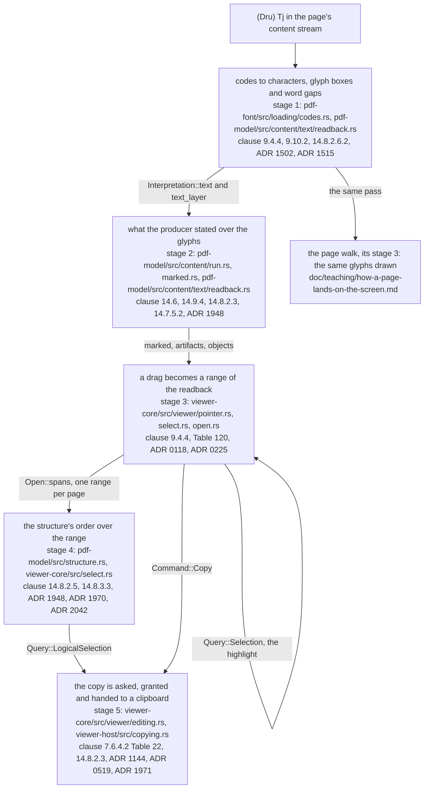
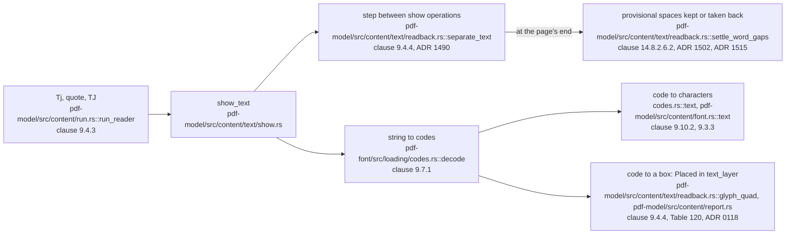
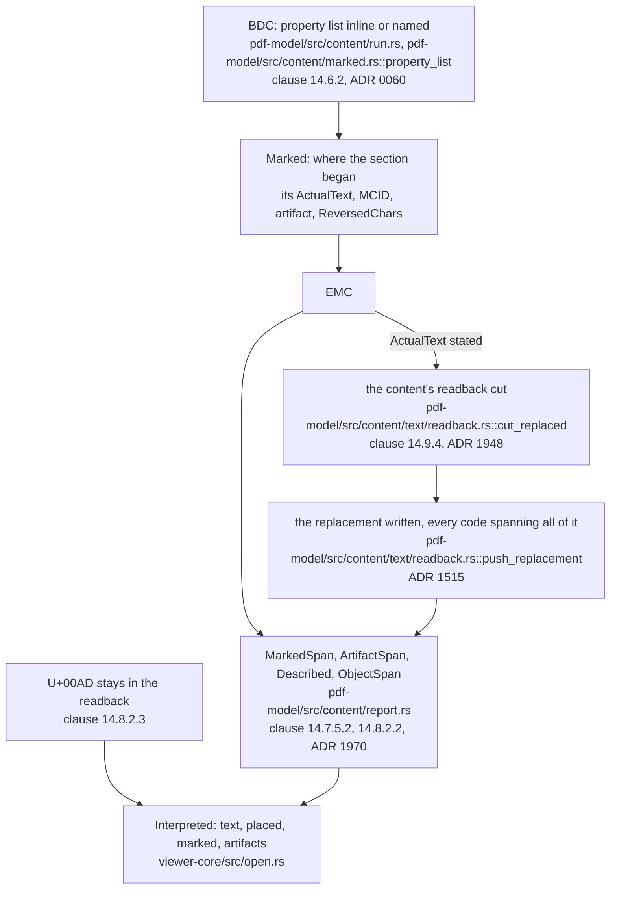
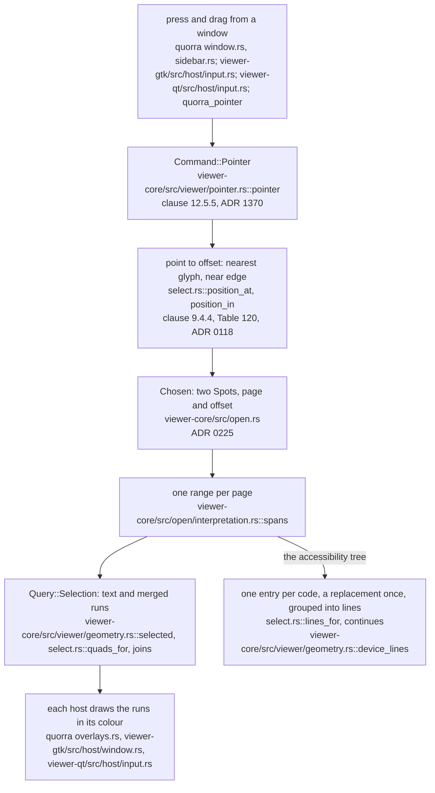
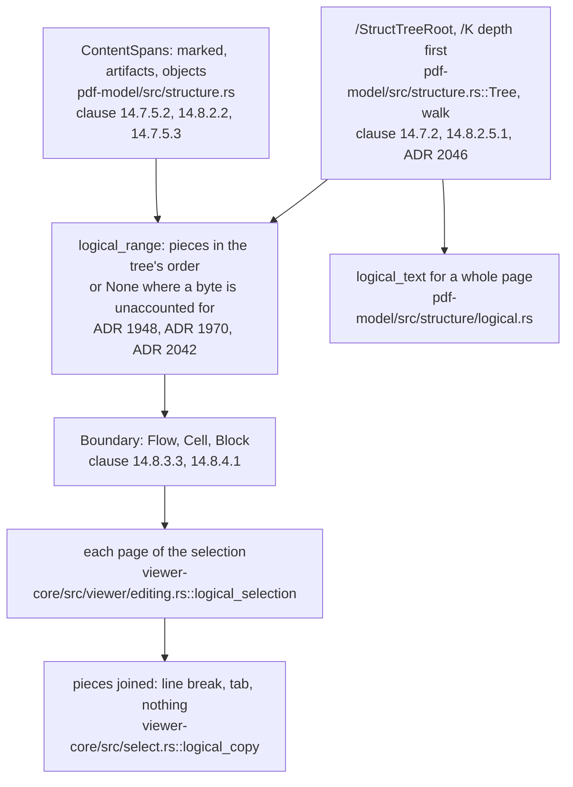
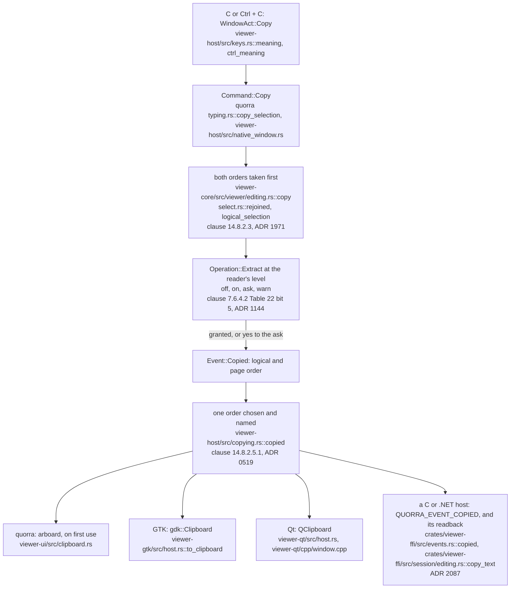

# How text is selected and copied

Status: **standing** — a walk, not a reference. Read by: a student, or a new contributor, who has
followed [how a page lands on the screen](how-a-page-lands-on-the-screen.md) and now wants to follow
what the same pass leaves behind *besides* the marks — the page's text — from the `Tj` that shows a
word, through a drag in a window and the document's structure tree, to the string another program
pastes. `doc/crate-map.md` says what each crate is responsible for; this says what happens **in
order**.

**This document is checked and it is also allowed to be wrong, and those two facts are the reason
for its last section.** `tools/conformance/tests/teaching.rs` holds every path and every
`file::name` pair it writes to a file that exists and a name the file contains, and every ADR it
cites to a record. It cannot hold a *sentence* true: when a round moves a stage, the sentence about
the stage is the round's to redraw. Each diagram below ends with a **Maintenance note** that says
which files and records it depends on, so the round that changes one knows which diagram it has
made stale. The rules for that are in [Keeping this document true](#keeping-this-document-true).

## The running example

ISO 32000-2 §14.9.4 ends with an EXAMPLE that "shows the use of replacement text to indicate the
correct character content in a case where hyphenation changes the spelling of a word": the German
word *Drucker* (printer), which before the spelling reform was divided at a line's end as *Druk-*
and *ker*. The walk follows that word. Around the clause's own line,
`(Dru) Tj /Span <</ActualText (c)>> BDC (k-) Tj EMC (ker) '`, is the least a tagged page needs for
the word to have a place in a structure: a paragraph that goes on to a second word divided by a soft
hyphen, a heading the stream draws *after* the paragraph, a page number tagged as an artifact, and a
structure tree that puts the heading first.

```text
1 0 obj  << /Type /Catalog /Pages 2 0 R /StructTreeRoot 10 0 R /MarkInfo << /Marked true >> >>
3 0 obj  << /Type /Page /Parent 2 0 R /MediaBox [0 0 300 300] /StructParents 0
            /Resources << /Font << /F1 5 0 R >> >> /Contents 4 0 R >>
4 0 obj  << /Length … >>
stream
/P <</MCID 0>> BDC BT /F1 12 Tf 14 TL 20 240 Td
  (Der Dru) Tj /Span <</ActualText (c)>> BDC (k-) Tj EMC
  (ker) ' [-250 (druckt eine Seiten\255)] TJ
  (zahl.) ' ET EMC
/H1 <</MCID 1>> BDC BT /F1 16 Tf 20 270 Td (Drucken) Tj ET EMC
/Artifact BMC BT /F1 10 Tf 140 20 Td (1) Tj ET EMC
endstream
5 0 obj  << /Type /Font /Subtype /Type1 /BaseFont /Helvetica
            /Encoding << /Differences [173 /softhyphen] >> >>
10 0 obj << /Type /StructTreeRoot /K [11 0 R] /ParentTree 12 0 R >>
11 0 obj << /Type /StructElem /S /Document /P 10 0 R /K [13 0 R 14 0 R] >>
12 0 obj << /Nums [0 [14 0 R 13 0 R]] >>
13 0 obj << /Type /StructElem /S /H1 /P 11 0 R /Pg 3 0 R /K 1 >>
14 0 obj << /Type /StructElem /S /P /P 11 0 R /Pg 3 0 R /K 0 >>
```

Read aloud: *the paragraph is marked-content sequence 0 and says "Der Druk-", then on the next line
"ker", a gap of a quarter em, "druckt eine Seiten" and code 173, then on a third line "zahl."; the
`k-` is a `Span` whose replacement text is "c"; above it, drawn later, sequence 1 is the heading
"Drucken" (printing); the folio "1" is an artifact; and the structure says the document is the
heading and then the paragraph.* Code 173 is named `/softhyphen` by the encoding, which is how a
producer writes the soft hyphen §14.8.2.3 describes.

A person drags from the left half of the second word's `D` to the right half of the `r` that ends
the next line's `ker`, and presses Ctrl + C; then selects the whole page and copies again. Every
string below was read off the tree, not reasoned out: the page's readback with
`crates/pdf-model/examples/readback.rs`, and the drag and both copies through the C ABI's
`quorra_pointer`, `quorra_select` and `quorra_copy` (`crates/viewer-ffi/include/quorra.h`), on the
objects above written out as a file.

Three sentences of the standard frame the walk. §14.8.2.5.1 gives one page two orders:

> Page content order shall be defined by the sequencing of graphics objects within a page's content stream.

> Logical content order -the ordering for semantic purposes -shall be defined by a depth-first traversal of the document's logical structure hierarch y.

(the doubled spaces and the split *hierarch y* are the conversion's, and `doc/md/` is quoted as it
stands). §14.9.4 says what a producer's replacement is:

> The ActualText value shall be used as a replacement, not a description, for the content,
> providing text that is equivalent to what a person would see when viewing the content.

And the third is a silence: **selection is not in ISO 32000-2.** The standard says where a glyph is
drawn and which character it stands for; what a drag across a page means is a question about a user
interface, so every step of stage 3 is a choice, and `crates/viewer-core/src/select.rs` writes each
one down.

## The whole walk

Five stages. The first two are *reading* — the same pass that draws the page writes its text, and
then what the producer stated over the glyphs corrects it. The third is *the gesture* — a drag
becomes a range of that text. The fourth is *meaning* — the structure tree reorders the range. The
fifth is *leaving* — a copy asked as an operation, and four clipboards.



**Maintenance note.** Depends on: `crates/pdf-font/src/loading/codes.rs`,
`crates/pdf-model/src/content/text/`, `crates/pdf-model/src/content/run.rs`,
`crates/pdf-model/src/content/marked.rs`, `crates/pdf-model/src/content/report.rs`,
`crates/viewer-core/src/viewer/pointer.rs`, `crates/viewer-core/src/select.rs`,
`crates/viewer-core/src/open.rs`, `crates/pdf-model/src/structure.rs`,
`crates/viewer-core/src/viewer/editing.rs`, `crates/viewer-host/src/copying.rs` and
`doc/crate-map.md`. Redraw it when the text stops being written by the pass that draws the page,
when the selection stops being a range of that text, or when a copy stops being a command. The rule
it draws — the text a person copies is the text the page was *drawn* from, reordered only by what
the structure states — is the one to keep true above all.

## Stage 1 — from `Tj` to the readback (`pdf-font`, `pdf-model`)

**Question answered:** what does a show operator leave behind besides the marks, and where do the
spaces and line breaks in it come from?

`crates/pdf-model/src/content/run.rs::run_reader` dispatches `Tj`, `'`, `"` and `TJ` to
`crates/pdf-model/src/content/text/show.rs::show_text`, and the strings of a `TJ` array one by one, each
number between them moving the text matrix by §9.4.3's adjustment. `show_text` does two things with
one string, and the module's own first paragraph is why: *one pass places the glyphs and extracts
the page's text from the same code-to-glyph decisions*, so what the readback says is evidence about
what was drawn. The drawing half is the page walk's stage 3; this is the other half.

1. **The string becomes codes.** `crates/pdf-font/src/loading/codes.rs::decode` splits it — one byte
   per code for a simple font like `/F1`, whatever the `CMap`'s codespace says for a composite one.
2. **Each code becomes characters.** `crates/pdf-font/src/loading/codes.rs::text` takes §9.10.2's
   methods in the clause's order:

   > A PDF processor can use these methods, in the priority given, to map a character code to a
   > Unicode value.

   — the font's `/ToUnicode` first, a predefined collection's CID next, then the glyph name the
   encoding selects through the Adobe Glyph List, and last `text_from_program`, the choice the
   clause permits where its methods fail. `/F1` has no `/ToUnicode`, so every code here is named by
   its glyph: `D`, `e`, `r`, and code 173's `/softhyphen`, which is U+00AD. Code 32 is
   `crates/pdf-model/src/content/font.rs::text`'s last word: §9.3.3 identifies the single-byte code
   with "the ASCII SPACE character", so the space inside `(Der Dru)` is a character the file
   states.
3. **Each code gets a box.** `glyph_quad` maps the glyph's advance and Table 120's `/Ascent` and
   `/Descent` through §9.4.4's text rendering matrix and the page's transform, and the code's range
   of the readback and that quadrilateral become one `Placed` in `Interpretation::text_layer`
   (`crates/pdf-model/src/content/report.rs::Placed`, ADR 0118). Text in rendering modes 3 and 7 is
   included — the OCR layer under a scanned page is invisible and is what a person most wants to
   select — and text on an optional-content layer that is off is not.
4. **The gaps between show operations become spaces and line breaks.** A content stream has
   positions, not words, so `crates/pdf-model/src/content/text/readback.rs::separate_text` reads the step
   from where the last glyph left the pen to where this string starts, once per show operation:
   inside one string nothing but code 32 can state a word gap. The step is measured in text space
   (ADR 1490), because §9.4.4 says so of the displacement it is compared with:

   > Both the glyph's shape and its displacement (horizontal or vertical) shall be interpreted in text space.

   A step across the line by more than half the font size is a line break, and one along it wider
   than a quarter of the font's space leaves a **provisional** space. The `-250` before
   `(druckt eine Seiten\255)` moves the pen 3 units at 12 points; Helvetica's space is 0.278 em,
   3.336 units, so the step is 0.9 of a space and the readback gets " ".
5. **Which provisional spaces stay is decided when the page is finished.**
   `crates/pdf-model/src/content/text/readback.rs::settle_word_gaps` reads each font's own threshold off
   every step it showed on the page (`own_threshold`, once a font shows `STEPS_TO_DECIDE` steps;
   half a space, `WORD_GAP_SHARE`, below that), takes back the spaces under it and moves every range
   over the text to match (ADRs 1502 and 1515 have the measurements). It is a heuristic and the
   standard names it as one — §14.8.2.6.2 requires a *tagged* producer to state its breaks:

   > For this purpose any white-space characters that would be present to separate words in a pure text representation shall be present in the tagged PDF representation of the text.

   so a conforming tagged page needs none of this, and `Interpretation::inferred_separators` counts
   how many a page used anyway.



**Maintenance note.** Depends on: `crates/pdf-model/src/content/run.rs`,
`crates/pdf-model/src/content/text/`, `crates/pdf-model/src/content/font.rs`,
`crates/pdf-model/src/content/report.rs`, `crates/pdf-font/src/loading/codes.rs`, ADR 0118,
ADR 1490, ADR 1502 and ADR 1515. Redraw it when the readback stops being written by the drawing
pass, when §9.10.2's methods change order, when the word gap stops being decided per font at the
page's end, or when the text layer stops carrying one entry per code.

## Stage 2 — what the producer stated over the glyphs (`pdf-model`)

**Question answered:** how do `/ActualText`, a soft hyphen and a marked-content identifier change
or annotate what stage 1 read back?

A `BDC` is read by `run_reader`'s `Operator::BeginMarkedProperties` arm. Its property list may be
written inline or named in the `/Properties` resources (§14.6.2), and
`crates/pdf-model/src/content/marked.rs::property_list` reads both (ADR 0060). From the one list the
arm takes §14.9's `/ActualText`, `/Alt`, `/E` and `/Lang`, an `/MCID`, whether the tag is
`/Artifact` or `/ReversedChars`, and it pushes a `Marked` that remembers where in the readback the
section began. Everything else happens at the `EMC`.

1. **A replacement cuts what the section read back and writes the stated text in its place.**
   `crates/pdf-model/src/content/text/readback.rs::cut_replaced` takes away `k-`, and
   `crates/pdf-model/src/content/text/readback.rs::push_replacement` writes `c` — and gives **each** code the
   section showed the whole replacement as its range, so both the `k` and the `-` read back as `c`
   and a drag over either finds it (ADR 1515).
2. **What the cut leaves alone is the reader's, not the content's** (ADR 1948). The separator
   inferred before the section's first glyph stays. And a replacement that takes away the hyphen its
   content ended on joins its line to the next: `k-` ended on a hyphen and `c` does not, so the line
   break stage 1 would have inferred at `(ker) '` is withheld, and the readback says `Drucker`. This
   is the clause's EXAMPLE read as it is written — the producer replaced the line-end hyphen, which
   is the statement that the word goes on.
3. **Two replacements in a row have no break between them** — "they shall be treated as if no word
   break is present between them", §14.9.4 again — so `run_reader` takes back the whitespace between
   one replaced section's end and the next one's text.
4. **The soft hyphen is a character and stays one here.** §14.8.2.3:

   > In tagged PDF, the visible hyphen that is introduced through the incidental division of a word at the end of a line but which would not be present otherwise, may be represented as a soft hyphen , mapped to the Unicode value U+00AD

   so `Seiten` ends on U+00AD and the line break after it is inferred as any other. What a reader
   does with the division is a copy's question and a search's, and stage 5 answers the first (ADR
   1971; ADR 1100 the second).
5. **The ranges the structure will need are recorded after the replacements**, so that they name
   the text as it now stands: a `MarkedSpan` for each sequence with an `/MCID` — the identifier, the
   stream, and its range of the readback (`Interpretation::marked`); an `ArtifactSpan` for each
   `/Artifact` (`Interpretation::artifacts`, nothing removed from the text: §14.8.2.2 leaves that to
   the consumer); a `Described` span for §14.9.3's and §14.9.5's substitutions, which are what a
   page is *spoken* as and change nothing a person copies. An annotation's appearance reads back
   after the page's content with no `/MCID`, and the ones the tree claims by object reference are
   `Interpretation::objects` (ADR 1970).

The example's page reads back, in page content order, as

```text
Der Drucker druckt eine Seiten\u{ad}
zahl.
Drucken
1
```

and `crates/viewer-core/src/open.rs::Interpreted` keeps the text, the text layer and those spans
beside the page's display list, because all three are only knowable while the page is being
interpreted and a drag asks about them sixty times a second.



**Maintenance note.** Depends on: `crates/pdf-model/src/content/run.rs`,
`crates/pdf-model/src/content/marked.rs`, `crates/pdf-model/src/content/text/readback.rs`,
`crates/pdf-model/src/content/report.rs`, `crates/viewer-core/src/open.rs`, ADR 0060, ADR 1515,
ADR 1948 and ADR 1970. Redraw it when a replacement stops being applied to the readback during
interpretation, when the line-end rule changes, when the soft hyphen starts being removed before a
copy asks, or when a span is recorded before the replacements rather than after them.

## Stage 3 — a drag becomes a range of the readback (hosts, `viewer-core`)

**Question answered:** which characters did the person drag over, and what shapes does the
highlight draw?

`crates/viewer-core/src/select.rs`'s module comment says what the whole stage is: selection is not
in ISO 32000-2, so everything here is a choice, built on two things that are not —
§9.4.4's placement of each glyph and Table 120's height of its line, which is what stage 1's text
layer holds.

**A host sends the pointer and nothing else.** `quorra` sends `Command::Pointer` with
`PointerAction::Pressed` from `crates/viewer-ui/src/bin/quorra/window.rs::click_page` and, while the
button is down, `PointerAction::Dragged` from
`crates/viewer-ui/src/bin/quorra/sidebar.rs::pointer_moved`. GTK's drag gesture sends it from
`crates/viewer-gtk/src/host/input.rs`, Qt's C++ half by number through
`crates/viewer-qt/src/host/input.rs::pointer`, and a C host with `quorra_pointer`. The confined
window sends a press and a release and no drag. No host computes a character.

1. **The press anchors an empty selection.** `crates/viewer-core/src/viewer/pointer.rs::pointer`
   asks where in the text the point lands *before* anything the press changes — §12.5.5's down
   appearance replaces a widget's normal one and throws the interpretation away — and on
   `Pressed` sets `Chosen::in_page` with both ends there. A drag still inside a pressed push button
   is that button's press and selects nothing (ADR 1370).
2. **A point becomes an offset.** `crates/viewer-core/src/select.rs::position_at` finds the nearest
   glyph by its box (zero inside it), and `position_in` projects the point onto that glyph's
   baseline: the left half means the position before the code's range, the right half the position
   after it. The press in the left half of `D` is offset 4, just after `Der `; the drag to the right
   half of `ker`'s `r` is offset 11. Each end is a `Spot` — a page and an offset — so a drag down a
   column of pages selects the first page's tail, the pages between whole and the last page's head
   (ADR 0225 is a click as an offset and a drag as two).
3. **Two spots become one range per page.** `crates/viewer-core/src/open/interpretation.rs::spans` orders the ends
   and answers each page's part, which is the one place the text, the highlight, the logical order
   and §12.5.6.10's markup read a selection from, so the four cannot disagree. Here it is one range,
   4 to 11 of page 1.
4. **The range becomes text and shapes.** `crates/viewer-core/src/viewer/geometry.rs::selected`
   answers `Query::Selection` with `Selected`: the text, borrowed from the page's readback where it
   is one page's — here `Drucker` — and the shapes from
   `crates/viewer-core/src/select.rs::quads_for`, merged by `joins` into one quadrilateral per run
   of a line: two glyphs join where both baseline corners agree and the second begins no further
   along than the first ends plus a line's height. The word is two runs, `Dru` with the `k` and the
   `-` that read back as `c`, and `ker` on the next line.
5. **Each host draws the shapes in its own colour**, in device pixels the core already computed —
   `crates/viewer-ui/src/bin/quorra/overlays.rs::selection_list` as a display list over the page,
   `crates/viewer-gtk/src/host/window.rs` and `crates/viewer-qt/src/host/input.rs::selection` for
   the toolkits. Interactive chrome crosses as geometry, not pixels, so a drag never redraws the
   page.

**A caret wants the opposite of a highlight**, and `crates/viewer-core/src/select.rs::lines_for`
is that other answer: the same range kept one entry per code and grouped into lines by
`crates/viewer-core/src/select.rs::continues`, whose tolerances are a twentieth and a half of the
glyph's own height rather than `joins`' hundredth of a unit — under `joins` a tracked display face
falls into a run per syllable, which a highlight does not show and a caret moving through seven
"lines" does. `crates/viewer-core/src/viewer/geometry.rs::device_lines` hands those lines to the
accessibility tree, for a screen reader's text interface, and speaks the `/ActualText` section once:
the `k` and the `-` are one character `c` whose box covers both glyphs, so the paragraph's first
line is `Der Druc` (ADR 2086).



**Maintenance note.** Depends on: `crates/viewer-core/src/viewer/pointer.rs`,
`crates/viewer-core/src/select.rs`, `crates/viewer-core/src/open.rs`,
`crates/viewer-core/src/viewer/geometry.rs`, `crates/viewer-ui/src/bin/quorra/window.rs`,
`crates/viewer-ui/src/bin/quorra/sidebar.rs`, `crates/viewer-ui/src/bin/quorra/overlays.rs`,
`crates/viewer-gtk/src/host/input.rs`, `crates/viewer-gtk/src/host/window.rs`,
`crates/viewer-qt/src/host/input.rs`, `crates/viewer-ffi/include/quorra.h`, ADR 0118, ADR 0225,
ADR 1370 and ADR 2086. Redraw it when a host starts computing positions itself, when a selection stops being two
spots, when the merge or the line rule changes, or when a new host joins — the .NET host of
`doc/rfc/0010-a-windows-native-host-in-dotnet-on-the-c-abi.md` will, through `quorra_pointer`.

## Stage 4 — the structure's order over the range (`pdf-model`, `viewer-core`)

**Question answered:** in what order does the document say the selected text is read, and what
lies between its pieces?

The two orders of the opening are both real on this page: the stream draws the paragraph, then the
heading, then the folio; the tree says the heading, then the paragraph. A highlight wants the first —
it is the order the shapes are in — and a person pasting the page wants the second.

1. **The tree is found and walked.** `crates/pdf-model/src/structure.rs::Tree` is built from the
   catalog's `/StructTreeRoot` by `Tree::of`, and `walk` goes depth first through every `/K`,
   bounded by `MAX_DEPTH` and `MAX_ELEMENTS` and marked `truncated` where a bound stopped it. A
   marked-content item is matched to the readback by its page and `/MCID` — the identifier
   `MarkedSpan` recorded in stage 2. `crates/pdf-model/src/structure/logical.rs::logical_text` is
   the same order for a whole page; the structure's module comment says which concern is in which
   file (ADR 2046).
2. **A range becomes pieces.** `crates/pdf-model/src/structure.rs::logical_range` takes the range
   and the page's three kinds of span, `ContentSpans` — sequences, declared artifacts, claimed
   annotations — and answers `LogicalPiece`s in the tree's order, each with the `Boundary` the
   structure puts before it: `Block` where a block-level element ended, which §14.8.3.3 states as

   > BLSEs shall be stacked within a reference area in block-progression order.

   `Cell` between table cells, and `Flow` inside a block, where a `Span` or an `/ActualText`
   divides no word.
3. **It answers only where every byte is accounted for.** A byte is reached by the traversal, or
   declared an artifact by the producer (§14.8.2.2's marked-content method), or it is content the
   structure says nothing about — and the third makes the answer `None`. §14.8.2.2.2 calls untagged
   content an artifact too, but that is an inference from absence that cannot tell a decoration left
   untagged from a paragraph a tree forgot, and a copy that silently lost a paragraph would be worse
   than one in page order (ADR 1948). The folio is declared, so it is accounted for and left out.
4. **Two kinds of element are read differently.** A `Private` element's content is copied and no
   type inside it is read as its type, because a copy is not the export ISO 32000-1's Table 333
   withholds it from (ADR 2042). And an annotation is placed where the tree's object reference names
   it, which is §14.8.2.5.2's rule (ADR 1970):

   > The position of an annotation in the logical content order is determined from the document's logical structure.

5. **The pieces become a string.** `crates/viewer-core/src/viewer/editing.rs::logical_selection`
   asks `logical_range` for each page of `Open::spans`, and
   `crates/viewer-core/src/select.rs::logical_copy` joins the pieces: a line break for a block's
   end, a tab for a cell's, nothing inside a block, with the readback's own whitespace at either
   side of a boundary giving way to the boundary's. No clause states what a clipboard holds, so the
   three characters are a choice, written down there. `Query::LogicalSelection` is the same answer
   asked as a question (`crates/viewer-core/src/viewer/answers.rs`).

The drag over `Drucker` lies inside sequence 0, so it is one piece and copies as `Drucker`. The
whole page is two pieces — the heading's range, which holds the line break stage 1 inferred before
`Drucken`, and the paragraph's after a `Block` — and copies as

```text
Drucken
Der Drucker druckt eine Seiten\u{ad}zahl.
```

where page content order would have given the paragraph first and the folio last. The soft
hyphen's line break is gone already, because `logical_copy` runs each piece through stage 5's
`rejoined`.



**Maintenance note.** Depends on: `crates/pdf-model/src/structure.rs`,
`crates/pdf-model/src/structure/logical.rs`, `crates/viewer-core/src/viewer/editing.rs`,
`crates/viewer-core/src/viewer/answers.rs`, `crates/viewer-core/src/select.rs`, ADR 1948,
ADR 1970, ADR 2042 and ADR 2046. Redraw it when `logical_range` moves out of the structure's root,
when it starts answering for a range it only partly reaches, when an element's boundary changes, or
when an inferred artifact starts counting as accounted for.

## Stage 5 — the copy is asked, granted and handed to a clipboard (`viewer-core`, `viewer-host`, the hosts)

**Question answered:** may the text leave the document, in which order does it leave, and whose
clipboard takes it?

**A copy is a command, not a question.** `Query::Selection` is asked sixty times a second to draw a
highlight, and refusing it would refuse the highlight; but §7.6.4.2's Table 22 restricts exactly
this, as bit 5:

> Copy or otherwise extract text and graphics from the document.

and `CLAUDE.md`'s rule is that a document's restriction is the reader's to set, at one of four
levels, asked in one place a host can supply. So the gesture is `Command::Copy` and the answer is an
event (ADR 1144).

1. **A key means copy in every window alike.** `C` and Ctrl + C are `WindowAct::Copy` in
   `crates/viewer-host/src/keys.rs::meaning` and `crates/viewer-host/src/keys.rs::ctrl_meaning`;
   each window's `copy_selection` sends `Command::Copy` where something is selected
   (`crates/viewer-ui/src/bin/quorra/typing.rs::copy_selection`, and
   `crates/viewer-host/src/native_window.rs`'s for the toolkits).
2. **The text is taken before the policy is asked.**
   `crates/viewer-core/src/viewer/editing.rs::copy` takes the selection in both orders at once — page
   order through `crates/viewer-core/src/select.rs::rejoined`, logical order through stage 4 —
   because under the `ask` level the answer may come after the person has dragged elsewhere, and a
   `yes` must release what they were asked about. Then the standing of `Operation::Extract` decides:
   refused (`Event::Refused`), granted (`Event::Copied`), granted with a warning, or held as
   `Held::Copy` until `Command::Answer`.
3. **The soft hyphen's division is undone, and the character kept.** `rejoined` takes out the
   whitespace after each U+00AD and leaves the U+00AD, because the break was the line's and the
   character is what §9.10.2's mapping produced: the Unicode Standard makes it a format character
   and a line-break opportunity, shown only where a line does break there (ADR 1971). So the paste
   reads `Seitenzahl`, and a program that reflows it may divide it again where the producer marked.
4. **One function chooses the order, for every host.**
   `crates/viewer-host/src/copying.rs::copied` turns `Event::Copied`'s two strings into one: nothing
   where nothing is selected, so a person's clipboard is never emptied; the logical order where the
   core could give one; page content order otherwise, said out loud as `ContentOrder::PageContent`
   rather than passed off as the other (ADR 0519). The drag's copy and the page's are both
   `ContentOrder::Logical`; the same page without its `/StructTreeRoot` copies as
   `Der Drucker druckt eine Seiten\u{ad}zahl.`, a line break, `Drucken`, a line break and `1`.
5. **Each host owns only the platform call.** `quorra` has no toolkit to ask, so
   `crates/viewer-ui/src/clipboard.rs::Clipboard` names `arboard`, connected on the first copy and
   never at launch (`CLAUDE.md` principle 2), and keeps the string beside it for a paste into a
   field. GTK sets the widget's `gdk::Clipboard` (`crates/viewer-gtk/src/host.rs::to_clipboard`); Qt
   raises a flag that the C++ half answers with `QGuiApplication::clipboard()`
   (`crates/viewer-qt/src/host.rs::to_clipboard`, `crates/viewer-qt/cpp/window.cpp`). A C host
   reads `QUORRA_EVENT_COPIED` with `quorra_event_copied`
   (`crates/viewer-ffi/src/events.rs::copied`, which calls `copied`), and its own program owns the
   clipboard — the .NET interop declares it in `hosts/windows/Quorra.Interop/Native.Commands.cs`.
   `quorra_selection_copy_text` (`crates/viewer-ffi/src/session/editing.rs::copy_text`) reads the same
   string back in C's two-call idiom: the session keeps what the last granted `Command::Copy`
   released and answers nothing before one, after a refusal or while a question is unanswered
   (ADR 2087). The confined window has no copy gesture.



**Maintenance note.** Depends on: `crates/viewer-host/src/keys.rs`,
`crates/viewer-host/src/native_window.rs`, `crates/viewer-host/src/copying.rs`,
`crates/viewer-core/src/viewer/editing.rs`, `crates/viewer-core/src/select.rs`,
`crates/viewer-core/src/event.rs`, `crates/viewer-core/src/command.rs`,
`crates/viewer-ui/src/bin/quorra/typing.rs`, `crates/viewer-ui/src/clipboard.rs`,
`crates/viewer-gtk/src/host.rs`, `crates/viewer-qt/src/host.rs`, `crates/viewer-qt/cpp/window.cpp`,
`crates/viewer-ffi/src/events.rs`, `crates/viewer-ffi/src/session/editing.rs`, ADR 0519, ADR 1144,
ADR 1971 and ADR 2087. Redraw it when the copy stops being a command, when the order is chosen anywhere but
`copying.rs`, when a host gains or loses a clipboard — the confined window, or the .NET host of RFC
0010 — or when the soft hyphen's division stops being undone at the copy.

## What the walk leaves out

The walk follows one word across one page. It does not follow: a search, which reads the same
readback with its own rules for case, presentation forms, marks and right-to-left words
(`crates/viewer-core/src/select.rs::find`, `Command::Find`; ADR 1100, ADR 1465, ADR 1477); a page
whose producer stored its characters reversed (`/ReversedChars`, §14.8.2.5.3) or writes vertically
(§9.7.4.3); a selection across pages, whose parts `selected` joins with a line break; §12.5.6.10's
markup over a selection (`Edit::Markup`), which reads the same `Open::spans`; the accessibility
tree's names and speech, where §14.9.3's `/Alt` and §14.9.5's `/E` do apply
(`crates/viewer-core/src/accessibility.rs`); and the text inside a form field a person is typing
into, whose caret and selection are the field's (`Query::Offset`, ADR 0225, and
[how a form field is filled](how-a-form-field-is-filled.md)). Each has a row in `doc/crate-map.md`,
which is the next document to open.

## Keeping this document true

Written for the round that changes the code, not for the one that reads this.

1. **The test is the floor.** `tools/conformance/tests/teaching.rs` reads this file and holds every
   `crates/…`, `raster/…`, `doc/…` and `tools/…` path to a file or directory that exists, every
   `path::name` pair to a file that contains `name`, every `ADR NNNN` to a record in `doc/adr/`,
   every diagram to its **Maintenance note**, and `doc/HANDOVER.md` and `doc/crate-map.md` to a
   pointer to this file. Run it with `cargo test -p conformance --test teaching`.
2. **The test cannot read a sentence.** A round that moves a function between modules, splits a
   file, changes where a word gap is decided or which order a copy takes reads the Maintenance notes
   above for the files it touched, redraws the diagram and rewrites the sentence beside it **in the
   present tense, as what is** (ADR 1023), not as what changed.
3. **The running example's strings were read off the tree.** A round that changes stage 1, 2 or 4
   writes the objects of [The running example](#the-running-example) out as a file, runs
   `crates/pdf-model/examples/readback.rs` and a select-all and copy over it, and corrects every
   string above that moved — a string reasoned out rather than read off is the kind of sentence this
   section exists to catch.
4. **A new stage or a new host shape is a new section** with a diagram and a Maintenance note, in
   the order the walk takes it.
5. **A claim that stops being true is deleted or corrected, not annotated.** The record of why is
   `doc/adr/` and `doc/history/`.
6. **A bug found while drawing a diagram is reported, not fixed in the same change**: the diagram
   says what the code does, and a bug is a gap between that and what the standard says.
